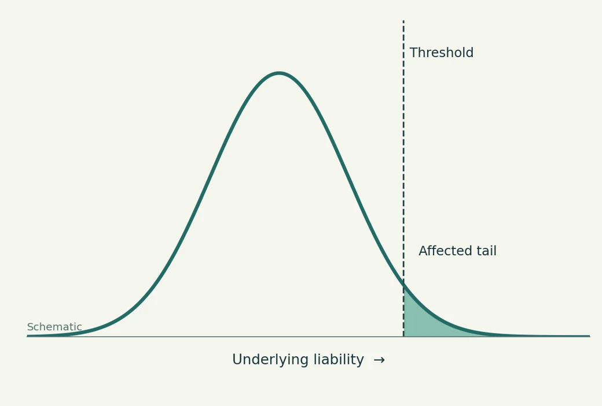
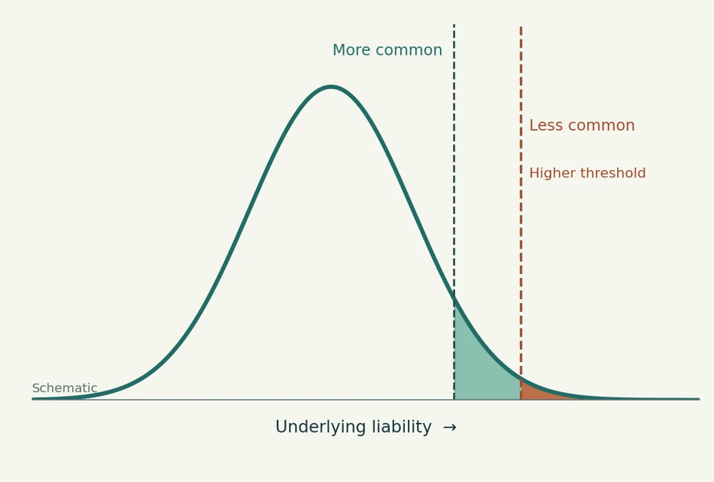

# Multifactorial Inheritance and Genetic Disease

- **Reading** — Ingrid Lobo (2008), *Nature Education* 1(1), 5. [Read the Scitable article](https://www.nature.com/scitable/topicpage/multifactorial-inheritance-and-genetic-disease-919/).
- **Contents** — [Trait variation](#trait-variation) · [Liability threshold](#liability-threshold) · [Family patterns](#family-patterns-and-recurrence) · [Clinical examples](#clinical-examples) · [GWAS](#how-gwas-studies-genetic-susceptibility) · [Self-check](#self-check)
- The figures open at full size when clicked.

## Trait variation

- **Mendel studied discrete phenotypes.** A pea was scored as round or wrinkled. ABO blood groups are another example of discrete categories.
- **Galton studied continuous phenotypes.** Height varies across a range. When plotted in a population, many observations cluster near the middle, with fewer at the extremes.
  - Galton described the appearance of intermediate traits as blending. Individual alleles still segregate, while their combined effects can produce a smooth distribution.
  - **Quantitative trait** = a trait measured numerically, such as height or LDL cholesterol. A bell curve is a common illustration. The actual distribution depends on the trait and population.
- **Polygenic** describes contributions from multiple genes. **Multifactorial** describes contributions from genetic and environmental factors. A trait can be both.
- **Clinical distinction** — A phenotype recorded as yes/no can have multifactorial causes. The form of the measurement and the mode of inheritance are separate questions.
- 
  - **Read the figure** — Height increases horizontally. The curve represents how often each height occurs in this schematic.

## Liability threshold

- **Liability** is an underlying tendency to develop a trait. It can reflect many inherited effects, environmental exposures, and interactions among them.
- **Threshold** is the point at which the model assigns the affected phenotype. The underlying liability varies continuously, while the diagnosis can fall into two categories.
  - People below the threshold can still carry susceptibility alleles and pass some on.
  - People with similar diagnoses may have reached the threshold through different combinations of factors.
  - The model can link greater liability with more severe expression in some conditions. The relationship between severity and recurrence needs evidence specific to that phenotype.
- 
  - **Read the figure** — Follow the x-axis from low to high liability. The shaded area beyond the line represents the modeled proportion affected. The figure is schematic and has no clinical scale.

## Family patterns and recurrence

- **Affected child, unaffected parents** — Each parent can contribute susceptibility despite being below the threshold. A pedigree with this pattern alone does not establish autosomal recessive inheritance.
- **Familial aggregation** — Relatives can share inherited susceptibility and environmental exposures. Recognize clustering without assuming a 25% or 50% transmission probability.
  - Recurrence can be higher when the relative is closer or when more family members are affected. How much it changes depends on the condition and the data.
  - **Empirical recurrence risk** comes from observing outcomes in comparable families. Keep the relationship, phenotype, study population, and outcome denominator in view.
- 
  - **Read the figure** — Compare the areas past the same vertical threshold. The shifted curve illustrates why the affected fraction can be larger among relatives.
- **Sex difference in prevalence** — A condition can occur in both sexes at different frequencies.
  - **Carter effect** — In the classic model, the less frequently affected sex has the higher threshold. When a proband from that group is affected, their first-degree relatives can have higher empirical risk. This pattern depends on the condition.
- 
  - **Read the figure** — The higher cutoff leaves a smaller affected tail. Neither cutoff is a measured clinical threshold.
- **Twin concordance** measures how often both twins express the same phenotype. Compare concordance rates calculated using the same definition.
  - Higher concordance in monozygotic than dizygotic twins can support a genetic contribution. Discordance in monozygotic twins shows that a shared inherited genome does not guarantee the same outcome.
- **Population differences** can reflect genetic background, exposures, access to care, and how researchers detect or count cases. Population labels alone cannot establish the reason for a difference.

## Clinical examples

### Cleft lip with or without cleft palate

- **Development** — The visible defect results when tissues fail to fuse during facial development. The anatomical extent can vary.
- **Threshold interpretation** — Two unaffected parents can have an affected child. Family clustering supports inherited susceptibility, and the article discusses associations with maternal smoking and nutritional factors.
- **Counseling application** — Confirm whether the family history describes cleft lip with or without cleft palate, cleft palate alone, or a syndromic presentation. Those distinctions can affect the recurrence estimate.

### Coronary artery disease

- **Inherited and non-inherited factors** — Family history can contribute alongside LDL cholesterol, blood pressure, type 2 diabetes, obesity, smoking, and diet.
- **What the example shows** — The disease can cluster in families or appear in someone without a known family history. Risk can vary across sex, age, and study populations.
- **Reading the evidence** — The article mentions periodontal disease as a reported association. An association by itself cannot show which factors caused an individual’s disease.

## How GWAS studies genetic susceptibility

- **GWAS** = genome-wide association study. It tests markers across the genome for statistical association with a phenotype.
- **Allele frequency** asks how common an allele is among copies of a locus in a population. **Penetrance** asks what proportion of people with a given genotype show the phenotype. **Effect size** describes the strength of a variant’s association with an outcome.
- **Typical GWAS findings** — Common alleles often have individually modest effects. A significant marker can tag a nearby causal variant through linkage disequilibrium.
- **Detection limits** — A rare allele with a small or moderate effect is hard to detect because few participants carry it and the signal can be weak. Larger samples and sequencing-based designs can help study some rare variants.
- **Other contributions** — Copy-number variants change DNA dosage. Modifier variants influence expression of a phenotype. Epistasis means the effect of one locus depends on genetic variation at another.
- 
  - **Read Figure 1** — The x-axis runs from rare to common alleles. The y-axis runs from lower to higher penetrance. Find the region where GWAS commonly identifies signals, then compare it with the rare, high-penetrance region.
  - **Figure credit** — McCarthy et al. (2008), reproduced in Lobo’s article. [View the figure on Scitable](https://www.nature.com/scitable/content/allele-frequency-penetrance-and-disease-21642/).

## Self-check

- **How can liability be continuous when the diagnosis is binary?** A threshold divides the liability distribution into affected and unaffected groups.
- **What does an affected child with unaffected parents tell you?** The pattern fits multiple etiologies. In multifactorial inheritance, both parents can contribute susceptibility without having the condition.
- **Why can a common risk allele explain little about an individual outcome?** Frequency describes how common the allele is. Its effect size may still be small, and the overall phenotype depends on other contributors.
