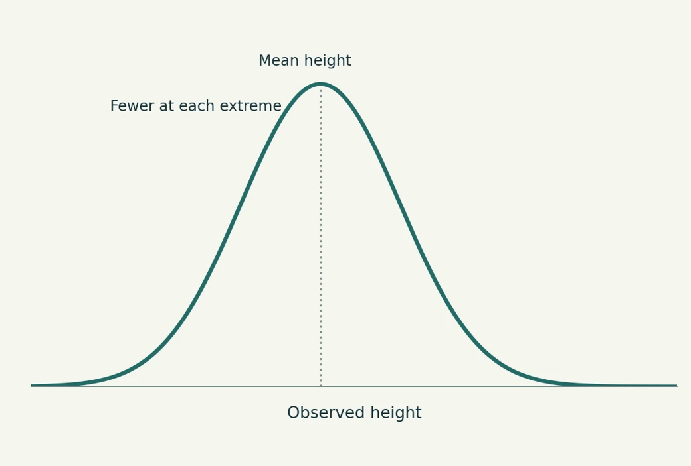
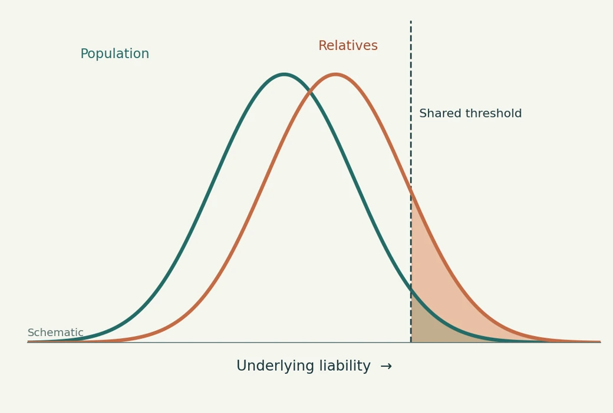
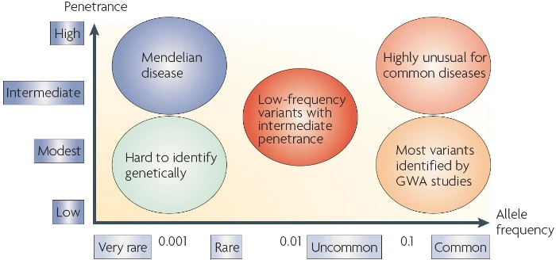

# Multifactorial Inheritance and Genetic Disease

- **Reading** — Ingrid Lobo (2008), *Nature Education* 1(1), 5. [Read the Scitable article](https://www.nature.com/scitable/topicpage/multifactorial-inheritance-and-genetic-disease-919/).
- **Contents** — [Trait variation](#trait-variation) · [Liability threshold](#liability-threshold) · [Family patterns](#family-patterns-and-recurrence) · [Clinical examples](#clinical-examples) · [GWAS](#how-gwas-studies-genetic-susceptibility) · [Self-check](#self-check)
- The figures open at full size when clicked.

## Trait variation

* **Mendel** - **discrete phenotypes**
    - A pea round or wrinkled
    - ABO blood groups
* **Galton** - **continuous phenotypes**
  - Height
  - **intermediate traits:** blending(eg.red+white -> pink flower)
  - described as **Quantitative trait** (such as height or LDL cholesterol)
    - A bell curve is a common illustration
    - 
    - 
* **Polygenic:** contributions from multiple genes
* **Multifactorial:** genetic + environmental factors
* **Clinical distinction** — A phenotype recorded as yes/no can have multifactorial causes

* 

## Characteristics of multifactorial disease
- **Affected child, unaffected parents**
- Environmental influences can increase/decrease the risk of the disease.
- more frequently in one gender, but is not a sex-limited trait
- first-degree relatives of individuals with **more rarely** affected gender have a **higher risk** (**Carter effect** - the **less frequently** affected sex has the **higher threshold**)
- **Twin concordance** measures how often both twins express the same phenotype. Compare concordance rates calculated using the same definition.
  - The concordance rates in monozygotic and dizygotic twins different from Mendelian proportions(not 100%/50%...)
- occurs more frequently in a specific ethnic group
- 
- 

## Liability threshold
* a disease develops and is expressed only after a certain critical liability threshold is reached
* The further surpassing liability threshold, more severe the disease phenotype is
* an individual will never develop the disease if not reach the liability threshold
  - People below the threshold can still carry susceptibility alleles and pass some on.
  - People with similar diagnoses may have reached the threshold through different combinations of factors.
- 

## Clinical examples
### Cleft lip with or without cleft palate

- **Development** — tissues fail to fuse during facial development
- **Threshold interpretation** — Two unaffected parents can have an affected child
- **Genetic factor**
  - parents may have inherited susceptibility
- **Non-genetic factor**
  - maternal smoking and nutritional factors.
- **Counseling application** — Confirm whether the family history describes cleft lip with or without cleft palate, cleft palate alone, or a syndromic presentation. Those distinctions can affect the recurrence estimate.

### Coronary artery disease

- **Inherited and non-inherited factors** — Family history + LDL cholesterol, blood pressure, type 2 diabetes, obesity, smoking, and diet.
- **What the example shows** — can occur without a known family history. Risk can vary across sex, age, and study populations.
- **Reading the evidence** — The article mentions periodontal disease as a reported association. An association by itself cannot show which factors caused an individual’s disease.

## How GWAS studies genetic susceptibility

- **GWAS** = genome-wide association study. It tests markers across the genome for statistical association with a phenotype.
- **Allele frequency** asks how common an allele is among copies of a locus in a population. **Penetrance** asks what proportion of people with a given genotype show the phenotype. **Effect size** describes the strength of a variant’s association with an outcome.
- **Typical GWAS findings** — Common alleles often have individually modest effects. A significant marker can tag a nearby causal variant through linkage disequilibrium.
- **Detection limits** — A rare allele with a small or moderate effect is hard to detect because few participants carry it and the signal can be weak. Larger samples and sequencing-based designs can help study some rare variants.
- **Other contributions** — Copy-number variants change DNA dosage. Modifier variants influence expression of a phenotype. Epistasis means the effect of one locus depends on genetic variation at another.
- 
  - **Read Figure 1** — The x-axis runs from rare to common alleles. The y-axis runs from lower to higher penetrance. Find the region where GWAS commonly identifies signals, then compare it with the rare, high-penetrance region.
  - **Figure credit** — McCarthy et al. (2008), reproduced in Lobo’s article. [View the figure on Scitable](https://www.nature.com/scitable/content/allele-frequency-penetrance-and-disease-21642/).

## Self-check

- **How can liability be continuous when the diagnosis is binary?** A threshold divides the liability distribution into affected and unaffected groups.
- **What does an affected child with unaffected parents tell you?** The pattern fits multiple etiologies. In multifactorial inheritance, both parents can contribute susceptibility without having the condition.
- **Why can a common risk allele explain little about an individual outcome?** Frequency describes how common the allele is. Its effect size may still be small, and the overall phenotype depends on other contributors.
