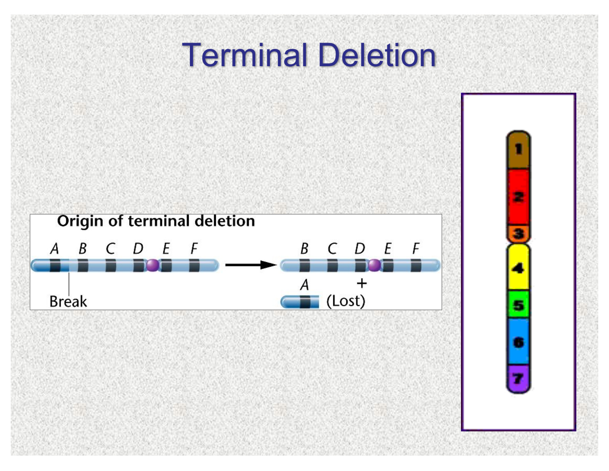
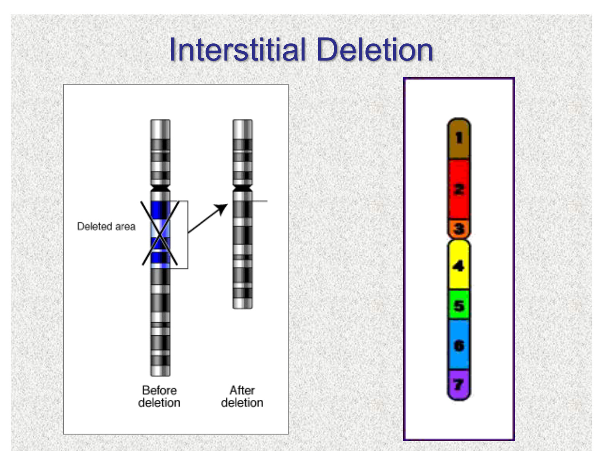
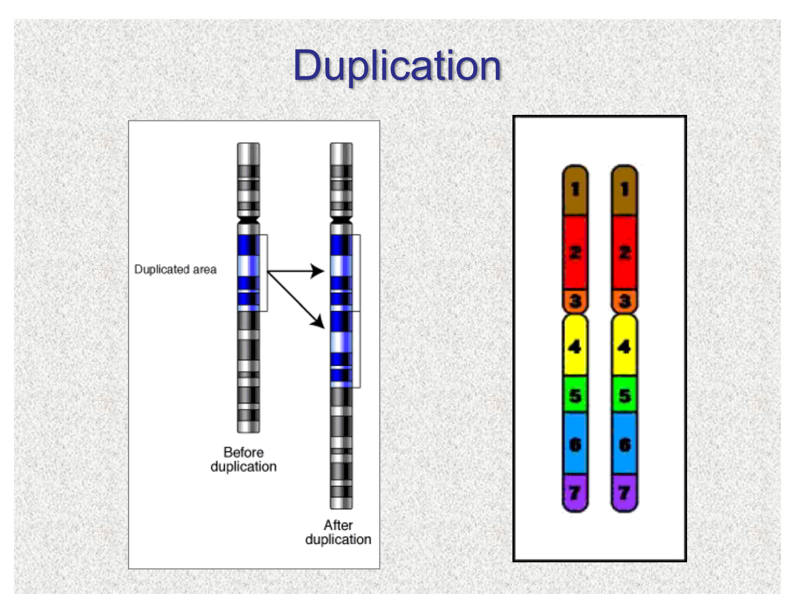
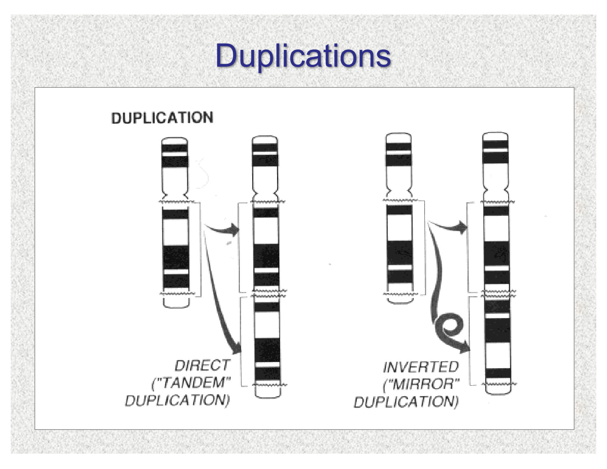
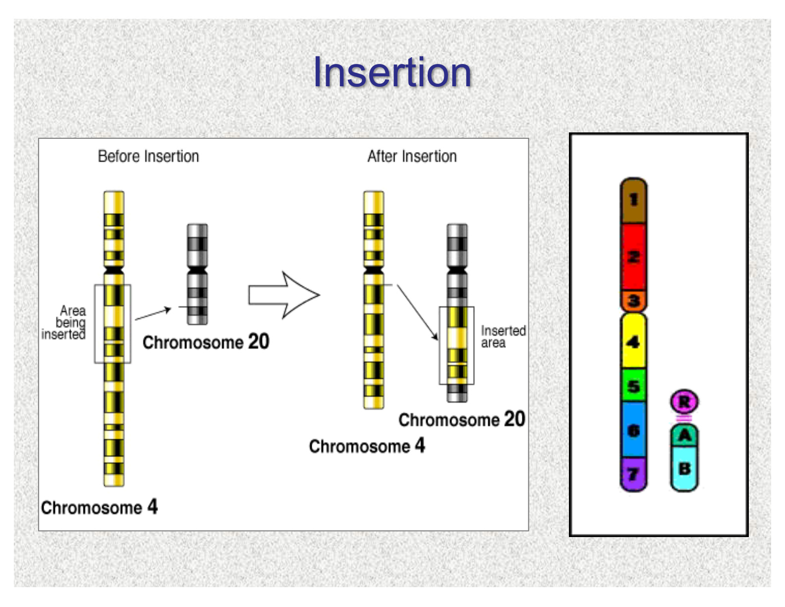
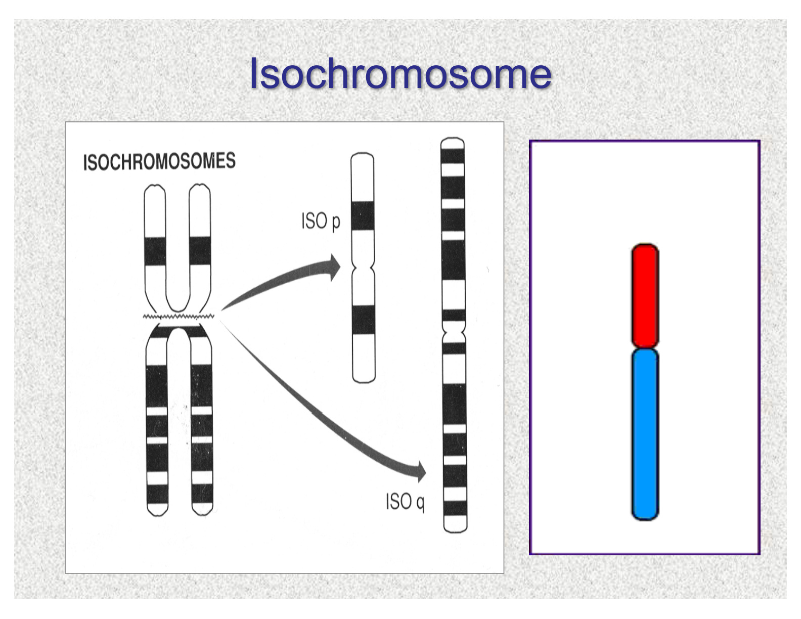
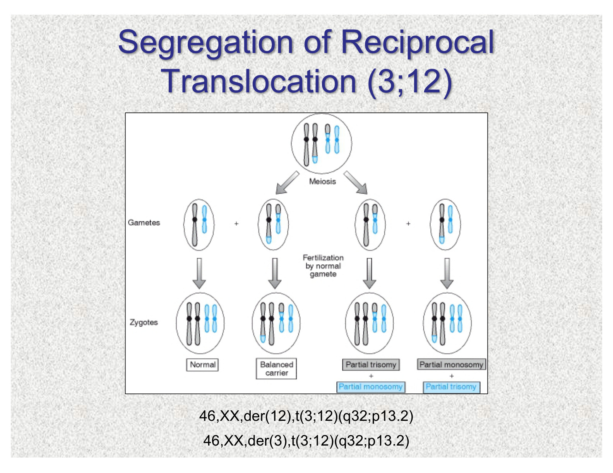

# Review 2 - Meiosis and mitosis
DNA -> chromatid(DNA wrapped around histones) -> nucleosomes -> chromosomes
## Homologous chromosomes
a pair inherited from different parents - one inherited from your mother and one from your father, have same gene in the same order but don't have same sequence

## Mitosis
* happen in somatic cells
* diploid -> diploid
* Process:
  * Interphase: period between one mitosis and the next, decide which cells can divide again
  * G1: growing phase, no DNA synthesis
  * S: synthesis phase (replication)
  * G2: each chromosome consists of two chromatids, ended by mitosis
  * M phase: Mitosis
* Components:
  * **centromere** - constriction on chromosome at which the sister chromatids are held tgt
  * **kinetochore** - protein structure on the centromere to which the spindle fibers are attached
  * **sister chromatids** - two identical strands of a replicated chromosome, joined by centromere
  * **kinetochore microtubules** - responsible for pulling the sister chromatids of each chromosome apart
  * **polar microtubules** - overlap in midline and responsible for pushing the poles of the spindle apparatus apart
  * **astral microtubules** - radiate in all direction and aid in spindle orientation before mitosis
  * **centrosome** - organelle that is the primary microtubular organizing center that splits and forms spindle apparatus
  * **centrioles** - located in the centrosomes and produces microtubules
  * **spindle apparatus** - network of filaments responsible for separating chromosomes during cell division
 
* **Prophase**
  - chromosomes condense, form light(less dense - eu, more active transcribed) and dark bands(more dense - hetero, less active transcribed)
  - **centrosome divide and migrate to opposite poles of the cell**
  - 
  
* **Prometaphase**
  - nucleus envelop breaks into membrane vesicles
  - spindle microtubules elongates
  - kinetochores mature and attach to the kinetochore microtubules
  - 

* **Metaphase**
  - nuclear membrane disappears, chromosomes becomes max condensed, easily visible in microscope
  - kinetochore microtubules align chromosomes at midway
  - polar microtubules begin to associate
  - 

* **Anaphase**
  - centromeres separate
  - sister chromatids is pulled apart by kinetochore microtubules
  - polar microtubules elongate to force the spindle poles further apart
  - anaphase ends when chromosomes arrive at spindle poles
  - 

* **Telophase**
  - spindle apparatus begin to dissociate
  - polar microtubules elongate, separate the two poles more
  - nuclear envelops begin to form surrounding aggregated chromosomes at each pole
  - chromosomes begin to decondense, nucleoli reappear
  - 

* **Cytokinesis**
  - occurs by cleavage, which began during anaphase
  - a cleavage furrow develops around the mid-section of the cell
  - furrow deepens and form bridge-like structure called mid-body
  - midbody eventually breaks down, daughter cells separate
  - 

## Meiosis
* **Meiosis I(2n->n)**: four stages: prophase, metaphase, anaphase, telophase
  - **prophase I** - **crossing over**
  - **prophase I** in oocyte can span for 40 or more years
  - end of prophase I: **chiasmata** - crossing over point between homologous chromosomes
  - **bivalent**: homologue pair held tgt by chiasmata, form in **metaphase I**
  - form recombinant chromosomes
  - 

* crossing over happens at **pseudoautosomal(PAR)** between X and Y chromosomes
  - if crossing over happens outside of PAR, **SRY** can be swapped to form: **XX males** or **XY females**
  - 
  - 

* **Meiosis II** follows Meiosis I *without* interphase and *without* DNA replication
* **Mendel's Principles**:
  - Mendel's law of segregation - gametes contain only one homologous chromosome and one gene for each trait
  - Mendel's law of independent assortment - chromosomes are inherited independently
  - 

* Consequences of meiosis:
  - reduction of chromosome number from diploid to haploid
  - allele segregation - Mendel's first law
  - independent assortment(2n possibilities) - Mendel's second law
  - crossing over

### Spermatogenesis & oogenesis

* primary **spermatocyte** divide into two secondary spermatocyte, dividing into four **spermatids**
* **oocyte** prophase starts during fetal life, remain in *suspended phase* until oocyte matures and is ovulated
  - Meiosis I is completed in ovulation
    - secondary oocyte - one daughter cells receives 23 chromosomes and most cytoplasm
    - 1st polar body - 23 chromosomes and little cytoplasm
  - Meiosis II proceeds immediately, but only complete if fertilized in fallopian tube. Form second polar body
    - **prolonged meiotic process in oocyte leads to high error risk, explains advanced maternal age increases chromosomal abnormality risk**

## Nondisjunction

# Chromosome
## karyotype

Process: 5ml blood sample -> add PHA to stick red cells together -> culture medium to have white cells suspension -> incubation -> add colchicine (spindle formation inhibitor) to block cells at metaphase -> nuclear membrane breaks down -> add hypotonic saline to lyse cells -> fix cells onto slides -> stain -> photograph

### G banding
* stained by Giesma, so **enzymatic exposure to trypsin**
* dark & light bands

### High revolution banding
* when a chromosome abnormality is highly suspected but shows a normal G-banded
karyotype

### Chromosome banding: 
* stains **heterochromatin around centromere**
* inherited SNPs on **1, 9, 16, Yq**
* **dicentric chromosomes** can be deteced
* 

### Silver staining (NOR)
* Nucleolar organizing region (which contain tandemly repeated **rRNA genes**.)
* can detect **acrocentric chromosomes** by stalking satellites
* 

## Chromosome structure:
* **Metacentric**
* **Submetacentric**
* **Acrocentric**
  - satellites
    - contain rRNA genes
    - redundant

## nonmenclature

## Ploidy

## chromosome condition
* frequency
  - 50% of all spontaneous 1st trisemester abortion(i.e. miscarriage)
  - 1% of live birth
  - 2% of pregnancies in women > 35
  - most cancer acquire structural/numerical chromosome abnormality (chromosome abnormalities cause cancer)
* indication for testing
  - problem of early growth and development
  - stillbirth and neonatal death
  - fertility issue
  - family history
  - advanced maternal pregnancy, abnormal prenatal screen
  - neoplasia(tumor)

## UPD - detected by SNParray

nondisjunction -> **Trisomy rescue**: Early in embryonic development, the cell attempts to self-correct by randomly expelling or losing one of the three chromosomes

## karyotype
* **Use**
  - family has structure rearrangement, confirm w karyotype
  - aneuploidy
  - woman with multiple miscarriages
  - prenatal diagnosis (amnios)
## FISH
* probe is designed as complementary DNA(cDNA), and in the lab strands are denatured(separated), and when the probe is added, the DNA reanneal. The targeted sequence is visualized using fluorescence
* Use for FAST diagnoses of very SPECIFIC conditions
* **Use**
  - determine fetal sex
  - aneuploidy (13, 18, 21); triploidy
  - translocation
  - detect where is SRY in XX male
  - dup, del
  - marker chromosome
  - orientation of duplication(tandem/mirror);insertion(inverted/direct)
 * **Limitation**
   - need gene region of interest
   - does not distinguish trisomy due to aneuploidy vs. chromosome rearrangement
 

## Microarray
* **postnatal - when to order**
   - multiple congenital abnormality and no known syndrome
   - DD/ID
   - ASD
### aCGH - unclear phenotype so scan the chromosome
* patient DNA vs. control
  - ratio of the fluorescence of the test to reference signals can
then be calculated for each spot of bacterial artificial chromosome (BAC) sequence or
oligonucleotides on the array
  - Equal amounts = shared colour
  - Gain, Too much = more patient colour +1
  - Loss, Too little = more control colour -1
* **Use**
  - CNVs(del, dup)
  - imbalanced translocation
  - aneuploidy
  - ID/ASD(ASD can be caused by CNVs)
* **Limitation**
  - cannot detect balanced translocation or UPD
  - cannot detect triploidy
  - VUS chance high

### SNParray

* **How to read**
  - AA-mom AB- kid BB- dad
  - Loss of middle line (AB)? - loss of heterozygosity
  - Four lines? Triploid (AAA, AAB, BBA, BBB)
* **Use**
  - UPD; consanguinity(ROH)
  - imbalanced translocation
  - del; dup
  - triploidy, aneuploidy
  - when asked what gene or size of deletion of the del syndromes
* **Limitation**
  - higher VUS chance
  - cannot detect balanced translocation

## ACMG guidelines for using CMA for CNVs
i. First line test in postnatal evaluation of those with multiple congenital
anomalies and no known syndrome; DD/ID; ASD
ii. Further determination of use for evaluation of child with growth delay, speech
delay
iii. Follow up when CNV is identified by CMA to include cytogenetic/FISH studies of patient, parental evaluations, and clinical genetic
evaluation and counseling

## Technique comparison
* Resolution:
  - G-banded karyotype: > 10 Mb (subjective)
  - High resolution karyotype: 2-3 Mb
  - CGH hybridized to metaphase chromosomes: 5-10 Mb
  - Microarray CGH: 200 Kb depending on probe
spacing and density
  - FISH is not efficient for the entire genome (need phenotype)

| Feature | Karyotype | FISH | aCGH | SNP Array |
|---|---|---|---|---|
| Deletions/duplications | Yes | Yes | Yes | Yes |
| Aneuploidy | Yes | Yes | Yes | Yes |
| Balanced translocation | Yes(first choice) | Yes | No | No |
| Imbalanced translocation | Yes | Yes | Yes | Yes |
| Triploidy | Yes | Yes | No | Yes |
| UPD | No | No | No | Yes |
| Regions of homozygosity / consanguinity | No | No | No | Yes |
| Mosaicism | Yes | Yes | Yes(if 20% cells have) | Yes(if 20% cells have) |

# Lesson 5 - Aneuploidy syndrome
* FISH is quick, followed with chromosome analysis(karyotype); Microarray can also detect
## Down syndrome — trisomy 21
* Example: `47,XX,+21`
* **Clinical Features**
  - increased NT in ultrasound
  - mild–moderate ID, hypotonia, short stature
  - flat nasal bridge, small mouth/ears
  - Heart defects
  - Hearing loss
  - Thyroid disease
  - diabetes, leukemia
  - Alzheimer risk.
* **Prevalence**
  - 1/600 newborns**.
* Confirm with chromosome analysis;(FISH can detect 3 signals, keryotype identify free trisomy vs. translocation).
* **Etiology**
  - **~95% nondisjunction**
  - 3–4% translocation
  - 1–2% mosaicism.
* **Nondisjunction Recurrence**
  - **1%** if any previous trisomy offpsrings
  - next pregnancy maternal age (2% if age >35)
* **Translocation risk**
  - 25–50% of translocation cases are inherited.
  - depend on sex of parents
    - 10-15% if mother is carrier
    - 1% if father is carrier
    - 100% if isochromosome 21/21

## Edwards syndrome — trisomy 18
* Example: `47,XY,+18`
* **Clinical Features**
  - Prenatal/postnatal growth restriction
  - single umbilical artery
  - severe ID
  - hypertonia
  - rocker bottom feet, clenched hands
  - heart, kidney, genitourinary malformation
* **Etiology**
  - usually **nondisjunction**(increase with advanced maternal age)
  - rarely translocation.
* **Survival rate**
  - ~30% die by one month
  - ~50% by two months
  - ~10% survive one year
  - most die early in embryonic or fetal life
* **Recurrence risk**
  - **1%** if any previous trisomy offsprings

## Patau syndrome — trisomy 13
* Example: `47,XX,+13`; nondisjunction, translocation, or mosaicism.
* **Clinical Features**
  - **Holoprosencephaly**, cleft lip/palate
  - microcephaly
  - hypotonia
  - **polydactyly** = extra digits
  - Growth restriction, single umbilical artery
  - heart/renal anomalies - **horseshoe kidney**
  - severe ID.
* **Etiology**
  - nondisjunction(risk increased with advanced maternal age)
* **Survival rate**
  - ~80% die in month one
  - ~5% survive six months
  - Most die early in embryonic or fetal life
* **Recurrence**
  - **~1%** if any previous trisomy offsprings; maternal-age effect
  - increased chance for Robertsonian translocation(13;14)
## X inactivation
* XIC(located at **Xq13**)
  - XIST gene: cis acting gene transcribed from inactive X, coats X chromatin
  - inactive state is “locked in” by methylation of CpG islands
## PAR regions
* PAR1 and PAR2 are not inactivated
  – 29 genes
* PAR1: **SHOX** gene: skeletal disorder
* PAR2: fertility genes (amenhorrea, ovarian dysgenesis)
* Other non-PAR genes escape inactivation
  – 15% total

## Turner syndrome — 45,X(paternal X/Y loss: not associated with AMA)
* **Prevalence**
  - * **99% of conceptions lost prenatally**
  - 1/2,000–1/5,000 female live births
* **Clinical Features**
  - Short stature
  - Webbed neck
  - shield chest
  - Gonadal dysgenesis, ovarian insufficiency, primary amenorrhea, infertility.
  - **ID uncommon**
* **Etiology**
  - paternal X/Y is missing typically
  - **Not associated with maternal age**, sporadic
* If mosaic (45,X/46,XY), exploratory laparotomy indicated because of increased risk for
gonadoblastoma
* Estrogen replacement supports puberty

## Klinefelter syndrome — 47,XXY
* **Prevalence**
  - 1/1,000 male births
  - 1/10 azoopermic infertile males
  - 1/100 males with learning difficulty
* **Most common cause of hypogonadism and infertility in males**
* **Clinical Features**
  - small testes/penis
  - low testosterone
  - azoospermia/infertility
  -  immaturity, shyness
  -  15-20% have IQs below 80
  -  40% Gynecomastia
  -  Adult obesity risk
* Additional X chromosomes generally increase clinical effects.

## Trisomy X — 47,XXX
* **Prevalence**
  - 1/1,000 female births
* **Etiology**
  - Usually maternal meiotic nondisjunction
  - maternal-age association
* Normal phenotype
  - ~75% fertile
  - 15–25% mild learning difficulties.
* Additional X chromosomes increase clinical effects.

## XYY syndrome — 47,XYY

* **Prevalence**
  - 1/1,000 male births
* Paternal MII nondisjunction
  - No clear paternal-age association
* Often normal phenotype
  - taller-than-average stature.
  - Learning/language or behavioral difficulties may occur.

# Lesson 5 - TBL
## Genetic marker
* sequence with a known location on a chromosome
* **types**
  - RFLPs: restriction fragment length polymorphisms; Southern Blot or PCR
  - VNTRs: variable number tandem repeats(microsatellites); PCR
  - SNPs: single nucleotide polymorphisms; Microarray

## Linkage analysis
* A technique used for DNA mapping/discovery
* Genes that are near each other are less likely
to be separated by crossing over - linked
  - Completely linked = recombination frequency of 0
  - Unlinked = recombination frequency of 0.5
* Independent Assortment:
  - 50% parental (nonrecombinant) chromosomes
  - 50% nonparental (recombinant) chromosomes
* Linkage is a departure from independent assortment

* other uses for genetic marker
  - Chromosome tracking (for preimplantation genetic testing of monogenic conditions)
  - DNA Profiling(for paternity or forensic analysis)

# Lesson 6 - Translocation
## Deletion
* **Terminal deletion:** distal segment lost after a breakpoint.
* 

* **Interstitial deletion:** internal segment lost between two breakpoints.
* 

## Duplication

* **Tandem duplication:** repeated segment adjacent in the same orientation.
* **Mirror/inverted duplication:** repeated segment has reversed orientation.
* 

## Insertion
* Insertion usually requires three breaks.
* Balanced rearrangement preserves dosage but may disrupt a gene/regulatory region.
* Unbalanced rearrangement changes dosage and may cause miscarriage or congenital anomalies.
* 

### Isochromosomes

## Reciprocal translocation

* **1/500 are translocation carrier**
  - Balanced carrier at risk of having children with multiple congenital anomalies
* **Single-segment exchange**: one exchanged segment is very small/telomeric.
* **Double-segment exchange**: both exchanged segments are large.

* **Quadrivalent**: At meiosis, the four chromosomes with segments in common come together, seen at pachytene
* segregation: distribution of the homolog
* **Types**
  - 2:2
    - **alternative**: normal / balanced
    - **adjacent 1**: like centromere travel together(most common)
    - **adjacent 2**: unlike centromere travel together(least common)
  - 3:1
    - **tertiary**: two normal chromosomes and one translocation
    - **interchange**: one normal chromosomes and two translocation
  - 4:0 - not viable

## der(22)t(11;22)(q23;q11)
* **most common human reciprocal translocation**
* Most abnormal offspring have a tertiary trisomy
  – Trisomy 11(q23)
  – Trisomy 22(pter-q11)

## Robertsonian Translocation (12345 RULE)
* involve acrocentric chromosomes(13,14,15,21,22 chromosomes)
* nonmenclature: rob(13;21); der(14;21)
* **Frequency**: 1/1000
* Balanced carriers example: 45,XX,der(14;21)(p10;q10)
* Most robs are heterologous chromosomes
* homologous robs are rare(usually de novo)
* The rob(13q;21q) and the rob(14q;21q) are the most common
* **Types**
  - centric fusion
  - one on q one on p, one of the centromeres get translocated WITH its q arm
  - both on short arms - dicentric chromosome

## Linked gene
* Neighboring genes are deleted/duplicated together.
* Gene dosage across the region produces the combined phenotype.
* Common findings: DD/ID, dysmorphism, organ malformations.
* Mechanisms include de novo events and aberrant recombination.
* **Phenotype-first:** recognize syndrome, then identify chromosome cause.
* **Genotype-first/reverse dysmorphology:** identify CNV, then characterize clinical variability.
* CMA helped reveal variable and atypical presentations.
* Historical resources in slides: **ECARUCA** and **RareChromo/Unique**.

### NORs
* The acrocentic chromosomes contain the nucleolar organizer regions(NOR) located in the stalks short arms
* When the rob forms, NORs of the two fusion chromosomes are lost
* Individuals with robs have 8 vs.10 NORs
  - need 4-7 active NORs for normal cellular function
* loss of NOR signal does not mean the loss of all acrocentric short arm; vice versa: A marker can retain that stalk region even if other parts of the short arm are missing.
  
### Heterologous robertsonian translocation
* Following 2:1 segregation
  – Alternate: normal and balanced gametes
  – Adjacent: two types of disomic and nullisomic gametes
  - 3:0 segregation is rare

### UPD of translocation trisomy
* UPD has imprinting effects for chromosomes 14 and 15
* UPD has no effect for chromosomes 13, 21, and 22

## Recurrence four factors:
* The mode of ascertainment (counseling reason: affected child, miscarriage, infertility, or incidental finding.)
* The predicted type of segregation leading to
potential viable gametes
* The sex of the transmitting parent
* The assessed imbalance of the potentially viable gamete
  - Risks range from 0% to 30% and depend on the actual cytogenetic imbalance

### Homologous Robertsonian Translocations
* Only two outcomes are possible at meiosis 1:0 segregation:
  – The gamete is disomic
  – The gamete is nullisomic
  – No gametes are balanced
* **Only translocation trisomy 13 and 21 are viable(18 is not an acrocentric chromosome, so cannot have rob)**

## Compare reciprocal vs. Robertsonian

* **reciprocal**: mode of ascertainment matter for recurrence risk(live born vs. recurrent miscarriage)
* sex of carrier parent important for recurrence risk (maternal > paternal)
# Lesson 6 - deletion syndrome
* diagnosed by:
  - FISH
  - Microarray
  - (karyotyoe usually not useful)
## 22q11.2 deletion syndrome
* **Prevalence**
  - 1/4,000 live births
  - **most common microdeletion syndrome**
* **Clinical Features**
  - increased NT in ultrasound
  - Conotruncal heart defects
  - Immune deficiency, **low Calcium**
  - Hearing loss
  - DD/learning difficulties
* **LCR misalignment → NAHR → recurrent deletion/duplication**.
* **Etiology**
  - Usually sporadic; inherited deletion follows **autosomal dominant** pattern

* **Case:** 12 weeks, NT **4.2 mm** → broad differential, not a specific diagnosis.
* Differential: chromosome disorder, isolated heart defect, single-gene disorder, genomic syndrome.
* Case testing: **CVS + karyotype + prenatal array** → 22q11.2 deletion.
* Follow-up: parental deletion testing and genetic counseling.
* **18–22 weeks:** detailed ultrasound + fetal echocardiogram.
* CMA detects the deletion; appropriate targeted FISH/MLPA can test a known familial deletion.

## 1p36 deletion syndrome
* **Prevalence**
  - 1/5,000
* **Etiology**
  - 95% de novo
* **Clinical Features**
  - Hypotonia
  - microcephaly
  - growth delay
  - severe learning difficulties
  - epilepsy
  - straight eyebrow(just like 1)
## Williams syndrome — 7q11.23 ELN deletion
* **Clinical Features**
  - Supravalvar aortic stenosis (SVAS)
  - stellate iris, elfin face
  - Growth/feeding difficulties
  - hypotonia, DD/ID, endocrine abnormalities
  - cocktail-party manner

* **Case:** 3-year-old with feeding delay, stellate iris, and high BP → suspect Williams syndrome.
* *Diagnostic deletion testing: CMA or appropriate targeted FISH/MLPA*

## Cri-du-chat syndrome — 5p deletion
* First chromosome deletion syndrome described
* **Clinical Features**
  - Cat-like cry
  - microcephaly
  - ID
  - heart defects.
* **Etiology**
  - Usually de novo
  - 10–15% parental translocation
* *CMA defines dosage loss; karyotype/parental studies assess structural mechanism*

## Wolf–Hirschhorn syndrome — 4p deletion
* **Clinical Features**
  - Prenatal/postnatal growth failure
  - Greek warrior helmet face(high arched eyebrows)
  - microcephaly
  - DD/ID
  - seizures
  - hypotonia.
* Heart, renal, and skeletal abnormalities.
* Mottled/dry skin and dental problems.

* **Etiology**
  - De novo
  - 50% unbalanced translocation
* Parental karyotypes matter when an unbalanced rearrangement is found.
* *large deletions may be visible on karyotype; Subtle deletions require molecular testing/CMA*

# Lesson 7 - Sex chromosome translocation
## X chromosome
* Aneuploidy for X is among the most common cytogenic abnormalities
* Relative tolerance for X chromosome abnormalities compared to autosomes (thanks to X-inactivation)
## X inactivation Mosaicism
* Expression of maternal X vs. paternal X is typically 50:50
 - 90% of females fall within a range of 75:25 to 25:75
* Skewed X-inactivation: when one X is preferentially inactivated
  - Structurally abnormal X chromosomes (dels,
dups, isochromosomes) are inactivated
  - X;autosome translocations
    - Balanced carrier – normal X is inactivated
    - Unbalanced offspring – der(X) is inactivated
* For the mosaicism, the **large skewed** proportion it is, **later** in embryonic development the nondisjunction error happened; or more cell differences[eg.(XY)(X)(XYY)]

* **examples**:
  - X-linked Anhidrotic ectodermal dysplasia
  - Calico cats
  - 

## Malsegregation
* Adjacent-1:
  - risk of functional X disomy (XX + der auto w. X segment) or X deletion
  - Risk of autosomal deletion or duplication
* Adjacent-2
  - Risk of X del/auto dup, X dup/auto del
* 3:1 Tertiary Trisomy
  - Risk of X dup, X dup/auto dup
* 3:1 Tertiary Monosomy
  - Risk of X del/auto del
## Balanced auto-X translocation
* 50% of female carrier and male carriers are infertile
* fertile females at risk of having abnormal children
  - mild(Turner/Klinefelter) to severe(partial X functional disomy/autosomal aneuploidy)
* each translocation needs to be assessed:
  - what genes are dep/del
  - breakpoints
## Y chromosome
* **SRY** - testis-determining gene (Yp near PAR1)
* loss of PAR2: no phenotype consequence
* **AZFa,b,c**: reproductive health
* 50% of Y is inert heterochromatic region
* **70% of t(Y;A) - auto is acrocetric**
  - breakpoint q12 in Y: fertile
  - 50% is chr 15
* reciprocal exchange between Yq & autosome:
  - Y breakpoint q11.2/q12
  - typically de novo
  - infertility might be factor(bc AZF is in Yq11)

# Lesson 8 - Inversion
* **Types**
  - pericentric - involves centromere
  - paracentric - on short/long arm
* crossing over:
  - Normal homolog: aa’
  - Inverted homolog: bb’
  - Recombinant homolog: cc’dup(p)
  - Recombinant homolog: dd’dup(q

**In inversion, if a recomb case is not seen in the family, chances of having a recomb child is 1%; but if recomb case is found, then 5-15% chance of having a recurrence**

## Pericentric inversion X
* breakpoint: may impact female phenotype
  - gonadal dysfunction (amenorrhea or premature menopause)
  - stature(SHOX-PAR1); ovarian(Xq, PAR2)
* Imbalance in 46,X,rec(X) female:
  - Del(Xq)/dup(Xp): normal or tall stature and ovarian dysgenesis
  - Del (Xp)/dup(Xq): short stature and intact ovarian function
* X inversions can be transmitted by both males and females
  - Males inv(x) hemizygotes: no effect on phenotype or reproduction
  - No recombination possible at meiosis
  - All daughters will be heterozygotes and all sons receive the normal Y
* **Benign variant** (no phenotype)
 - **Inv(Y)(p11q13)**
   - No phenotypic or reproductive effect
 - Autosomal: **inv(2)(p11q13)** and inversions of **1, 9, 16, and Y heterochromatin**
* Ascertainment via recombinant child: 5-15%
* No family history of recombinant form: overall 1%
* Prenatal diagnosis:
 - if any heterozygote whose family had a recombinant child
 - any heterozygote with an inversion involving chromosome 13, 18 & 21
* Molecular analysis to exclude deletion in the Prader-Willi/Angelman breakpoints
## Paracentric inversion
* cannot produce unbalanced offspring (dicentric/acentric) - both nonviable
  - **0.1%** risk of abnormal offspring
  - Familial paracentric inv(X) has no phenotypic consequence, but breakpoints may impact fertility

## Pericentric vs. paracentric inversions

# TIPs and things to remember
* Do not forget about the shape of chromosome(acrocentric(12345)-robs) when looking at the type of translocation
* Pay attention to breakpoints
* if you see robs translocation, and there are THREE chromosomes, don't see it as balanced jst bc you only see one chromosome in the other. IT IS NOT BALANCED!
* LOOK AT QUESTION CAREFULLY
* track up and down pedigree and CHECK CAREFULLY
* chromosome Inv(Y)(p11q13), inv(2)(p11q13), 1,9,16,Y: benign inversion
* chromosome 13,21: only viable homologous rob recombinations
* chromosome 12,13,14,15,21,22: robertsonian translocation
* chromosome 14,15: UPD imprinting effect of robs translocation (SO MUST TEST FOR UPD IF 14,15 BALANCED ROBS)
* 50% of t(A,Y) is caused by chromosome 15
* t(12;18): reciprocal translocation; 45,XY,der(13,21): robs translocation
* FISH: multiple miscarriages, prenatal diagnosis; quick aneuploidy check; family history of chromosome rearrangement
* FISH cannot distinguish nondisjunction from imbalanced translocation
* aCGH cannot detect triploidy
* mar(): marker(RFLP; VNTR; SNPs)
* recurrence risk for aneuploidy syndrome: 1.7 morbility ratio x baseline risk
* indication for chromosome testing: miscarriage, neoplasia, fertility problem, AMA, family history
* most common chromosomal cause of first trimester miscarriage - aneuploidy
* der chromosome is defined by its centromere
* single segment exchange: one translocated segment is small/double segment exchange: both segments translocated are big
* 22q11 del: most common microdel syndrome
* der(22)t(11,22)(q23;q11): most common reciprocal translocation
* adjacent 2: centric segment small/translocation segment big
* balanced X;autosome translocation: 50% female and all male carrier infertile
* to test X inactivation - PCR testing for CAG repeat in AR
* PAR2 loss seem to have no consequence in phenotype
* AZF is in Yq11, so Y;A translocation breakpoint is important
* female present with primary amenorrhea or premature menopause, no dup;del in X chromosome in CMA: inversion breapoint in X matters
* If one is 46, X, rec(X) after inversion, the recombinant X is inactivated
* chromosome breakpoint 15q11-13: imprinting(prader-willi/angelman)
* most common infertility cause in male: Klinefelter syndrome
* 1p del syndrome emerged bc of FISH
* use SNParray when asked what gene or size of deletion of the del syndromes
* use FISH probes for orientation of insertion/dup, see if it is inverted or not; tandem or mirror dup.
* if it's 46, X, der(X), t(X;A), but the der(X) doesn't have XIC, then the normal X will be inactivated, resulting in severe Turner syndrome
* For trisomy: if the sources of trisomy is not sure(nondisjunction/translocation): karyotype
               if sure, and want to check which stage of nondisjunction: Trio
* Karyotype: pericentromeric means near centrosome(for near centrosome or heterochromatins, use C banding)
* risk factor that matters:
* | reciprocal | robertsonian | pericentric inv | paracentric inv |
  |---|---|---|---|
  |mode of ascertainment | sex of the parents | mode of ascertainment(5-15% if recomb live birth; 1% if only miscarriages) | 0.1% |
