# Spina Bifida - Primer Reading Notes

Copp et al., *Nature Reviews Disease Primers* (2015). [Read the article](https://doi.org/10.1038/nrdp.2015.7). The figures, tables, and boxes below are from this Primer. Risk and outcome numbers are estimates from the studies it reviewed.

## Types of neural tube defects (NTDs)

* **Spina bifida** = incomplete closure of the vertebral arches, sometimes with spinal cord involvement.
  - **Occulta** → small bony gap under intact skin, usually asymptomatic.
  - **Closed spinal dysraphism** → skin-covered defect. A lipoma or tethered cord can affect neurologic function.
  - **Meningocele** → meninges + cerebrospinal fluid (CSF) protrude through the defect.
  - **Myelomeningocele (MMC)** → exposed spinal cord forms a flat **neural placode**, often on a CSF-filled sac. This is the open lesion discussed in the Primer.
* **Look at Figure 1, bottom row** → follow the blue cord in each panel. In meningocele, the cord stays in the canal. In MMC, the neural placode is at the surface.

<a href="assets/spina-bifida/figure-1.webp">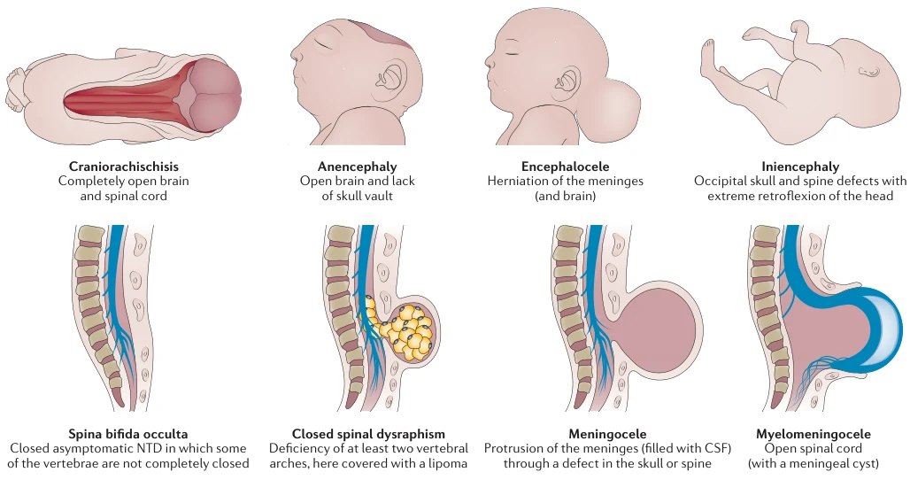</a>

## How the defect forms

* **Primary neurulation, days 22–26 after fertilization** → neural plate bends → folds meet and fuse → posterior neuropore closes around day 26.
  - Failure of closure in the lower spine → **open MMC**.
* **Secondary neurulation** → caudal cells condense → a lumen forms within the solid cord → the lowest part of the neural tube develops. This process finishes during week 6.
  - Failure to separate from surrounding tissue can leave a **skin-covered tethered cord**, sometimes with a lipoma.
* **Look at Figure 2** → top (a–c): two folds come together. Bottom (d–f): a lumen forms inside a solid mass.

<a href="assets/spina-bifida/figure-2.webp">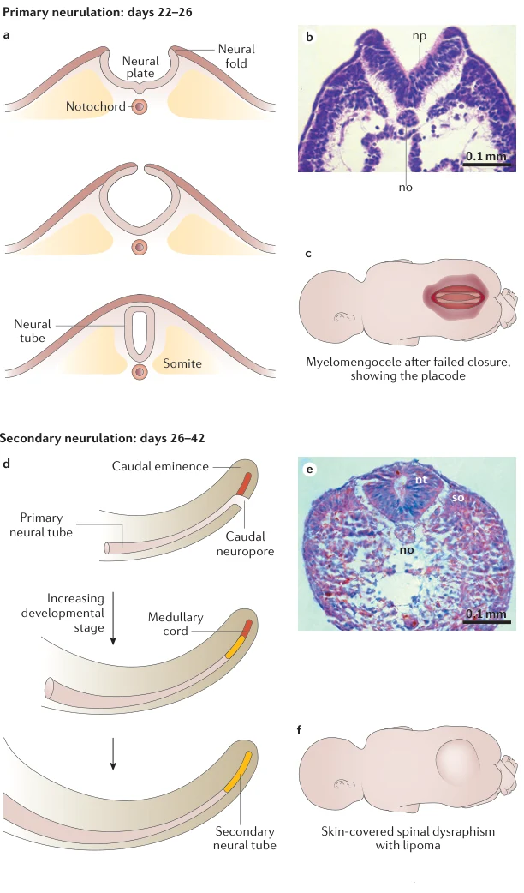</a>

### Two-hit model

1. **Hit 1** → the spinal neural tube fails to close. The exposed cord can still develop some early motor and sensory function.
2. **Hit 2** → ongoing exposure during pregnancy damages the cord. Serial ultrasound showing declining leg movement supports progressive injury.
3. **Why repair before birth?** Covering the placode earlier may protect remaining function from the second hit.

<a href="assets/spina-bifida/box-2.webp">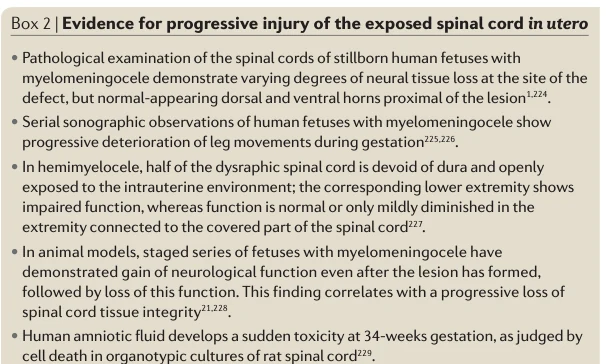</a>

## Epidemiology, inheritance & recurrence

* Most NTDs are **sporadic and multifactorial** → genetic susceptibility + non-genetic factors. A minority are syndromic, including cases associated with **trisomy 13 or 18**.
* **60–70%** = historical population heritability estimate. For a family with an affected pregnancy, the relevant number is the **empirical recurrence risk**.
  - After **one** NTD-affected pregnancy → **~3%** for the next pregnancy.
  - After **two** → **~10%**. The Primer also reports a **2–5%** range for siblings of an affected individual.
* **Ascertainment matters** → birth-only counts miss prenatally diagnosed pregnancies that end in termination. EUROCAT reported **0.51 per 1,000** for spina bifida across live births, stillbirths, and terminations (2003–2007).
* **Genetic evidence** → mouse studies implicate many neurulation genes. Human studies implicate parts of the **planar cell polarity** and **folate one-carbon metabolism** pathways. An MTHFR C677T allele is a susceptibility factor in some populations. Most cases lack a single identified genetic cause.
* **Maternal factors highlighted in the Primer** → low folate status, pregestational diabetes, obesity, and valproate exposure. Box 1 lists other proposed associations with varying evidence.

<a href="assets/spina-bifida/box-1.webp">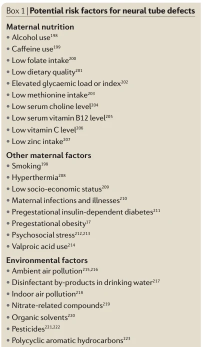</a>

## What changes above and below the lesion?

* **Below the lesion** → leg weakness or paralysis, reduced sensation, and bladder/bowel dysfunction. Reduced sensation increases pressure-injury risk. Higher lesions generally affect more function.
* **At the brain** → **Chiari II** involves downward displacement of the hindbrain through the foramen magnum. **Hydrocephalus** can accompany it.
* **Look at Figure 3, a–c** → compare cerebellum position (**cb**), tectal shape (**t**), and corpus callosum (**cc**). In g–i, compare frontal (blue) with posterior (yellow) connections.

<a href="assets/spina-bifida/figure-3.webp">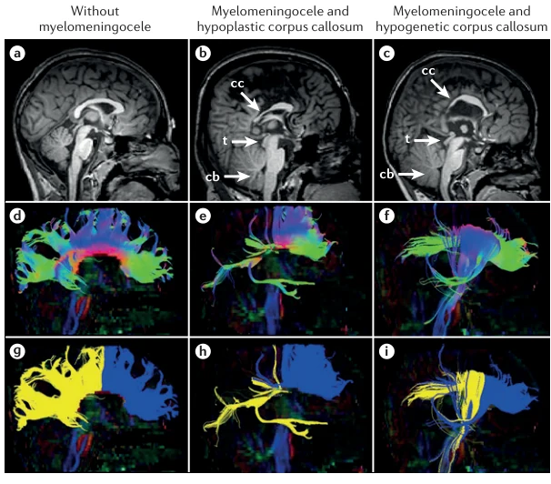</a>

* **Learning profile varies**. Examples from Table 1 → word decoding may be stronger than reading comprehension, and math facts may be easier than applying algorithms.

<a href="assets/spina-bifida/table-1.webp">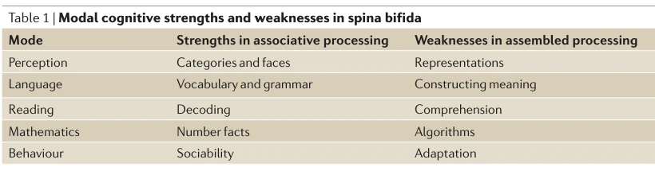</a>

## Prenatal screening & diagnosis

* **Maternal serum AFP** → elevated AFP can flag an open NTD. Amniotic-fluid AFP and acetylcholinesterase can provide additional biochemical evidence when used.
* **Targeted ultrasound** → look at both the **spine** and the **head**. Skin-covered lesions are harder to detect.
  - **Spine, a–d** → compare the normal contour with the posterior defect or protruding sac.
  - **Lemon sign, e–f** → inward scalloping of frontal bones.
  - **Banana sign, g–h** → abnormally curved cerebellum associated with hindbrain displacement.
* **Counseling point** → ultrasound can estimate the anatomical level. Postnatal mobility also depends on the functional level and other findings.

<a href="assets/spina-bifida/figure-4.webp">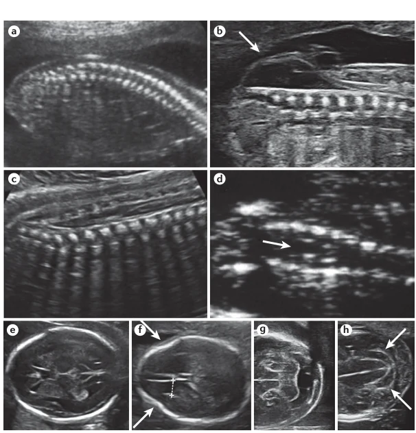</a>

* **Table 2 vs. Table 3** → Table 2 compares individual head signs in affected fetuses (lemon **91%**, banana-shaped cerebellum **97%**). Table 3 reports spinal findings on routine scans in the included studies (**94% of 187 affected fetuses**). Read the denominators before comparing the percentages.

<a href="assets/spina-bifida/table-2.webp">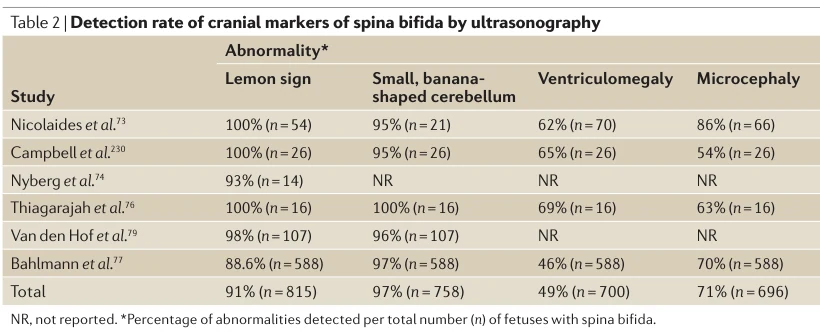</a>

<a href="assets/spina-bifida/table-3.webp">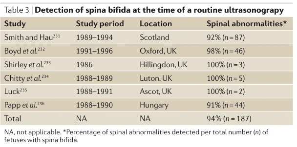</a>

## Folic acid & the one-carbon pathway

* **Timing** → neural tube closure happens in the first month after fertilization, so prevention starts **before conception**. Folic acid supplementation and food fortification reduce NTD risk.
* **Follow Figure 7 in two directions** → one branch supports **methionine production and methylation**. The other supports **nucleotide synthesis and cell proliferation**.
* The exact protective mechanism is still incompletely understood in the Primer. Some NTDs occur despite supplementation.

<a href="assets/spina-bifida/figure-7.webp">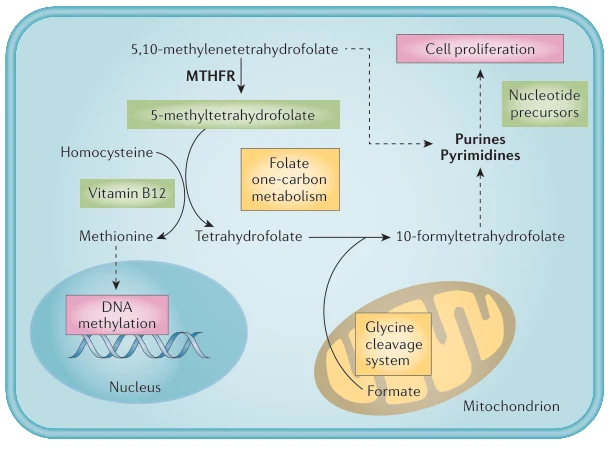</a>

## Management & counseling

* **After birth** → close the open lesion, assess for hydrocephalus and symptomatic Chiari II, and follow bladder/kidney function, mobility, orthopedic issues, and skin integrity.
* **Hydrocephalus, Box 3** → a VP shunt diverts CSF. Endoscopic third ventriculostomy creates an alternate route for CSF flow. Choroid plexus cauterization reduces CSF production.

<a href="assets/spina-bifida/box-3.webp">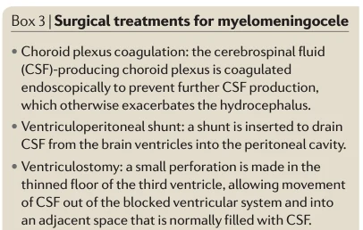</a>

* **Fetal repair, Figure 5** → expose the lesion through a uterine incision, then cover the placode. Goals include limiting further cord injury and reducing CSF leakage.

<a href="assets/spina-bifida/figure-5.webp">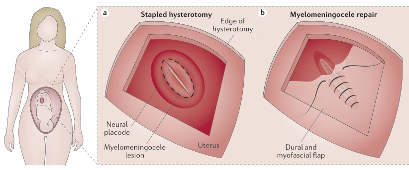</a>

* **MOMS randomized trial (selected pregnancies)** → fetal vs. postnatal repair
  - **VP shunt by 12 months** → **40% vs. 82%**.
  - **Independent walking at 30 months** → **42% vs. 21%**.
  - **Trade-off** → fetal surgery increased risks including preterm delivery and uterine scar thinning or dehiscence.
* **Read Box 4 as trial criteria** → 19w0d to 25w6d at randomization, normal karyotype, lesion at S1 or higher, and confirmed hindbrain herniation were among the selection criteria.

<a href="assets/spina-bifida/box-4.webp">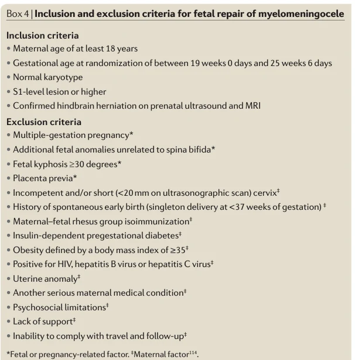</a>

## Quality of life across ages

* **Childhood** → mobility, continence, learning supports, participation with peers, and family adjustment.
* **Adolescence** → practice managing care and building autonomy as responsibilities shift.
* **Adulthood** → independence, school or employment, social participation, relationships, and ongoing access to care.
* **Look at Figure 6** → the boxes above the arrow show concerns that can persist. The boxes below show how priorities change with age.

<a href="assets/spina-bifida/figure-6.webp">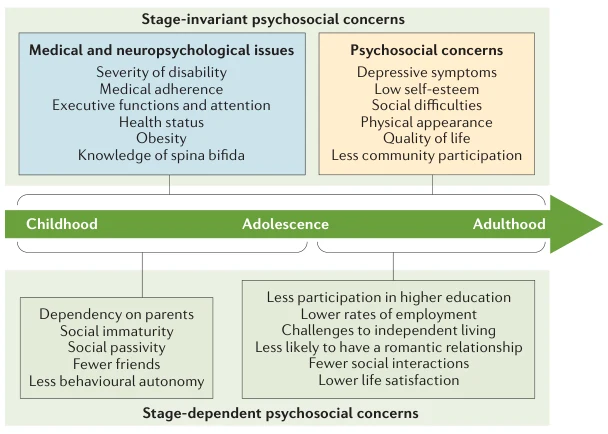</a>
