# Stage 3 - Lesson 9 Mental Illness Jars - Counseling Notes

- **Source** — *Jars - updated 2020.pdf*, 34 slides. Slides credit Jehannine Austin and images by Ben Austin.
- **Reading the screenshots** — Click any image for full size. Slide numbers refer to the supplied PDF.
- **Model** — Genetic vulnerability + environmental vulnerability contribute to an episode. Protective factors increase the capacity represented by the jar.
- **Outline** — [Jar model](#jar-model) · [Inheritance](#inherited-vulnerability) · [Protection](#protection-and-recovery) · [CNVs](#cnv-version) · [Major events](#major-events) · [Interaction](#geneenvironment-interaction) · [PRS](#polygenic-risk-score-prs) · [Review](#quick-review)
- The jars are a counseling analogy. Their fill level and height are conceptual, and cannot be measured as a clinical score.

## Jar model

- **Slide 2** — Everyone has a jar representing vulnerability to mental illness.
  - **Yellow/orange balls** = genetic vulnerability.
  - **Blue pieces** = environmental vulnerability.
- **Slide 3** — Follow the jars **left to right over time**. Environmental contributions accumulate on top of the genetic contribution.
  - **Top of the jar** = the modeled threshold for an episode.
  - **Look at the rim** — the last jar reaches the threshold.

<a href="assets/mental-illness-jars/slide-02.webp">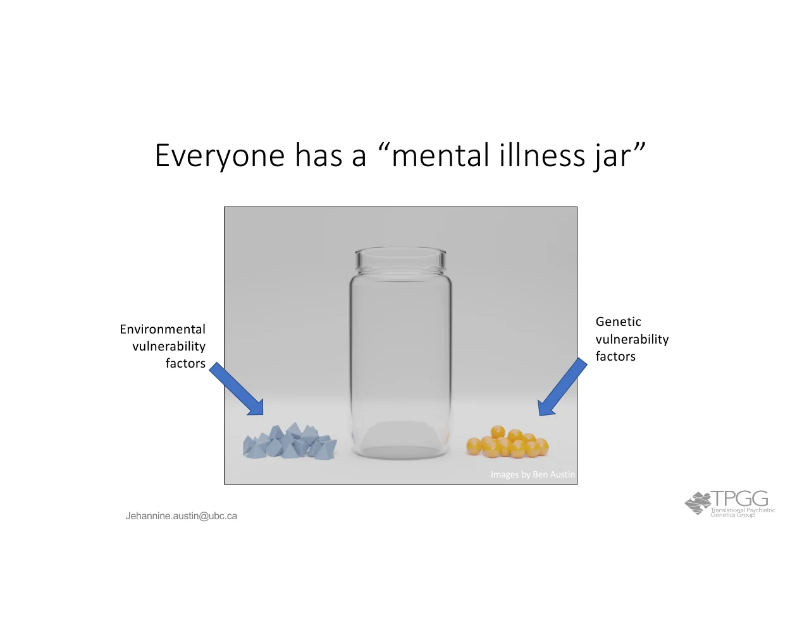</a>

- *Source slide 2 — Jehannine Austin, images by Ben Austin.*

- *Source slide 3 — Jehannine Austin, images by Ben Austin.*

- **Slide 4** — Different combinations can reach the same threshold.
  - **Upper row** — more genetic vulnerability + less environmental contribution.
  - **Lower row** — less genetic vulnerability + more environmental contribution.
  - **Compare the final jars** — both reach the rim despite different starting levels.

<a href="assets/mental-illness-jars/slide-04.webp">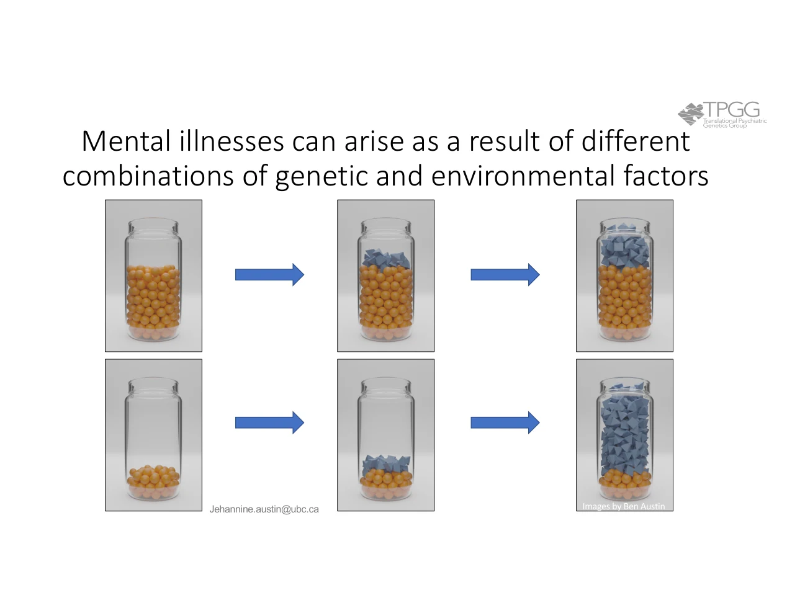</a>

- *Source slide 4 — Jehannine Austin, images by Ben Austin.*

## Inherited vulnerability

- **Slide 5** — Genetic vulnerability varies across the population.
  - **Look at the bell curve** — low, moderate, and high vulnerability fall along a continuum.
  - The curve represents the spread of vulnerability across people.
- **Slide 6** — Relatives can inherit different combinations of susceptibility.
  - **Look at the children’s jars** — siblings show different amounts of yellow material.
  - A family history can raise concern without determining that an individual will develop illness.
- **Slide 7** — Substantial genetic vulnerability can coexist with mental health.
  - **Compare the fill level with the rim** — yellow and blue material can remain below the threshold.

<a href="assets/mental-illness-jars/slide-05.webp">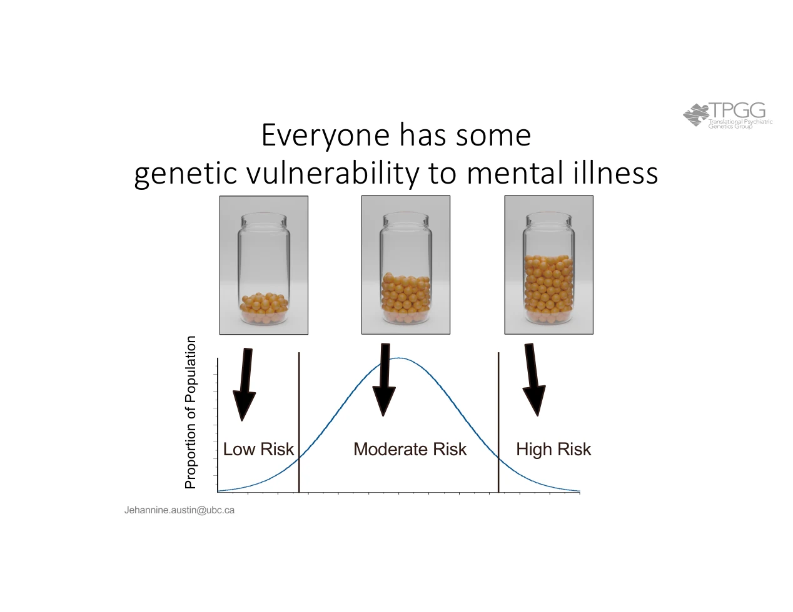</a>

- *Source slide 5 — Jehannine Austin, images by Ben Austin.*
<a href="assets/mental-illness-jars/slide-06.webp">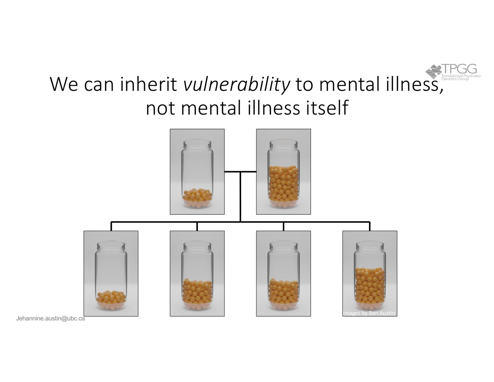</a>

- *Source slide 6 — Jehannine Austin, images by Ben Austin.*
<a href="assets/mental-illness-jars/slide-07.webp">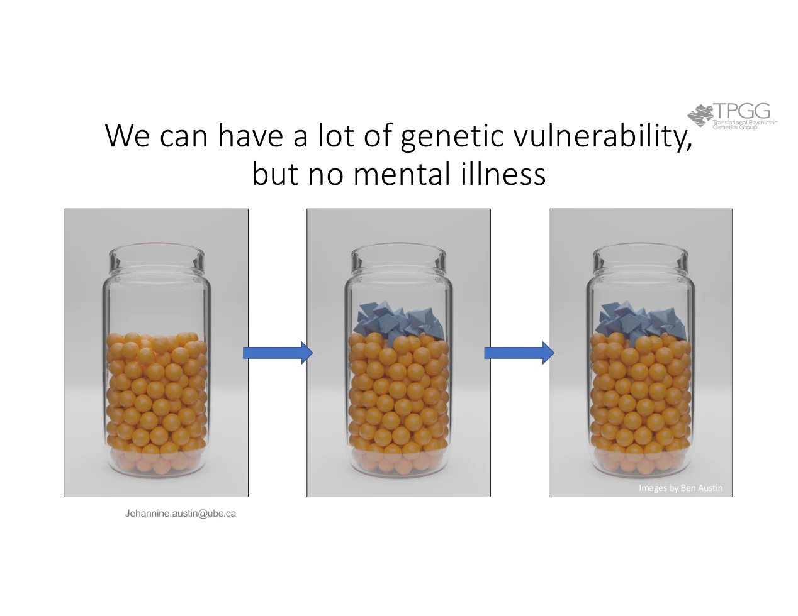</a>

- *Source slide 7 — Jehannine Austin, images by Ben Austin.*

## Protection and recovery

- **Slide 8** — Protective factors add height to the jar.
  - **Look at the rings** — added rings represent more capacity before reaching the threshold.
- **Slide 9** — Recovery involves changes over time and increased protection.
  - **Compare all three jars** — the environmental fill decreases, then protective rings increase height.
  - **Look at the yellow layer** — the illustrated genetic contribution persists.
- **Slide 10** — Protection can also help before an episode.
  - **Compare the last two jars** — similar contents, but the taller jar leaves more room below the rim.
- **Counseling cue** — Ask which supports already help the person and what additional support they would find useful.

- *Source slide 8 — Jehannine Austin, images by Ben Austin.*
<a href="assets/mental-illness-jars/slide-09.webp">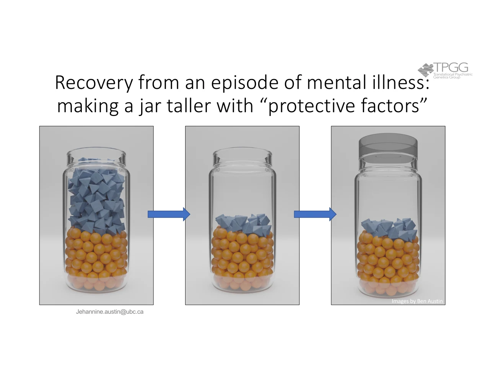</a>

- *Source slide 9 — Jehannine Austin, images by Ben Austin.*
<a href="assets/mental-illness-jars/slide-10.webp">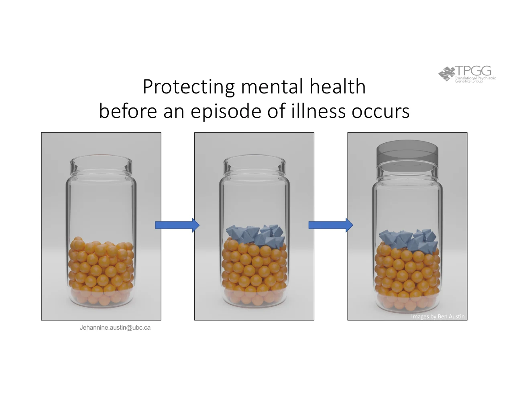</a>

- *Source slide 10 — Jehannine Austin, images by Ben Austin.*

## CNV version

- **Slides 12–14** — The same jar model includes a large yellow ball in the genetic contribution.
  - **CNV** = copy-number variant, a deletion or duplication of a DNA segment.
  - **Large yellow ball** = the CNV contribution represented in this example.
  - **Slide 13** — the combined contents reach the threshold.
  - **Slide 14** — the CNV and other contributions remain below the rim.
  - Interpret the contribution of a particular CNV using its specific evidence.
- **Slides 15–17** — Protective rings also apply in the CNV version.
  - **Slide 16** — recovery with the large genetic ball still present.
  - **Slide 17** — added protection increases capacity before an episode.

<a href="assets/mental-illness-jars/slide-13.webp">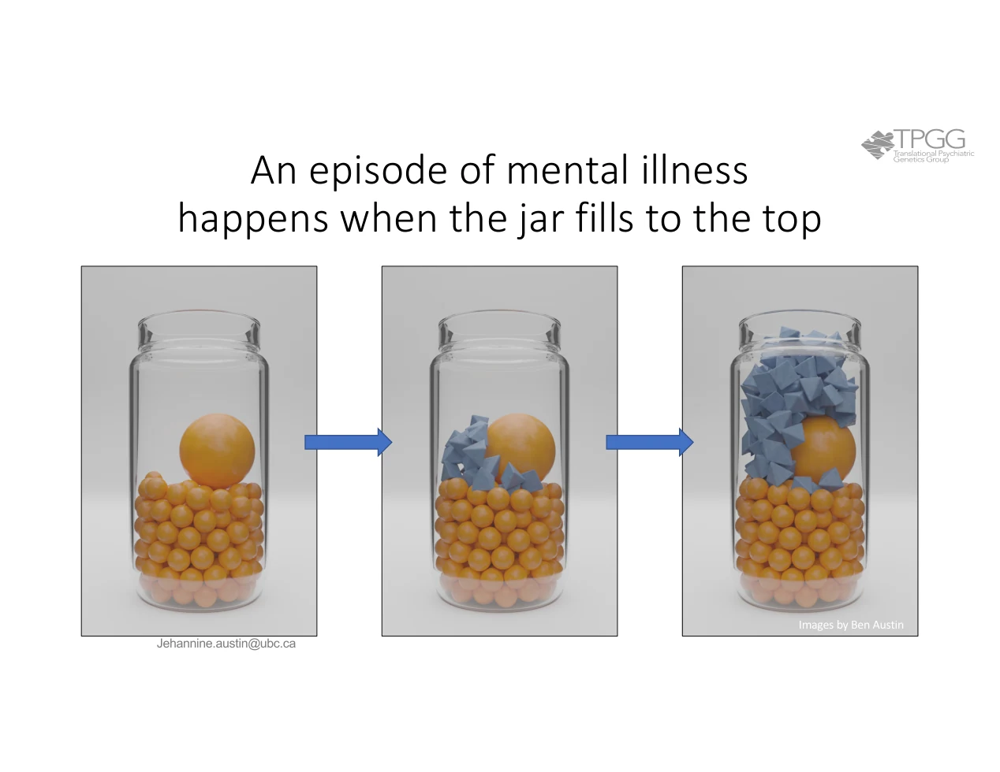</a>

- *Source slide 13 — Jehannine Austin, images by Ben Austin.*
<a href="assets/mental-illness-jars/slide-14.webp">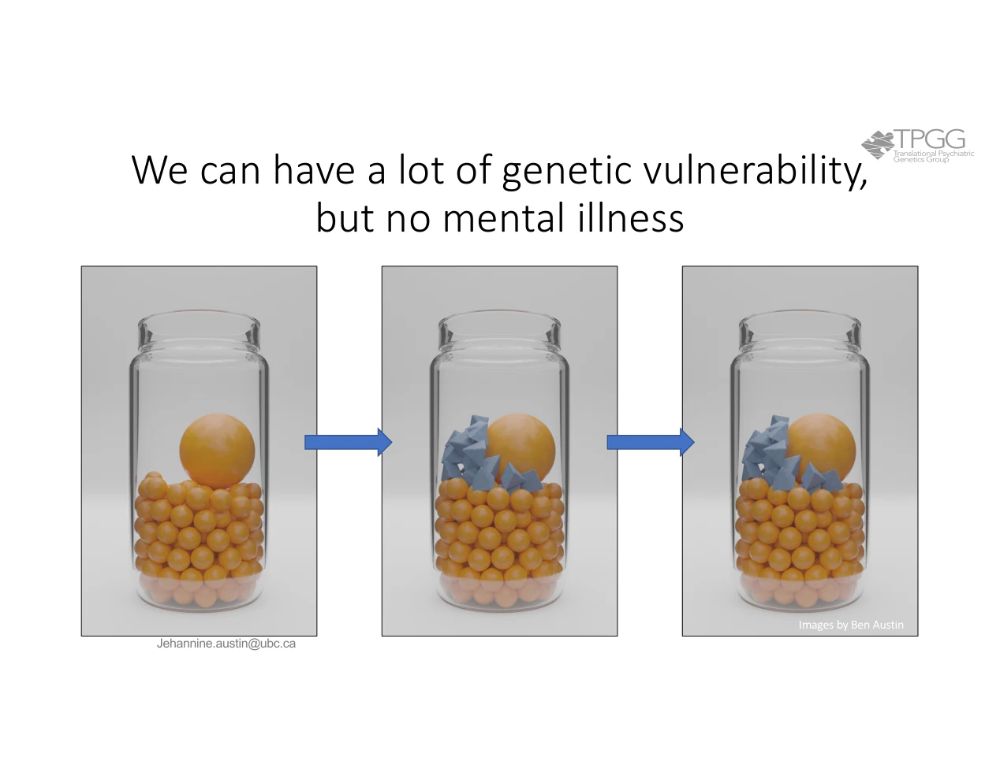</a>

- *Source slide 14 — Jehannine Austin, images by Ben Austin.*
<a href="assets/mental-illness-jars/slide-16.webp">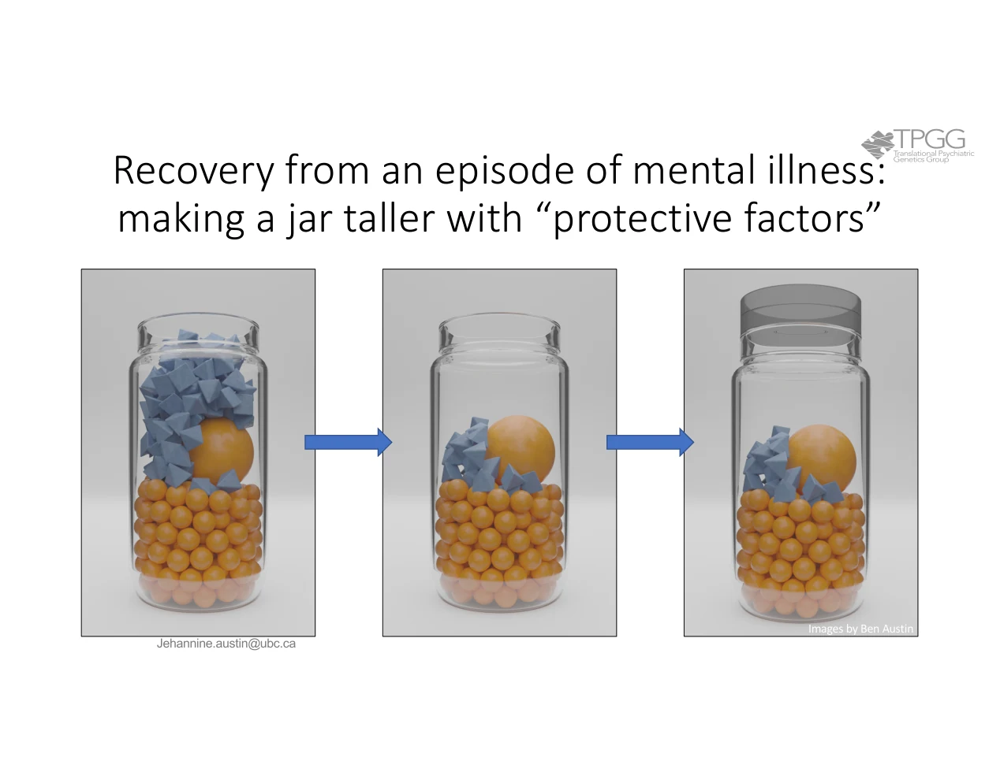</a>

- *Source slide 16 — Jehannine Austin, images by Ben Austin.*
<a href="assets/mental-illness-jars/slide-17.webp">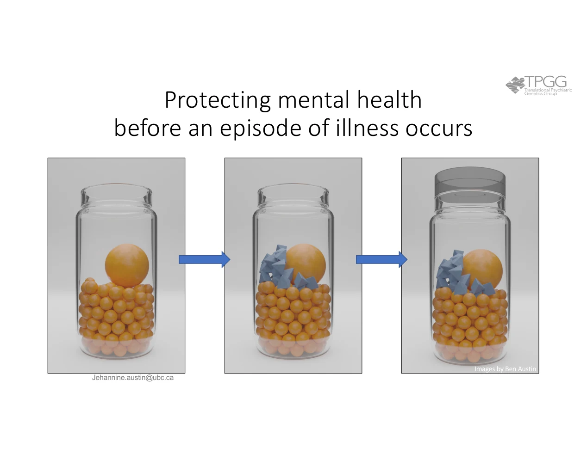</a>

- *Source slide 17 — Jehannine Austin, images by Ben Austin.*

## Major events

- **Slides 19–20** — The environmental pieces now include a larger shape.
- **Slide 21** — A major event can add a large environmental contribution.
  - **Look at the large blue piece** — compare the fill level before and after it enters.
- **Slides 22–24** — Protective factors can increase capacity when major events remain part of someone’s history.
  - **Slide 23** — added rings leave room above the contents.
  - **Slide 24** — recovery is illustrated with the large blue piece still present.
- **Counseling cue** — Invite discussion of experiences at the person’s pace and identify the support they want.

<a href="assets/mental-illness-jars/slide-21.webp">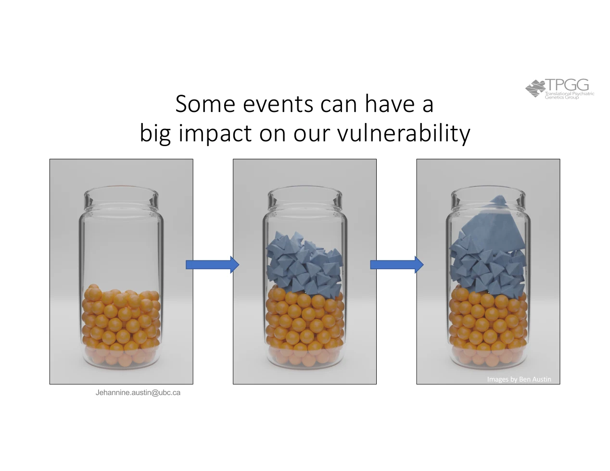</a>

- *Source slide 21 — Jehannine Austin, images by Ben Austin.*
<a href="assets/mental-illness-jars/slide-23.webp">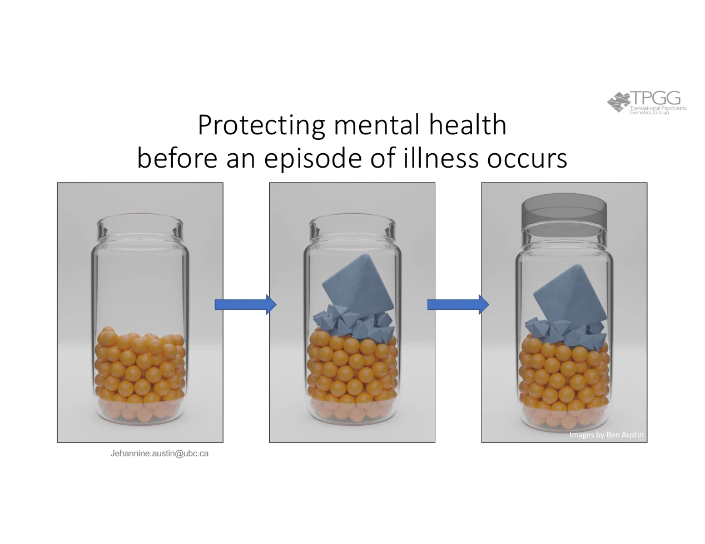</a>

- *Source slide 23 — Jehannine Austin, images by Ben Austin.*
<a href="assets/mental-illness-jars/slide-24.webp">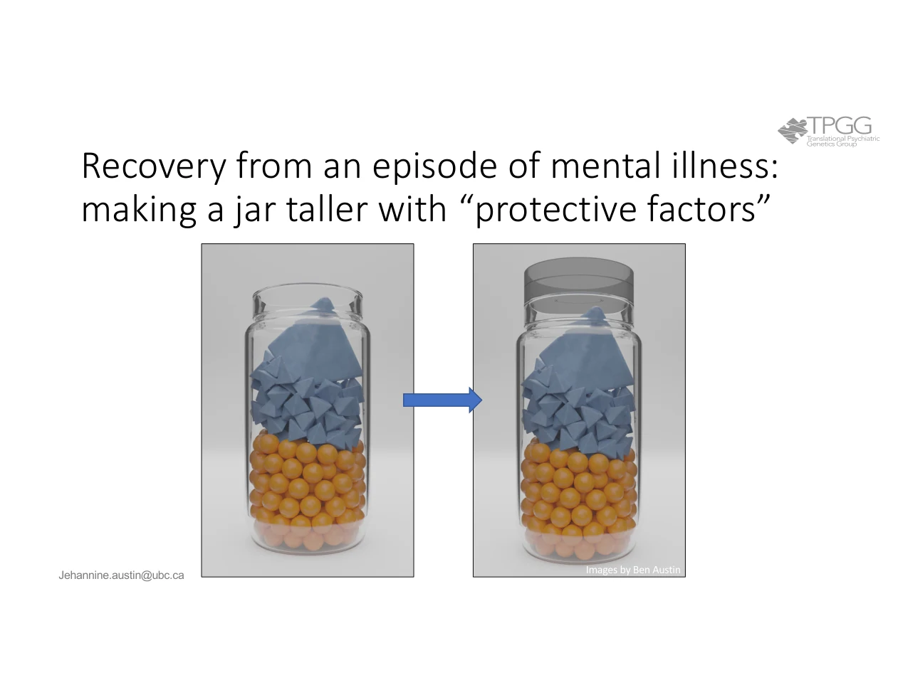</a>

- *Source slide 24 — Jehannine Austin, images by Ben Austin.*

## Gene–environment interaction

- **Slides 26–27** — The effect of one factor can depend on the presence of another.
  - **G × E interaction** = the effect of an exposure differs with genetic background, or the effect of a genetic factor differs with exposure.
  - **Look at the green pieces** — follow how the specific factors combine and change the total contribution.
  - Compare the resulting fill with the rim.
- **Slide 28** — Exposure occurs without the specific genetic factor.
- **Slide 29** — The specific genetic factor is present without that exposure.
  - **Compare with slides 26–27** — these examples illustrate different combined effects.
  - The slides use an analogy and do not identify a tested variant–exposure pair.

<a href="assets/mental-illness-jars/slide-26.webp">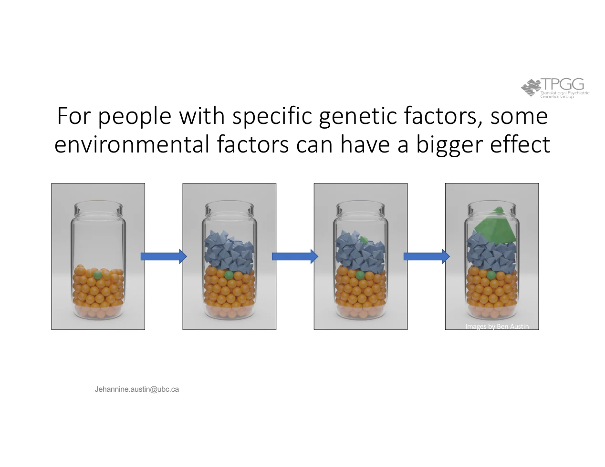</a>

- *Source slide 26 — Jehannine Austin, images by Ben Austin.*
<a href="assets/mental-illness-jars/slide-27.webp">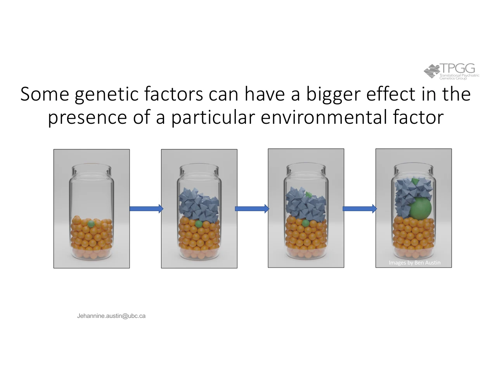</a>

- *Source slide 27 — Jehannine Austin, images by Ben Austin.*
<a href="assets/mental-illness-jars/slide-28.webp">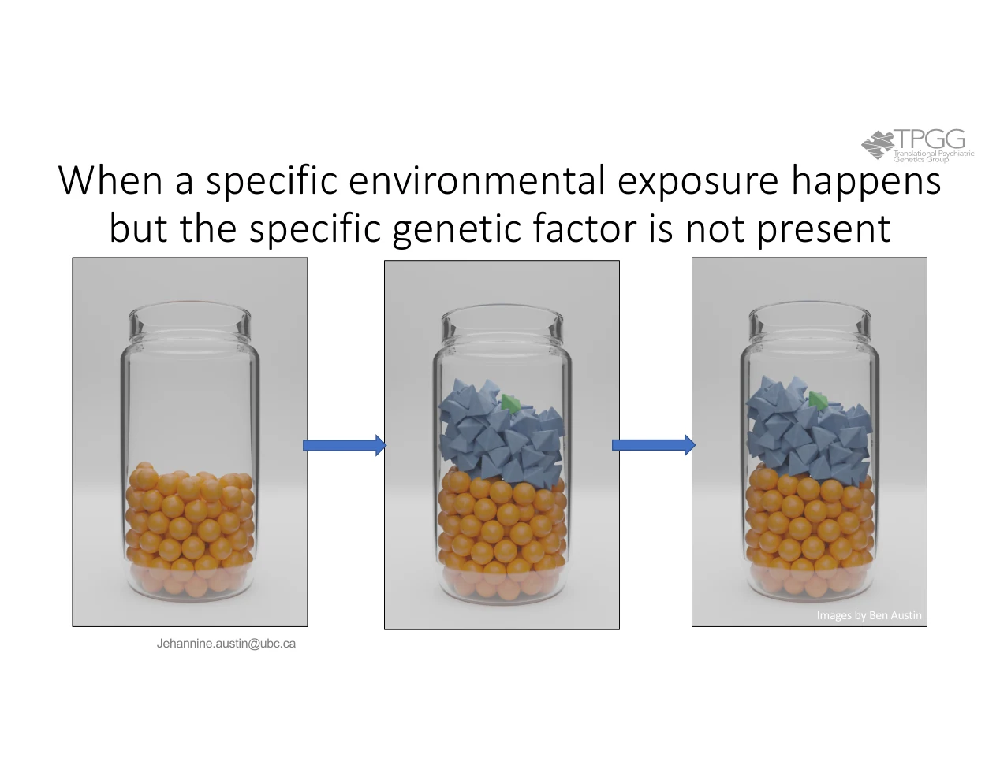</a>

- *Source slide 28 — Jehannine Austin, images by Ben Austin.*
<a href="assets/mental-illness-jars/slide-29.webp">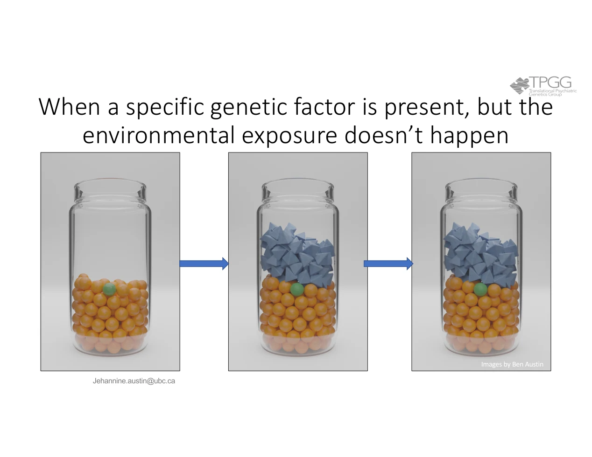</a>

- *Source slide 29 — Jehannine Austin, images by Ben Austin.*

## Polygenic risk score (PRS)

### Relative position on the distribution

- **Slide 31** — A PRS combines information from the genetic variants included in a score.
  - **X-axis** = increasing genetic risk according to the tested variants.
  - **Y-axis** = number of people with each score.
  - **Red line** = the individual’s position relative to others assessed with the same variants.
  - This position alone does not give an absolute probability of depression.

<a href="assets/mental-illness-jars/slide-31.webp">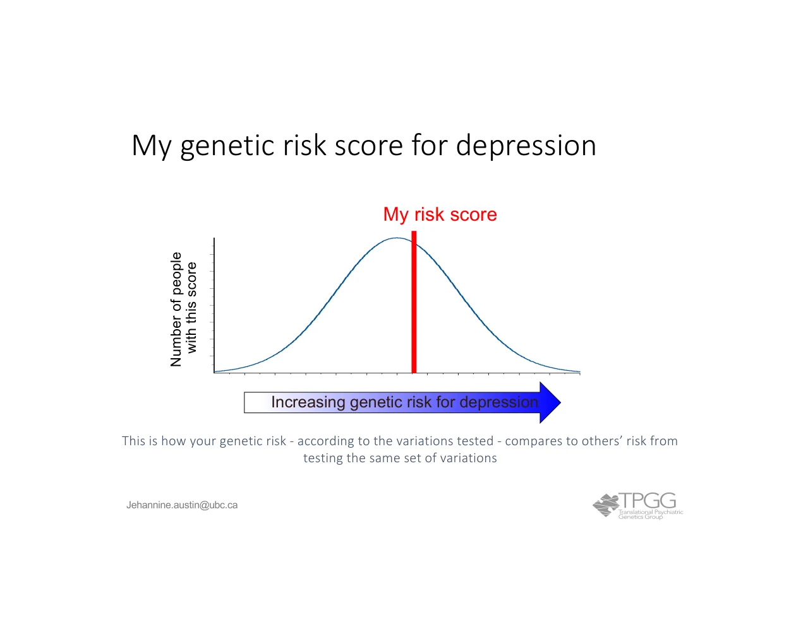</a>

- *Source slide 31 — Jehannine Austin, images by Ben Austin.*

### Absolute probability in the teaching example

- **Slide 32** — Each dot panel represents **100 people**.
  - **Blue person** = depression.
  - **Red person** = no depression.
  - **Panel Z** = 10/100 with depression, 90/100 without.
  - **Panel A** = 15/100 with depression, 85/100 without. The slide uses 15% as the population lifetime example.
  - **Panel B** = 37/100 with depression, 63/100 without.
  - **Panel C** = 42/100 with depression, 58/100 without.
- **Indicator** — Match each letter on the score distribution to the dot panel below it.
- These are the probabilities used in the **2020 teaching slides**. Applying a PRS clinically requires the evidence and calibration for the particular score and population.

<a href="assets/mental-illness-jars/slide-32.webp">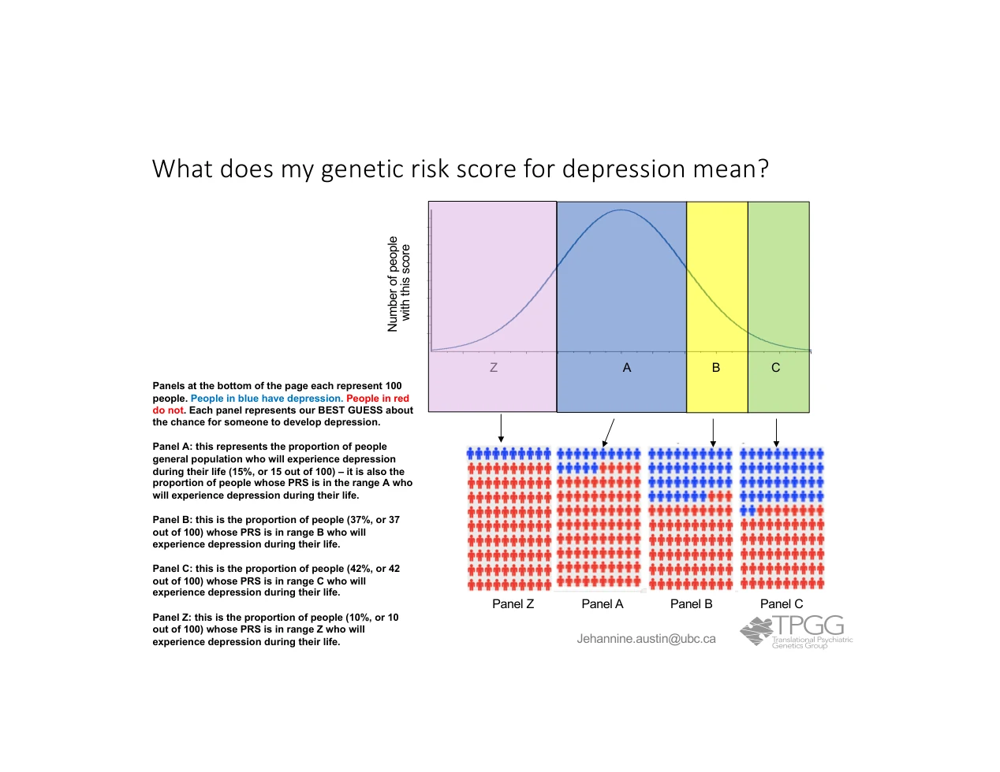</a>

- *Source slide 32 — Jehannine Austin, images by Ben Austin.*

### What the score leaves unexplained

- **Slide 33** — The pie uses **2.5% tested contribution** and **97.5% other contributions** to illustrate limited coverage.
  - **Small red slice** = contribution attributed to the variants included in this example.
  - **Large blue slice** = other genetic contributions and experiences omitted from the score.
  - These percentages describe the illustration. They do not give an individual’s probability of depression or a universal proportion for all PRS tests.
- **Slide 34** — The bracket highlights how the tested variants represent only part of the jar.
  - A PRS samples some susceptibility information while many other contributors remain outside the test.
- **Counseling cue** — Explain the outcome, comparison population, and time period attached to a risk estimate. Ask what the result means to the person.

<a href="assets/mental-illness-jars/slide-33.webp">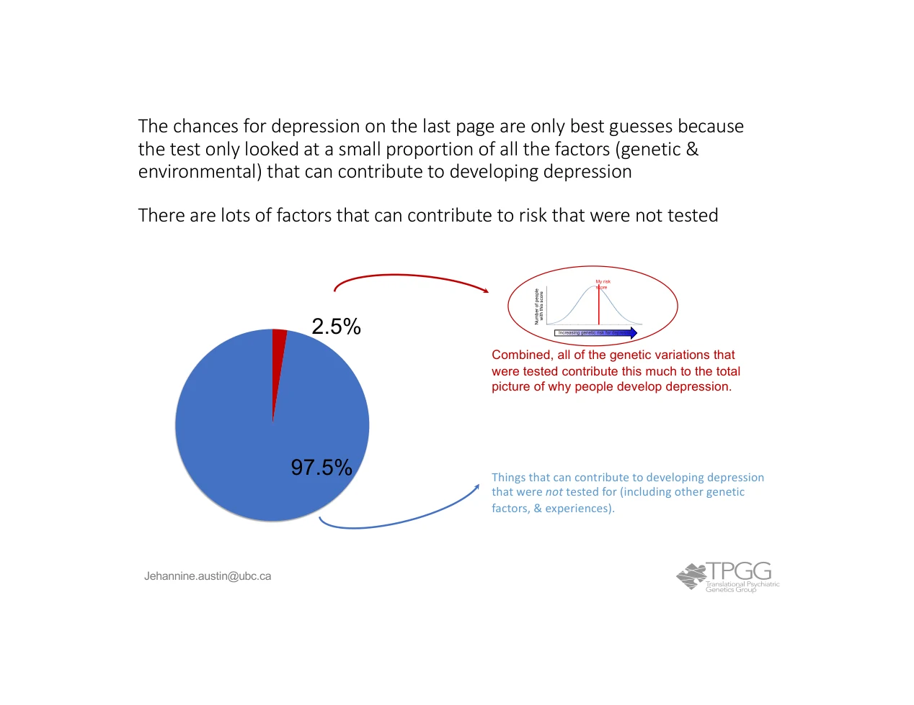</a>

- *Source slide 33 — Jehannine Austin, images by Ben Austin.*
<a href="assets/mental-illness-jars/slide-34.webp">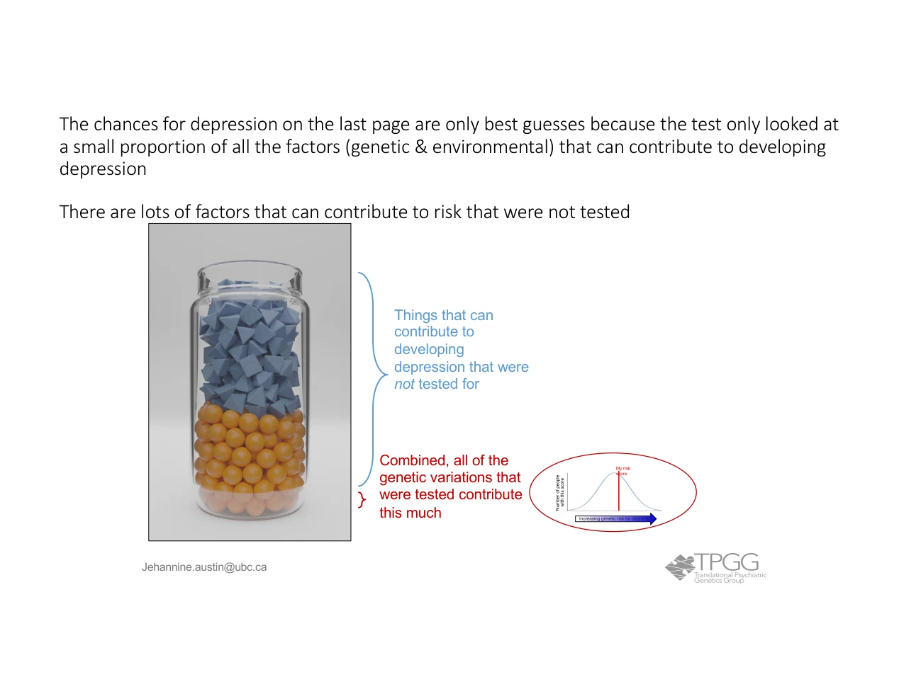</a>

- *Source slide 34 — Jehannine Austin, images by Ben Austin.*

## Quick review

- **Yellow balls** = inherited susceptibility.
- **Blue pieces** = environmental contributions.
- **Large yellow ball** = the CNV contribution illustrated in this deck.
- **Large blue piece** = a major event.
- **Rim** = modeled threshold for an episode.
- **Rings** = added protection and capacity.
- **Green pieces** = specific factors used to illustrate interaction.
- **PRS position** = comparison using the tested variants.
- **100-person panels** = absolute probabilities in the example.
- **Pie and bracket** = much of the total picture lies outside the score.

Additional repeated slides and visual legend

- Slides 12, 15, 19, 20, and 22 repeat the legend or protection model within the CNV and major-events sections.

<a href="assets/mental-illness-jars/slide-12.webp">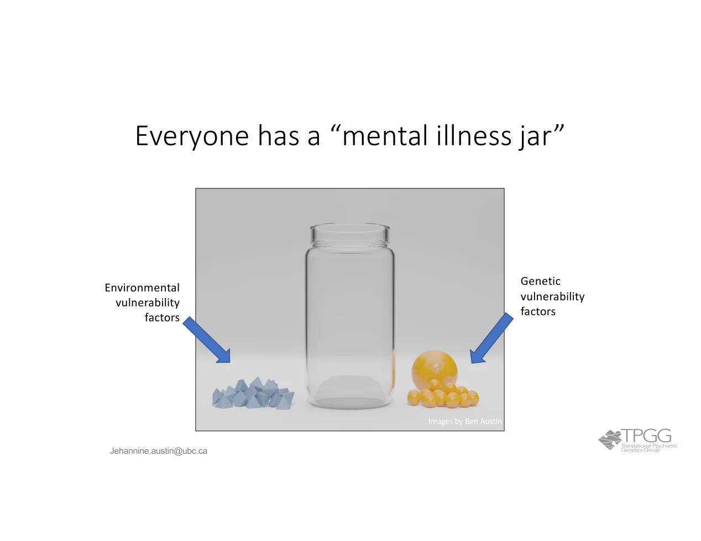</a>

- *Source slide 12 — Jehannine Austin, images by Ben Austin.*

- *Source slide 15 — Jehannine Austin, images by Ben Austin.*
<a href="assets/mental-illness-jars/slide-19.webp">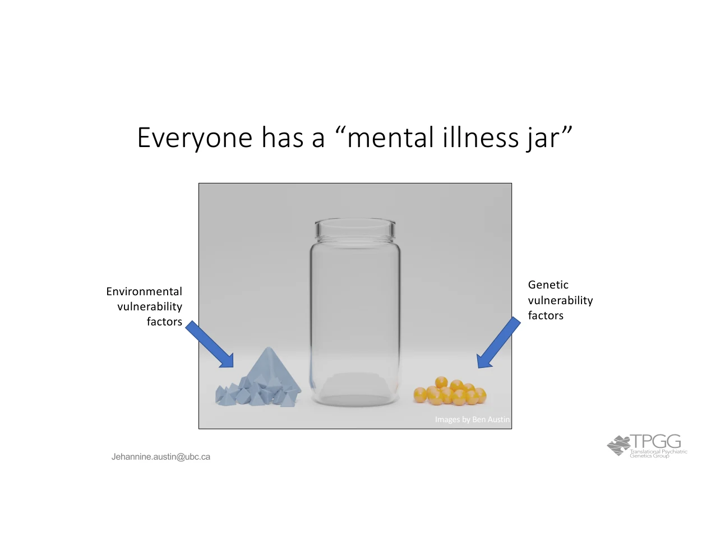</a>

- *Source slide 19 — Jehannine Austin, images by Ben Austin.*
<a href="assets/mental-illness-jars/slide-20.webp">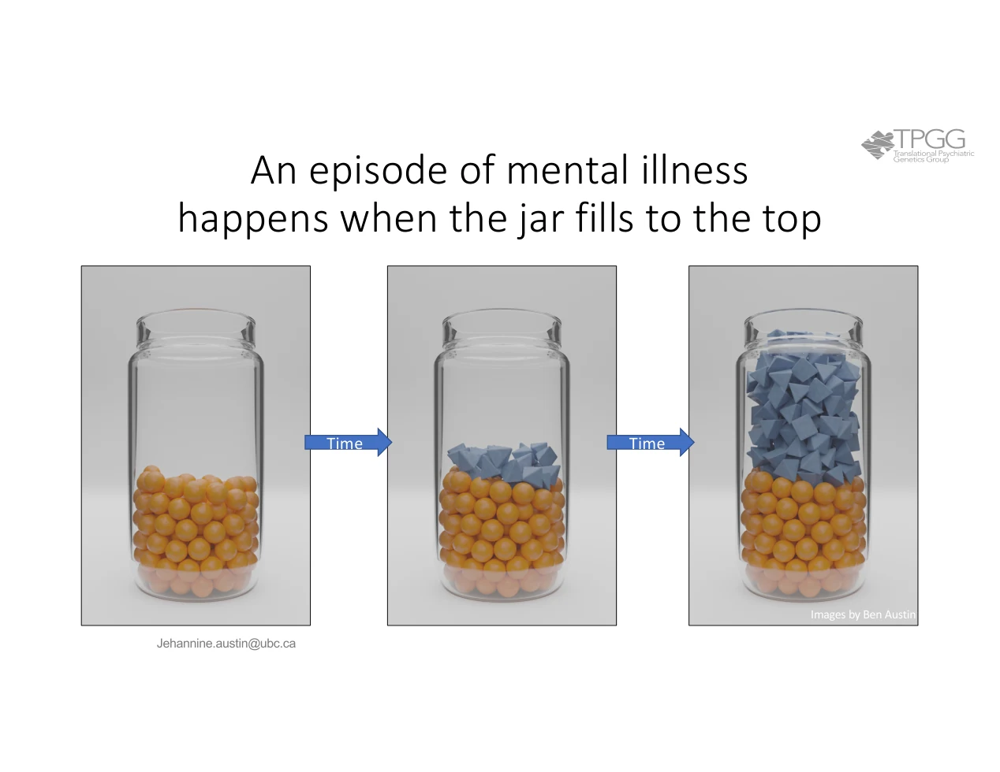</a>

- *Source slide 20 — Jehannine Austin, images by Ben Austin.*
<a href="assets/mental-illness-jars/slide-22.webp">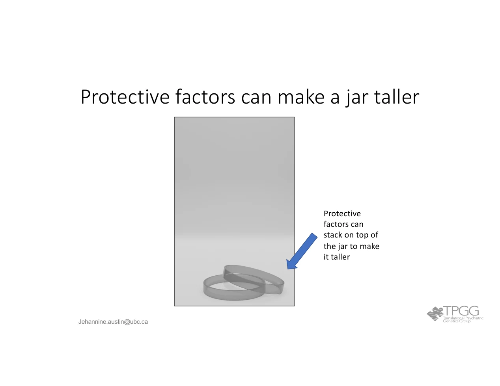</a>

- *Source slide 22 — Jehannine Austin, images by Ben Austin.*

