# Review 2 — ChatGPT

Short notes consolidated from the 19 uploaded files. Course estimates are retained and source conflicts are flagged. Click screenshots for full size.

- [Chromosome structure and terminology](#chromosome-structure-and-terminology)
- [Cell division](#cell-division)
- [Nondisjunction, markers, and UPD](#nondisjunction-markers-and-upd)
- [Cytogenetic tests and result interpretation](#cytogenetic-tests-and-result-interpretation)
- [Aneuploid syndromes](#aneuploid-syndromes)
- [Genomic disorders and deletion syndromes](#genomic-disorders-and-deletion-syndromes)
- [Structural chromosome rearrangements](#structural-chromosome-rearrangements)
- [Reciprocal translocations](#reciprocal-translocations)
- [Robertsonian translocations](#robertsonian-translocations)
- [Sex chromosome rearrangements](#sex-chromosome-rearrangements)
- [Inversions](#inversions)
- [Source index](#source-index)

## Chromosome structure and terminology

### DNA packaging and homologs

* DNA wraps around histones → **nucleosomes** → chromatin → condensed chromosomes.
* A chromatid contains one DNA double helix plus associated proteins.
* Replicated chromosome = two sister chromatids joined at the centromere.
* Homologs: one maternal + one paternal chromosome.
* Homologs carry corresponding genes, usually in the same order.
* Homologs may carry different alleles and DNA sequences.
* Typical somatic complement: **46 chromosomes**, 22 autosomal pairs + sex chromosomes.
* **Karyotype:** chromosome complement, displayed by size, shape, and banding.
* **Ideogram:** schematic chromosome sizes and banding patterns.
* Chromosome length depends on condensation and cell-cycle stage.
* Metaphase chromosomes: condensed and readily visible.
* Prophase/prometaphase chromosomes: longer, less condensed, more bands.

<a href="assets/review2/dna-packaging.jpg">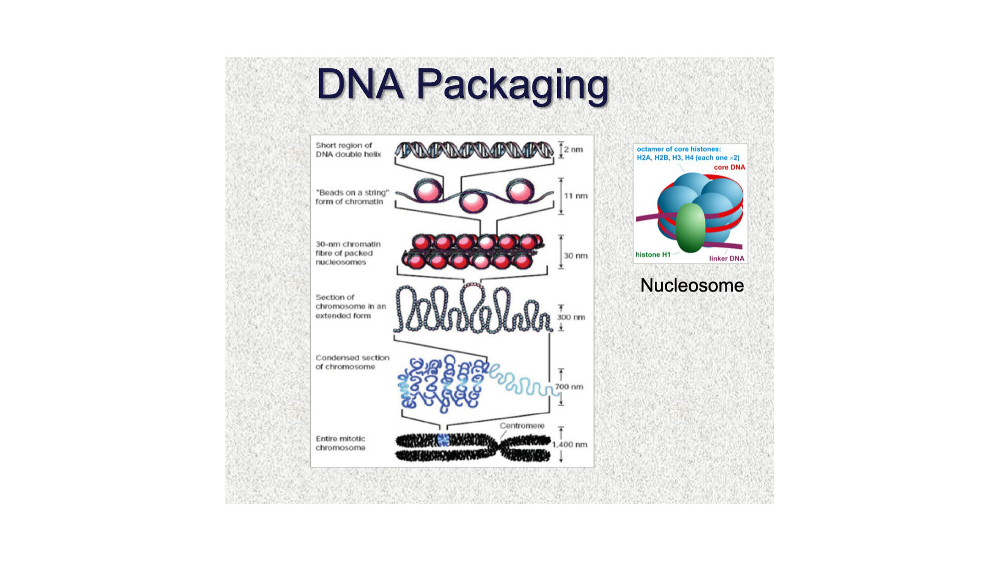</a>

DNA packaging into nucleosomes and chromosomes · [MI] AHG2022Mitosis&Meiosis.pptx, page/slide 8.

### Arms, centromeres, and chromosome groups

* **p:** short arm; **q:** long arm.
* **Telomeres:** chromosome ends; **pter/qter:** corresponding arm tips.
* **Metacentric:** centromere near the middle.
* **Submetacentric:** centromere off-center.
* **Acrocentric:** centromere near one end.
* Acrocentric autosomes: **13, 14, 15, 21, 22**.
* Acrocentric short-arm stalks contain **NORs/rRNA gene arrays**.
* Redundant rRNA gene copies help tolerate Robertsonian short-arm loss.
* **A:** chromosomes 1–3; large.
* **B:** chromosomes 4–5; large, submetacentric.
* **C:** chromosomes 6–12 and X; medium, submetacentric.
* **D:** chromosomes 13–15; acrocentric.
* **E:** chromosomes 16–18; relatively short.
* **F:** chromosomes 19–20; short, metacentric.
* **G:** chromosomes 21–22 and Y; short, acrocentric appearance.
* Y lacks the NOR-bearing satellites of acrocentric autosomes.

<a href="assets/review2/chromosome-groups.jpg">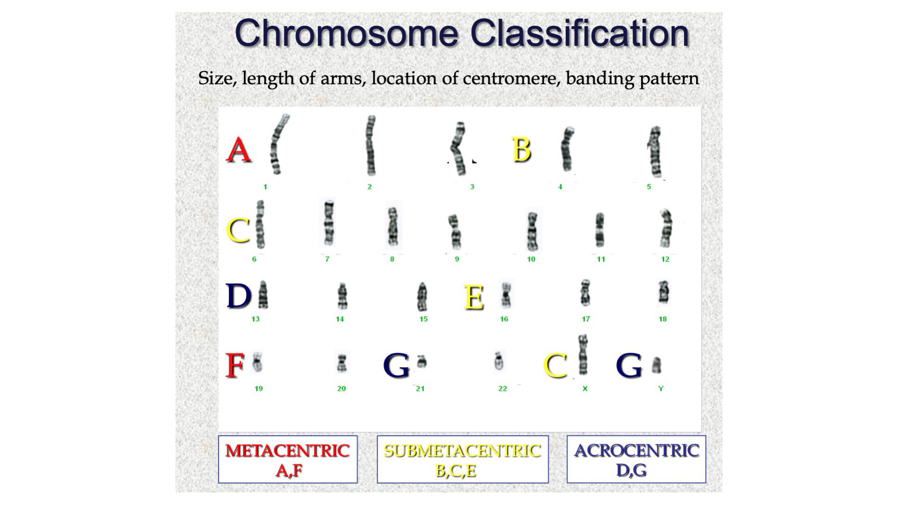</a>

Chromosome groups A–G and centromere positions · [MI] AHG2022Mitosis&Meiosis.pptx, page/slide 18.

### Ploidy and chromosome dosage

* **Haploid:** n = 23 chromosomes.
* **Diploid:** 2n = 46 chromosomes.
* **Polyploid:** extra complete chromosome sets.
* **Triploid:** 3n = 69 chromosomes.
* **Aneuploid:** extra/missing individual chromosomes.
* **Trisomy:** three copies of one chromosome.
* **Monosomy:** one copy of one chromosome.
* **Partial trisomy/monosomy:** extra/missing chromosome segment.
* Count chromosomes by centromeres, not DNA quantity.
* S phase doubles DNA content without doubling chromosome count.

### Chromosome bands and resolution

* Band = region distinguishable from adjacent regions by staining.
* **G-banding:** trypsin treatment followed by Giemsa staining.
* Routine G-banding: approximately **400–500 bands** per haploid set.
* Dark G-bands: relatively AT-rich, late-replicating, less transcriptionally active.
* Light G-bands: relatively GC-rich, more transcriptionally active.
* **High-resolution banding:** prophase/prometaphase, approximately **800–1,200 bands**.
* Less condensation reveals smaller bands and more precise breakpoints.
* **C-banding:** preferentially stains constitutive centromeric heterochromatin.
* Common heterochromatic size variants: **1, 9, 16, Yq**.
* These are chromosome heteromorphisms, not simply individual SNPs.
* C-banding can help identify two centromeric regions in dicentric chromosomes.
* **Silver/NOR staining:** active nucleolar organizer regions at acrocentric stalks.
* NORs contain tandemly repeated rRNA genes.
* Course gene counts: genome ~20,000; chromosome ~500–4,000.
* Course gene counts: metaphase band ~50–100; high-resolution band ~50.
* Gene counts vary widely; visible bands contain many genes.

<a href="assets/review2/gene-resolution.jpg">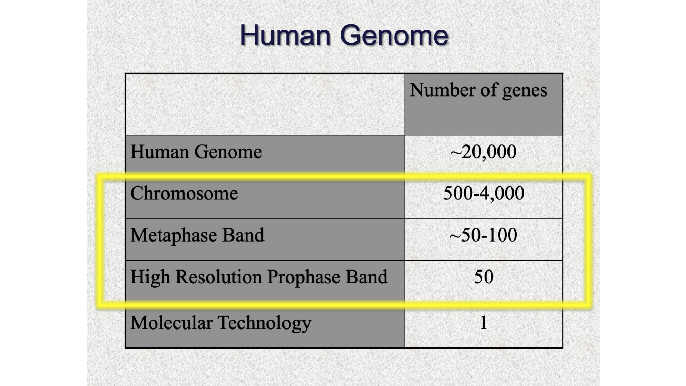</a>

Approximate genes per chromosome and visible band · [MI] AHG2022Mitosis&Meiosis.pptx, page/slide 9.

### ISCN nomenclature

* Order: **chromosome count, sex chromosomes, abnormality**.
* Normal examples: `46,XX`; `46,XY`.
* `47,XX,+21`: female with trisomy 21.
* `45,XY,-10`: male missing one whole chromosome 10.
* `45,X`: monosomy X; no second sex chromosome listed.
* `del`: deletion; `dup`: duplication; `inv`: inversion.
* `ins`: insertion; `t`: translocation; `der`: derivative chromosome.
* `rec`: recombinant chromosome; `i`: isochromosome; `rob`: Robertsonian translocation.
* `cen`: centromere; `mar`: marker chromosome of unresolved origin.
* `47,XX,+mar`: female with an extra marker chromosome.
* Maternal 15q11–q13 deletion → Angelman; paternal deletion → Prader–Willi, in the imprinting examples.
* `mat`/`pat`: maternal/paternal origin.
* `/`: different cell lines; `[n]`: cells counted in that line.
* Regions/bands are numbered outward from the centromere.
* `6q23`: chromosome 6, q arm, region 2, band 3.
* `8q21.3`: chromosome 8, q arm, region 2, band 1, sub-band 3.
* Landmark = reproducible chromosome feature used for identification.
* Region = interval between adjacent landmarks.
* Decimal numbers identify sub-bands.
* **Derivative identity follows its centromere**, regardless of attached material.
* Same chromosome count can accompany normal, balanced, or unbalanced DNA dosage.

### Chromosomal conditions and indications for testing

* Course frequency: ~50% of first-trimester miscarriages.
* Course frequency: ~1% of live births.
* Course frequency: ~2% of pregnancies in women >35.
* Many cancers acquire numerical or structural chromosome abnormalities.
* Typical clues: DD/ID, growth differences, dysmorphism, congenital anomalies.
* Indications: unexplained developmental delay or multiple congenital anomalies.
* Indications: stillbirth, neonatal death, infertility, recurrent miscarriage.
* Indications: family chromosome rearrangement or abnormal prenatal screening/ultrasound.
* Chromosome studies also help classify selected neoplasias.
* Most autosomal monosomies and many autosomal trisomies are lost prenatally.
* Trisomies **13, 18, 21** can survive to birth.
* **Trisomy 16** is a common chromosome cause of first-trimester miscarriage.
* Maternal-age risk reflects increased meiotic nondisjunction.
* Course history: early chromosome counting → hypotonic spreading → trisomy discoveries → banding → molecular cytogenetics.
* Hypotonic treatment improved chromosome separation and accurate counting.
* Clinical team: laboratory director, cytogenetic technologists, geneticists, genetic counselors.
* Directors: specialized clinical laboratory genetics training; technologists: laboratory-science training, sometimes CG(ASCP).
* Genetic counselors: master’s-level genetics/counseling training; medical geneticists: physicians with specialist genetics training.
* Laboratories: hospital, academic, cancer, and commercial/reference settings.

<a href="assets/review2/maternal-age.jpg">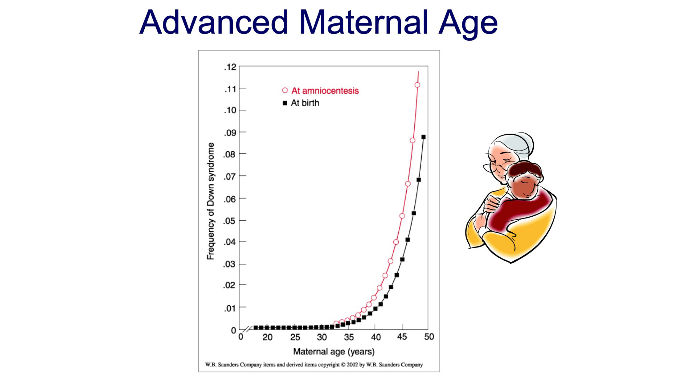</a>

Maternal age and chromosome abnormality risk · [MI] AHG2022Mitosis&Meiosis.pptx, page/slide 45.
<a href="assets/review2/miscarriage-selection.jpg">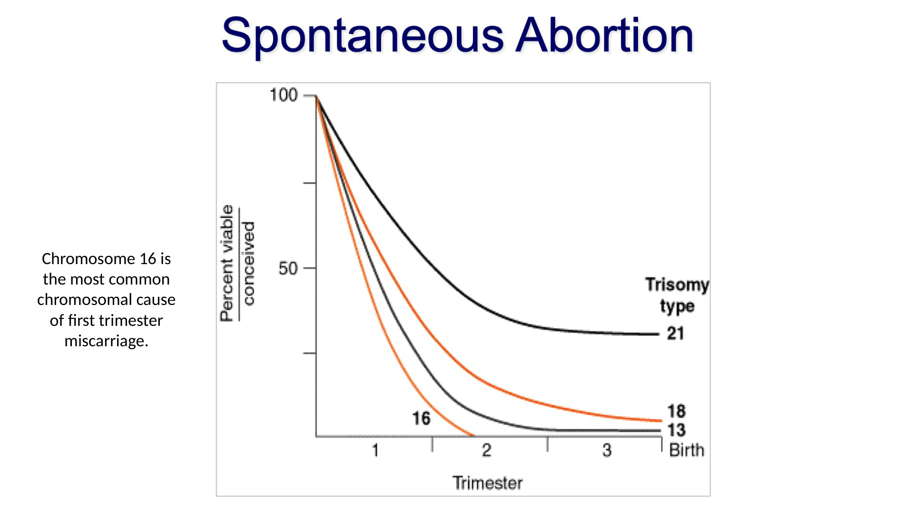</a>

Trisomy-specific survival and pregnancy loss · [MI] AHG2022Mitosis&Meiosis.pptx, page/slide 46.

## Cell division

### Cell cycle and chromosome counts

* **Interphase = G1 + S + G2**.
* **G1:** growth; no DNA replication.
* **G0:** exit from the active division cycle; may be reversible.
* **S:** DNA replication.
* **G2:** each chromosome has two sister chromatids.
* **M:** mitosis and cytokinesis.
* G1: 46 chromosomes, 46 chromatids, **2C DNA**.
* G2: 46 chromosomes, 92 chromatids, **4C DNA**.
* After normal mitosis: 46 chromosomes and 2C DNA per daughter.
* Once sister centromeres separate, each chromatid becomes an individual chromosome.
* Mitosis usually produces two genetically similar diploid somatic cells.
* Meiotic crossing over is not a normal feature of mitosis.

### Cell-division machinery

* **Centromere:** chromosome region joining sisters and assembling kinetochores.
* **Kinetochore:** protein complex attaching chromosomes to spindle microtubules.
* **Sister chromatids:** replicated chromosome copies.
* **Kinetochore microtubules:** move chromosomes toward spindle poles.
* **Polar microtubules:** overlap centrally and push poles apart.
* **Astral microtubules:** orient/position the spindle at the cell cortex.
* **Centrosome:** main microtubule-organizing center in animal cells.
* **Centrioles:** structures within centrosomes; surrounding material nucleates microtubules.
* **Spindle apparatus:** microtubules and proteins organizing chromosome segregation.
* Centrosomes duplicate before mitosis and separate during prophase.
* Handout matching: centromere **e**, kinetochore **f**, sister chromatids **b**.
* Handout matching: kinetochore microtubules **i**, polar **h**, astral **g**.
* Handout matching: centrosome **d**, centrioles **c**, spindle apparatus **a**.

<a href="assets/review2/cell-machine.jpg">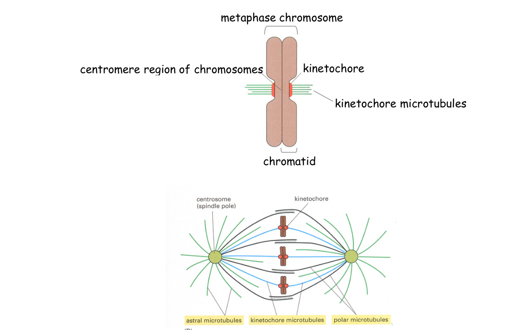</a>

Chromatid, centromere, kinetochore, and spindle labels · [MH] AHG Meiosis and Mitosis Handout (1).pdf, page/slide 3.

### Mitotic stages

* **Prophase:** chromosome condensation begins.
* Each replicated chromosome retains two sister chromatids.
* Centrosomes migrate toward opposite poles.

* **Prometaphase:** nuclear envelope breaks down.
* Spindle microtubules enter the former nuclear region.
* Kinetochores attach to spindle microtubules.

* **Metaphase:** chromosomes align at the equatorial plate.
* Chromosomes are highly condensed and readily visible.
* Polar microtubules overlap in preparation for pole separation.

* **Anaphase:** sister chromatids separate.
* Kinetochore microtubules shorten and draw chromosomes toward poles.
* Polar microtubules slide/elongate and separate poles.
* Chromosome arrival at poles marks the end of anaphase.

* **Telophase:** spindle disassembles; nuclear envelopes reform.
* Chromosomes decondense; nucleoli reappear.

* **Cytokinesis:** cytoplasm divides through a cleavage furrow.
* Cleavage = pinching inward, usually beginning during anaphase.
* Furrow deepens; a narrow midbody remains.
* Final separation produces two daughter cells.

<a href="assets/review2/mitosis-overview.jpg">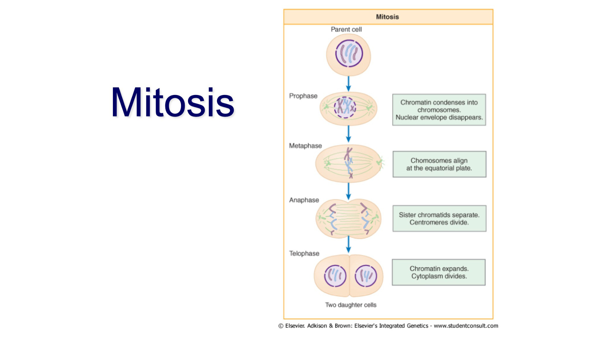</a>

Mitosis overview · [MI] AHG2022Mitosis&Meiosis.pptx, page/slide 23.

### Meiosis, bivalents, and crossing over

* One DNA replication precedes **two divisions**.
* Meiosis I separates **homologs**; meiosis II separates **sister chromatids**.
* **Prophase I:** homologs pair and non-sister chromatids recombine.
* **Bivalent:** paired homologs; four chromatids form a tetrad.
* Bivalents form during prophase I and align at metaphase I.
* **Chiasmata:** visible crossover connections between homologs.
* DNA breakage/rejoining creates recombinant chromatids.
* **Metaphase I:** homologous pairs orient independently.
* **Anaphase I:** homologs separate while sister chromatids remain joined.
* After meiosis I: 23 chromosomes, 46 chromatids, **2C DNA** per cell.
* No S phase occurs between meiosis I and II.
* Brief interkinesis may occur; DNA is not replicated again.
* After meiosis II: 23 chromosomes, 23 chromatids, **1C DNA** per product.
* Four haploid products result; oogenesis allocates cytoplasm unequally.

<a href="assets/review2/meiosis-overview.jpg">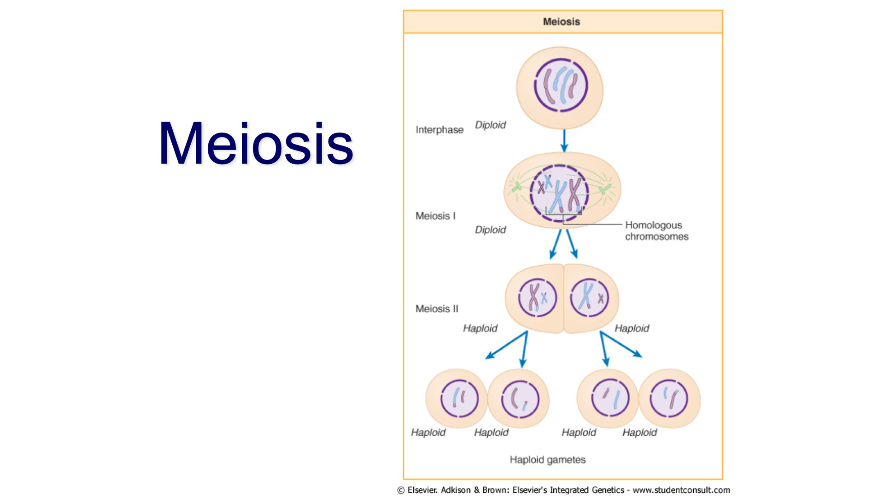</a>

Meiosis I and II overview · [MI] AHG2022Mitosis&Meiosis.pptx, page/slide 27.
<a href="assets/review2/recombination.jpg">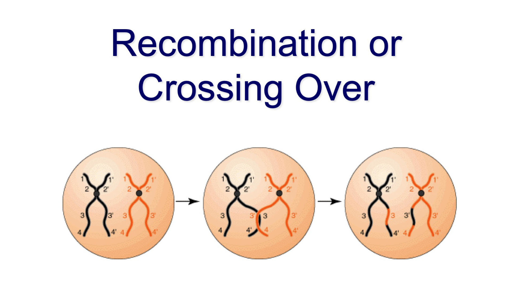</a>

Crossing over between non-sister chromatids · [MI] AHG2022Mitosis&Meiosis.pptx, page/slide 28.
<a href="assets/review2/bivalent.jpg">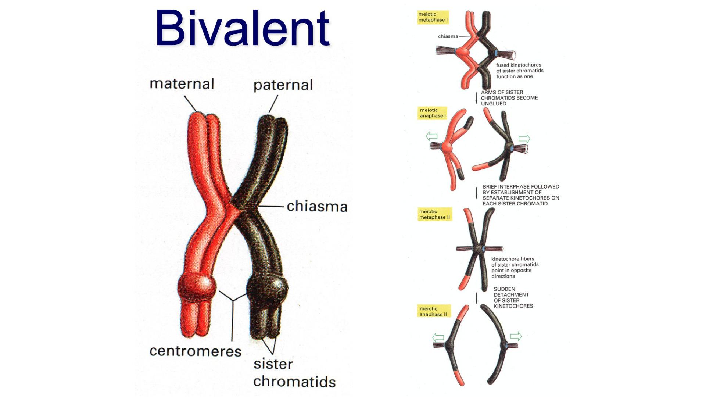</a>

Bivalent and chiasma · [MI] AHG2022Mitosis&Meiosis.pptx, page/slide 29.

### Mendel's laws and meiotic consequences

* **Segregation:** each gamete receives one allele at a typical autosomal locus.
* **Independent assortment:** different homologous pairs orient independently.
* Linked loci may depart from independent assortment.
* Assortment alone gives **2²³ ≈ 8.4 million** chromosome combinations in humans.
* Consequence 1: chromosome reduction, **diploid → haploid**.
* Consequence 2: segregation of alleles.
* Consequence 3: independent assortment of homologs.
* Consequence 4: crossing over creates new allele combinations.

### Spermatogenesis and oogenesis

* Primary spermatocyte → two secondary spermatocytes → four spermatids.
* Spermatids mature into sperm; course duration ~60–70 days.
* Primary oocytes enter prophase I during fetal life.
* Oocyte prophase arrest may last decades.
* Meiosis I finishes near ovulation.
* Secondary oocyte receives 23 replicated chromosomes and most cytoplasm.
* First polar body receives 23 replicated chromosomes and little cytoplasm.
* Secondary oocyte arrests in metaphase II.
* Fertilization triggers completion of meiosis II and second polar-body extrusion.
* One large ovum results; polar bodies retain little cytoplasm.
* Prolonged oocyte arrest contributes to maternal-age-associated aneuploidy.
* Most extra chromosome 21 copies are maternal in origin.

## Nondisjunction, markers, and UPD

### Meiosis I, meiosis II, and mitotic errors

* **Nondisjunction:** failure of chromosomes/chromatids to segregate normally.
* **MI error:** homologs fail to separate.
* MI products: two **n+1** and two **n−1** gametes.
* **MII error:** sister chromatids fail to separate in one cell.
* MII products: one **n+1**, one **n−1**, two normal gametes.
* Fertilization by a normal gamete can produce trisomy or monosomy.
* Postzygotic mitotic errors can produce **mosaicism**.
* Early errors can affect many tissues and leave no normal cell line.
* Later errors may retain normal cells alongside abnormal lines.
* Blood-cell proportions do not necessarily represent every tissue.

<a href="assets/review2/mi-error.jpg">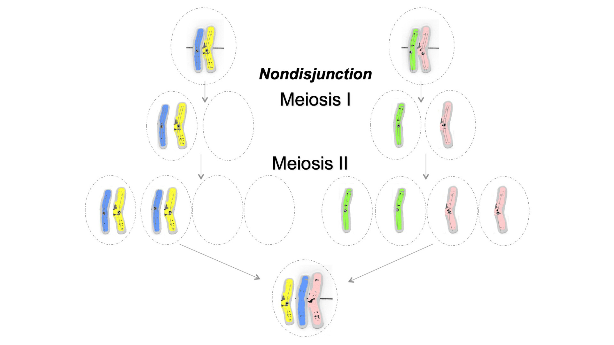</a>

Meiosis I nondisjunction · [MI] AHG2022Mitosis&Meiosis.pptx, page/slide 40.
<a href="assets/review2/mii-error.jpg">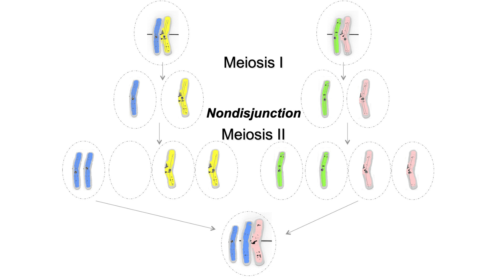</a>

Meiosis II nondisjunction · [MI] AHG2022Mitosis&Meiosis.pptx, page/slide 41.

### Sex-chromosome nondisjunction examples

* **47,XXY:** maternal MI, maternal MII, or paternal MI.
* Paternal MI can produce **XY sperm**; normal X egg → XXY.
* Paternal MII produces **XX or YY sperm**, rather than XY sperm.
* XX sperm + X egg → XXX; YY sperm + X egg → XYY.
* TBL “meiosis-II-only” answer: **XYY**, among the listed meiotic mechanisms.
* Caveat: postzygotic errors can also produce XYY mosaicism.
* **45,X/47,XYY:** early Y nondisjunction from a **46,XY zygote**.
* One daughter loses Y; the other receives both Y chromatids.
* `[8]/[12]` reports 8 and 12 analyzed cells, not whole-body percentages.
* TBL later-error answer: **45,X/46,XY/47,XXY**, with a normal cell line retained.
* The quiz's `46,XYY` is a count typo; XYY ordinarily has **47** chromosomes.

<a href="assets/review2/early-mosaicism.jpg">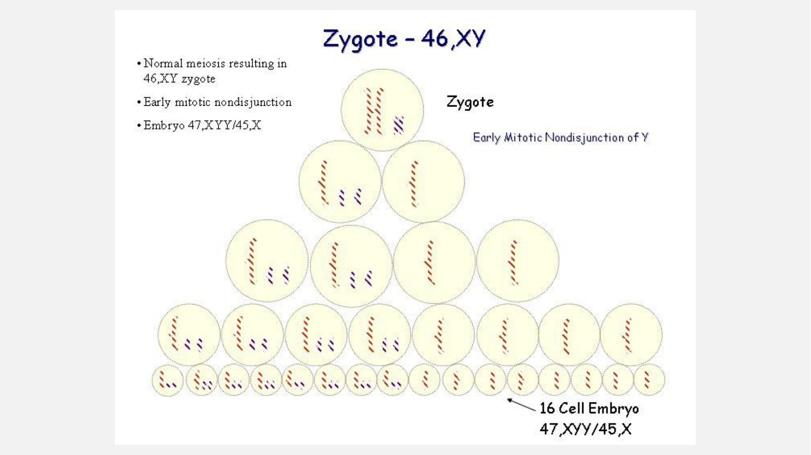</a>

46,XY zygote producing 45,X and 47,XYY lines · [CY] 2026AHG-CytoPPTwAnswers.pptx, page/slide 44.

### Genetic markers and linkage analysis

* **Genetic marker:** DNA variant with a known chromosome location.
* A marker may lie within a gene or outside genes.
* **RFLP:** restriction fragment length polymorphism; Southern blot or PCR.
* **VNTR:** variable-number tandem repeat.
* **STR/microsatellite:** short repeat unit; often analyzed by multiplex PCR.
* **SNP:** single-nucleotide polymorphism; genotyped at predefined sites.
* **Linkage:** nearby loci tend to be inherited together.
* Complete linkage: recombination fraction **0**.
* Unlinked loci: recombination fraction **0.5**.
* Unlinked expectation: 50% parental and 50% recombinant combinations.
* Informative markers distinguish the relevant parental homologs.
* Establish which marker haplotype tracks the disease allele.
* Flanking markers help recognize recombination around the disease locus.
* A crossover can separate a marker from the pathogenic variant.
* Uses: disease mapping, family tracking, PGT-M, paternity, forensics.

### Marker-based worked cases

* **Hemophilia A, flanking RFLPs:** fetus has a crossover; TBL answer **E**.
* Track both sides of the locus; one linked marker alone may mislead.

<a href="assets/review2/linkage-flanking.jpg">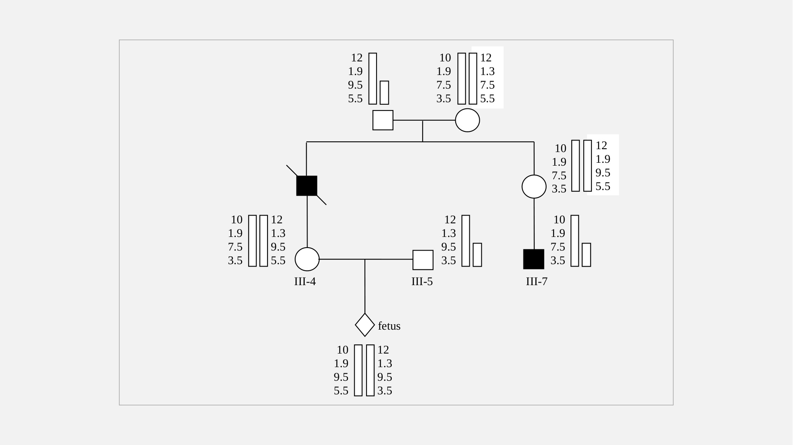</a>

Hemophilia A: flanking RFLP haplotypes · [CY] 2026AHG-CytoPPTwAnswers.pptx, page/slide 26.

* **Hemophilia A, intragenic markers:** fetus is an unaffected male; answer **B**.
* Fetus has maternal marker 4, not the affected marker-1 haplotype; the paternal X marker is absent.

<a href="assets/review2/linkage-intragenic.jpg">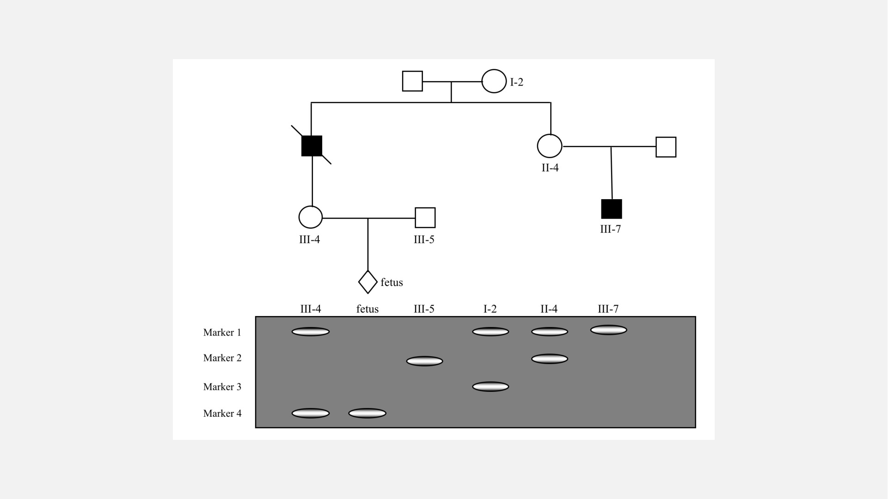</a>

Hemophilia A: intragenic marker inheritance · [CY] 2026AHG-CytoPPTwAnswers.pptx, page/slide 29.

* **Chromosome 6 disease marker:** fetus inherits the affected paternal homolog; answer **A**.
* Affected child and fetus share paternal **6.1-kb** marker inheritance in the key.

<a href="assets/review2/chr6-marker.jpg">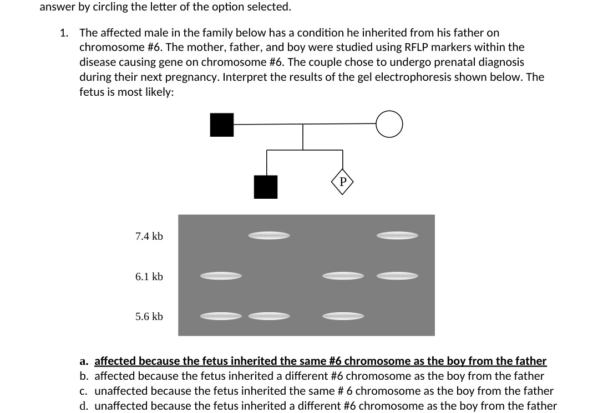</a>

Chromosome 6 disease-linked marker in fetus · [NQ] NondisjunctionTBLQuizKey.docx, page/slide 1.

* **Trisomy 18 gel:** child has paternal 5- and 4-kb alleles plus maternal 7-kb allele.
* Two distinct paternal centromeric alleles → **paternal MI**; answer **C**.
* This TBL gives recurrence as **1.7 × maternal-age-related risk**.
* Aneuploid phenotype slides instead give a broad **~1%** figure; keep the source context.

<a href="assets/review2/trisomy18-gel.jpg">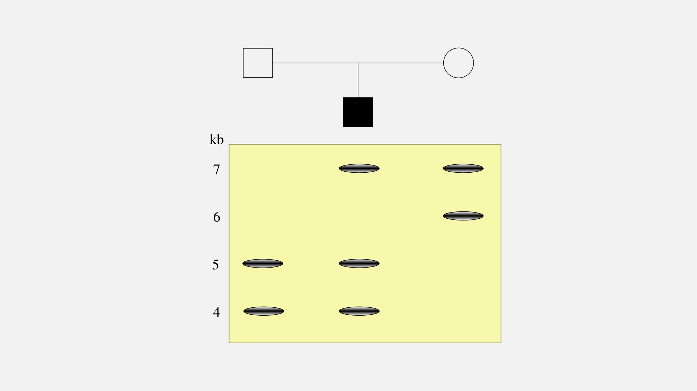</a>

Trisomy 18: parental origin and meiosis stage · [CY] 2026AHG-CytoPPTwAnswers.pptx, page/slide 32.

* **Trisomy 21 gel:** shared 9-kb parental allele limits parent-of-origin inference.
* Key answer: **either maternal or paternal MII**; answer **C**.
* Band intensity/dosage and additional informative markers can resolve ambiguity.

<a href="assets/review2/trisomy21-gel.jpg">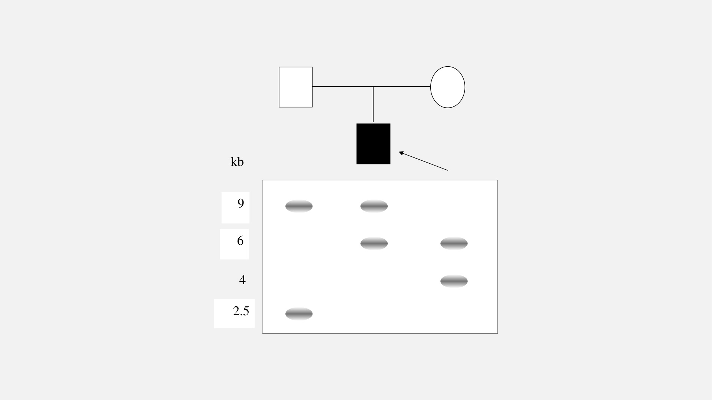</a>

Trisomy 21: limits of a shared marker allele · [CY] 2026AHG-CytoPPTwAnswers.pptx, page/slide 36.

* **Chromosome-painting quiz:** duplicated paternal homolog → **paternal MII**; answer **D**.
* **Trisomy 13 marker quiz:** **maternal MI**; answer **A**.
* Use centromere-proximal markers to reduce confusion from crossing over.

<a href="assets/review2/painted-origin.jpg">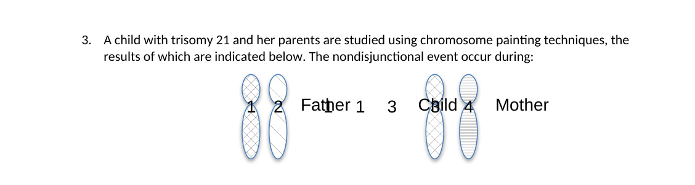</a>

Chromosome painting near the centromere · [NQ] NondisjunctionTBLQuizKey.docx, page/slide 1.

### UPD, isodisomy, and heterodisomy

* **UPD:** both homologs, or a chromosome segment, inherited from one parent.
* **Isodisomy:** two copies of one parental homolog/segment.
* **Heterodisomy:** both different homologs from one parent.
* **Trisomy rescue:** loss of one chromosome from a trisomic cell.
* Loss of the sole homolog from the other parent can leave UPD.
* Monosomy rescue by chromosome duplication can produce isodisomy.
* MI-derived UPD often retains heterodisomy near the centromere.
* MII-derived UPD may show centromeric isodisomy.
* Recombination can produce mixed iso-/heterodisomic regions.
* UPD can alter imprinting or unmask a recessive pathogenic variant.
* SNP array may suggest isodisomy through copy-neutral homozygosity.
* Pure heterodisomy can be missed without parental analysis.
* Parent-of-origin testing: parental SNP/STR analysis.
* Imprinting disorders may require methylation studies.
* FISH counts/localizes targets; it does not establish parental origin.

## Cytogenetic tests and result interpretation

### Karyotype preparation and clinical use

* Peripheral blood is a common sample; other tissues depend on indication.
* Culture lymphocytes with **PHA** to stimulate division.
* Course workflow: ~5 mL blood; culture ~3 days at 37°C.
* **Colchicine/colcemid:** inhibit spindle formation and enrich metaphases.
* Hypotonic treatment swells cells and spreads chromosomes.
* Fix cells; drop onto slides; stain, photograph, and arrange homologs.
* Giemsa is a stain; a **chiasma** is a meiotic crossover connection.
* Shows chromosome number and large structural rearrangements.
* Detects balanced translocations/inversions that CMA usually misses.
* Uses: recognizable chromosome syndrome, familial rearrangement, recurrent miscarriage.
* Trisomy diagnosis plus recurrence mechanism → **karyotype**.
* Suspected Turner syndrome/mosaic sex-chromosome abnormality → **karyotype**.
* Course resolution: routine banding >~10 Mb; high-resolution banding ~2–3 Mb.
* Actual resolution depends on preparation, region, and laboratory.

### FISH: targeted detection and localization

* **Fluorescence in situ hybridization:** labeled probe binds complementary target DNA.
* Denature DNA → hybridize probe → wash → fluorescence microscopy.
* Multiple probe colors can assess several targets.
* **Interphase FISH:** rapid signal counting in nondividing nuclei.
* **Metaphase FISH:** localizes a target to a chromosome/derivative.
* Uses: rapid testing for 13, 18, 21, X, Y aneuploidy.
* Multi-chromosome enumeration can suggest triploidy.
* Uses: targeted microdeletion/duplication, marker chromosome, translocated material.
* **SRY present in an XX fetus → FISH to locate SRY**.
* Standard trisomy FISH does not establish free trisomy versus translocation trisomy.
* Normal targeted FISH does not exclude abnormalities elsewhere.
* A deletion smaller than the probe may retain a visible signal.
* FISH is inefficient as a genome-wide survey.
* A positive rapid prenatal result often needs broader chromosome characterization.
* PWS/Angelman FISH detects a deletion, but misses nondeletion mechanisms.
* Course turnaround: rapid FISH ~48 hours; cultured karyotype often ~2 weeks.

<a href="assets/review2/fish-counting.jpg">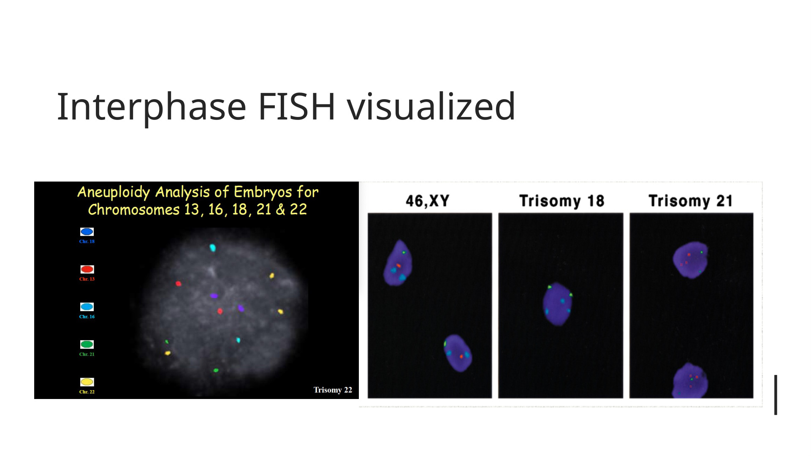</a>

Interphase FISH: normal and trisomic signal counts · [MC] AHG-MolecularCytogeneticsPPT.pptx, page/slide 4.
<a href="assets/review2/fish-deletion.jpg">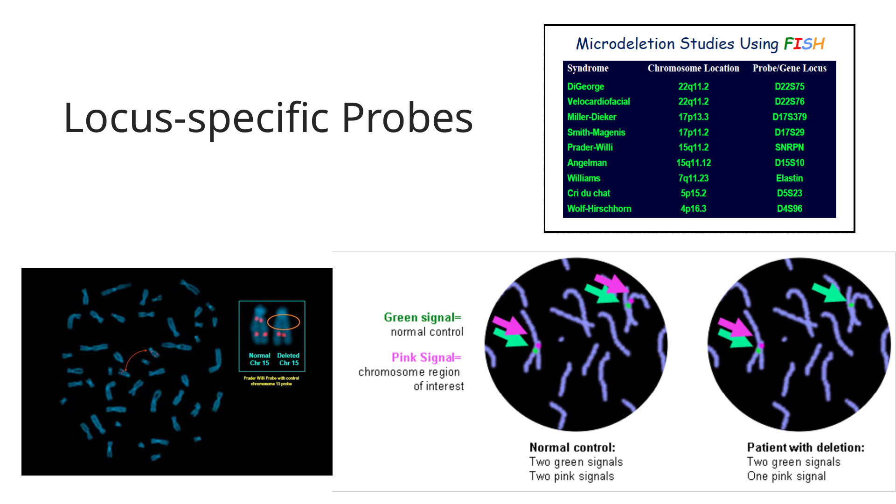</a>

Locus-specific FISH probes and a missing signal · [MC] AHG-MolecularCytogeneticsPPT.pptx, page/slide 5.

### aCGH: copy-number comparison

* Patient and reference DNA receive different fluorescent labels.
* Hybridize to known genomic probes; compare relative signal.
* Higher patient/reference signal → gain; lower signal → loss.
* Detects deletions, duplications, and many whole-chromosome imbalances.
* Balanced translocations/inversions usually have no detectable dosage change.
* Whole-genome triploidy is generally missed by relative copy-number normalization.
* **3/2 ratio:** log₂ ≈ **+0.58**, consistent with a three-copy gain.
* **2/2 ratio:** log₂ = **0**, normal relative dosage.
* **1/2 ratio:** log₂ = **−1**, consistent with a one-copy deletion.
* Course resolution: metaphase CGH ~5–10 Mb; array CGH ~200 kb.
* Probe density/spacing determine actual detectable size.
* Patient signal can come from constitutional or tumor DNA.
* Historical handout study: ~20% imbalance detection in a selected normal-karyotype ID cohort.
* That cohort-specific yield is not a universal diagnostic rate.

<a href="assets/review2/array-workflow.jpg">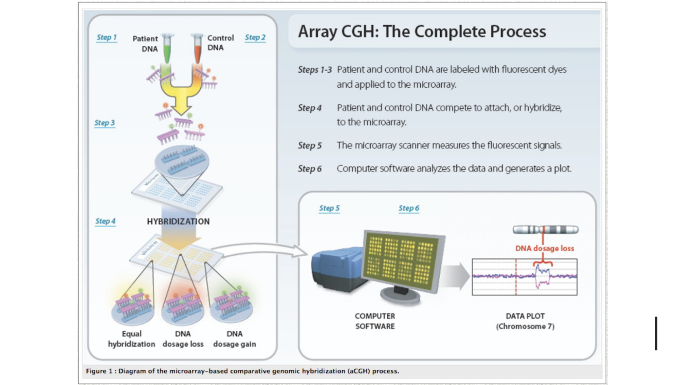</a>

aCGH experimental workflow · [MC] AHG-MolecularCytogeneticsPPT.pptx, page/slide 10.
<a href="assets/review2/array-ratios.jpg">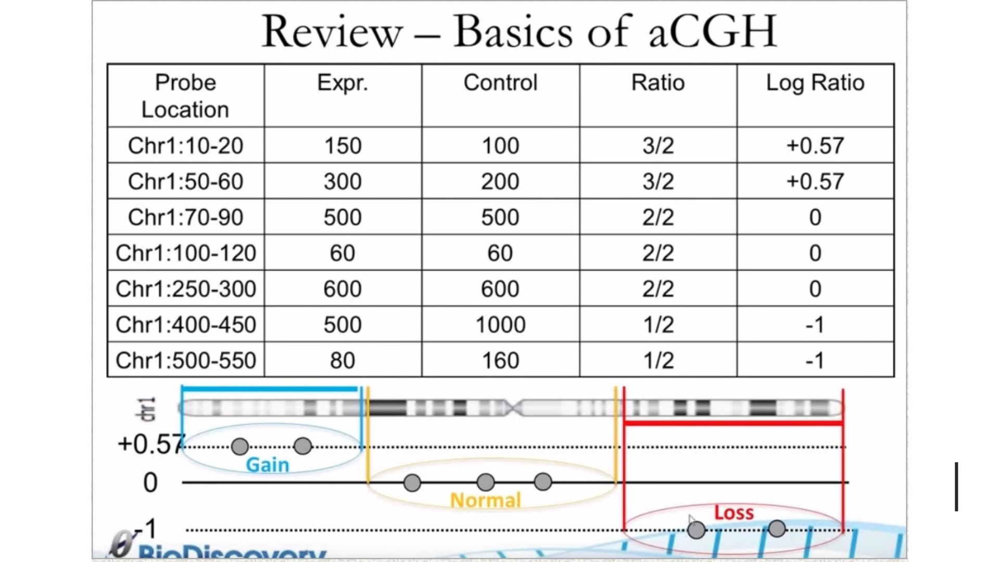</a>

aCGH ratios and log2 copy-number signals · [MC] AHG-MolecularCytogeneticsPPT.pptx, page/slide 12.
<a href="assets/review2/array-data.jpg">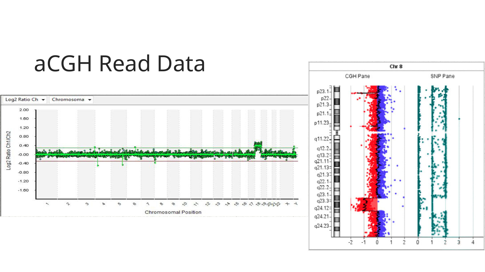</a>

aCGH trace and corresponding SNP tracks · [MC] AHG-MolecularCytogeneticsPPT.pptx, page/slide 13.

### SNP array: allele pattern plus copy number

* Genotypes predefined **SNP sites**; does not sequence all variants.
* Evaluates copy number and **B-allele frequency (BAF)**.
* No co-hybridized second patient/reference sample; reference datasets still support interpretation.
* Normal diploid BAF: **0, 0.5, 1** = AA, AB, BB.
* Three-copy BAF: **0, ⅓, ⅔, 1** = AAA, AAB, ABB, BBB.
* Hemizygous deletion: **0 and 1**, with reduced copy-number intensity.
* Copy-neutral homozygosity: **0 and 1**, with normal copy-number intensity.
* Two BAF tracks alone do not prove a deletion.
* Four tracks on one chromosome suggest trisomy.
* Genome-wide three-copy allele patterns can identify triploidy.
* **ROH/LCSH/AOH:** regions of homozygosity/absence of heterozygosity.
* AOH means **absence of heterozygosity**, not “absence of homozygosity.”
* ROH on one chromosome may suggest UPD/isodisomy.
* ROH across multiple chromosomes may suggest parental relatedness.
* Copy-neutral heterodisomy may need parental testing for detection.
* SNP arrays do not generally detect balanced rearrangements.

<a href="assets/review2/snp-baf.jpg">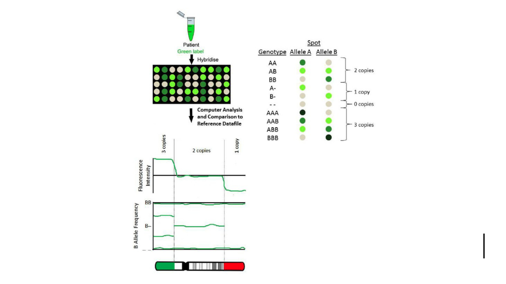</a>

SNP allele clusters and copy-number states · [MC] AHG-MolecularCytogeneticsPPT.pptx, page/slide 15.

### CNVs, array scope, and follow-up

* **CNV:** deletion or duplication changing regional DNA copy number.
* CNVs may be benign, pathogenic, or uncertain.
* Classification: benign, likely benign, VUS, likely pathogenic, pathogenic.
* Inheritance and phenotype help interpretation; inheritance alone does not prove benignity.
* Historical resource: Sanger Copy Number Variant Project.
* Excluding highly variable regions can reduce benign findings.
* **Targeted array:** selected clinically important regions.
* **Genome-wide array:** broader coverage; potentially more uncertain findings.
* Course ACMG framework: CMA for unexplained MCA, DD/ID, or ASD.
* Course ACOG framework: fetal structural anomaly + invasive diagnosis → offer CMA.
* Growth/speech delay may warrant testing depending on the overall presentation.
* Follow-up: parental studies, clinical genetics review, genetic counseling.
* Cytogenetics/FISH may clarify location, structure, or recurrence mechanism.
* A VUS is not a confirmed explanation for the phenotype.
* Probe coverage, mosaicism, and sample type limit interpretation.

<a href="assets/review2/test-comparison.jpg">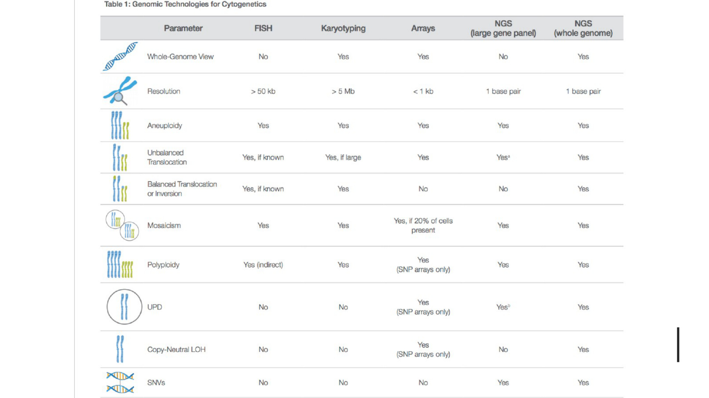</a>

Capabilities and limits of chromosome tests · [MC] AHG-MolecularCytogeneticsPPT.pptx, page/slide 17.

### Choosing complementary tests

| Clinical question | Main approach |
|---|---|
| Obvious trisomy phenotype + recurrence assessment | Karyotype |
| Known balanced parental translocation | Fetal karyotype; CMA for imbalance |
| Unexplained DD/ID/MCA | CMA in the course framework |
| Known target needs chromosome localization | Metaphase FISH |
| Rapid common-aneuploidy count | Interphase FISH |
| Small deletion/duplication or breakpoint imbalance | CMA |
| Suspected copy-neutral homozygosity/triploidy | SNP array |
| UPD parent-of-origin question | Parental markers ± methylation |

* Known chromosome partner does not make FISH a complete fetal survey.
* **Karyotype:** chromosome arrangement; **CMA:** DNA dosage; **FISH:** selected target presence/location.
* CVS samples placenta; amniocentesis samples amniotic-fluid cells.
* At 12 weeks, CVS is an option; amniocentesis is generally offered from ~15 weeks.
* Neither routine karyotype nor CMA measures functional X-inactivation directly.

## Aneuploid syndromes

### Down syndrome — trisomy 21

* Example: `47,XX,+21`; course frequency **~1/600 newborns**.
* Confirm with chromosome analysis; identify free trisomy versus translocation.
* Mechanisms: **~95% nondisjunction**, 3–4% translocation, 1–2% mosaicism.
* Features: mild–moderate ID, hypotonia, short stature.
* Face: brachycephaly, flat nasal bridge, epicanthal folds, upslanting palpebral fissures.
* Small mouth/ears, protruding tongue, excess nuchal skin.
* Short fifth finger/clinodactyly; single transverse palmar crease.
* Heart defects, GI atresia, hip dislocation, neurologic differences.
* Hearing loss, otitis media, obstructive sleep apnea.
* Cataracts and refractive errors.
* Thyroid disease, diabetes, leukemia, premature aging/Alzheimer-type dementia risk.
* Care: treat manifestations, early intervention, education, vocational support, anticipatory guidance.
* No intervention removes the extra chromosome.
* Mosaic phenotype varies; blood mosaicism does not reliably predict severity.
* Course nondisjunction recurrence: **1% or maternal-age risk, whichever is greater**.
* Translocation recurrence requires parental karyotypes and rearrangement-specific counseling.
* Course estimate: 25–50% of translocation cases are inherited.
* Homologous 21;21/i(21q) carrier: surviving offspring expected to have Down syndrome.
* “100% affected survivors” does not mean 100% live-birth probability per conception.

<a href="assets/review2/down-mechanism.jpg">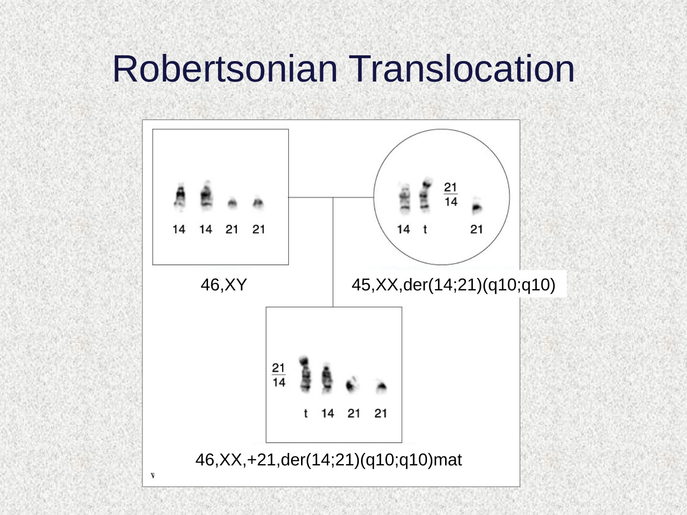</a>

Balanced Robertsonian carrier and translocation Down syndrome · [AN] Aneuploid syndrome phenotypes review.pptx, page/slide 7.

### Edwards syndrome — trisomy 18

* Example: `47,XY,+18`; usually nondisjunction, rarely translocation.
* Prenatal/postnatal growth restriction, polyhydramnios, single umbilical artery.
* Microcephaly, hypertonia, severe ID.
* **Clenched hands with overlapping fingers; rocker-bottom feet**.
* Heart, kidney, genitourinary defects; diaphragmatic hernia.
* Feeding, respiratory, apnea, cardiac, and CNS complications.
* Most affected conceptions are lost prenatally.
* Historical slides: ~30% die by one month; ~50% by two months; ~10% survive one year.
* Survival depends on cohort and care; historical figures are not individual predictions.
* Maternal-age association; course phenotype recurrence estimate **~1%**.
* Marker TBL instead gives **1.7 × age-related risk** for its trisomy-18 example.

<a href="assets/review2/trisomy18-features.jpg">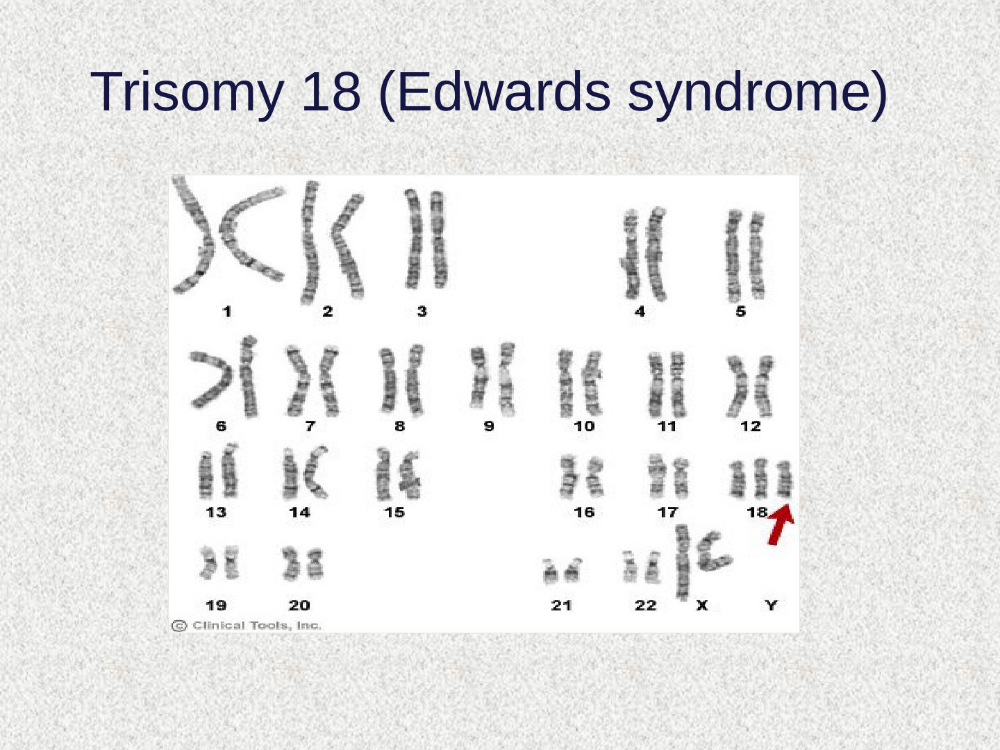</a>

Trisomy 18 phenotype illustration · [AN] Aneuploid syndrome phenotypes review.pptx, page/slide 10.

### Patau syndrome — trisomy 13

* Example: `47,XX,+13`; nondisjunction, translocation, or mosaicism.
* **Holoprosencephaly, cleft lip/palate, polydactyly**.
* Microphthalmia, microcephaly, low-set ears, broad flat nose.
* Syndactyly = fused digits; polydactyly = extra digits.
* Growth restriction, single umbilical artery, heart/renal anomalies, severe ID.
* Seizures and failure to thrive in survivors.
* Most affected conceptions are lost prenatally.
* Historical slides: ~80% die in month one; ~5% survive six months.
* Course nondisjunction recurrence estimate **~1%**; maternal-age effect.
* Translocation cases require parental karyotypes, not a generic “higher risk” assumption.

<a href="assets/review2/trisomy13-features.jpg">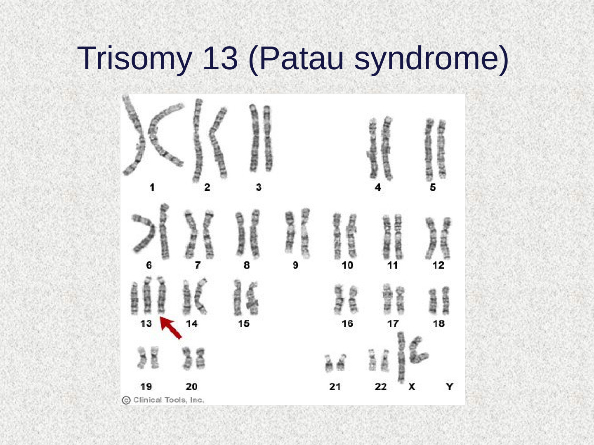</a>

Trisomy 13 phenotype illustration · [AN] Aneuploid syndrome phenotypes review.pptx, page/slide 13.

### Turner syndrome — 45,X and related complements

* Course frequency: **1/2,000–1/5,000 female live births**.
* Course estimate: ~99% of 45,X conceptions lost prenatally.
* Mosaicism/structural X changes may modify phenotype.
* Short stature, low birth weight/slow growth, hand/foot lymphedema.
* Webbed neck, low hairline, shield chest, cubitus valgus.
* Strabismus, micrognathia, high-arched palate.
* Gonadal dysgenesis, ovarian insufficiency, primary amenorrhea, infertility.
* Estrogen replacement supports puberty when clinically indicated.
* Y material raises gonadoblastoma concern; specialist assessment is required.
* Historical “exploratory laparotomy” wording is not a universal current recommendation.
* Current gonadectomy decisions are individualized.
* Cardiovascular/renal disease, hypertension, hearing loss, thyroid disease.
* Glucose intolerance and hyperlipidemia.
* ID is uncommon; visuospatial, mathematics, and memory difficulties may occur.
* Behavioral/attention differences, including hyperactivity, may occur.
* Unexpected ID warrants assessment for structural X changes/other causes.
* Usually sporadic; missing sex chromosome often paternal in origin.
* No typical maternal-age association.

<a href="assets/review2/turner-features.jpg">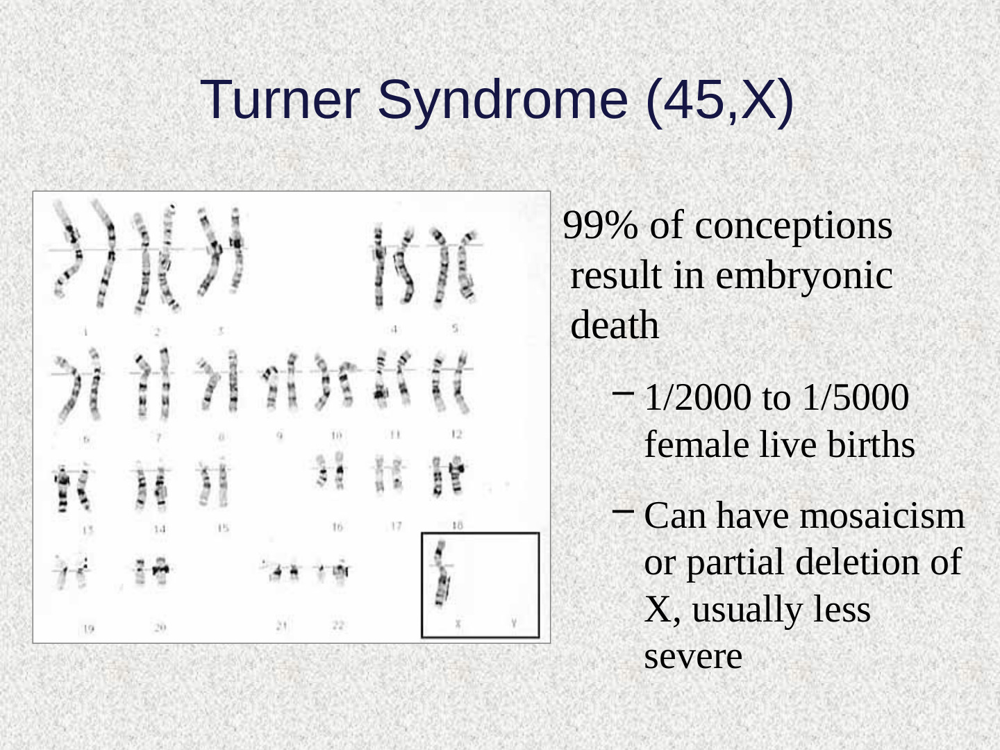</a>

Turner syndrome phenotype illustration · [AN] Aneuploid syndrome phenotypes review.pptx, page/slide 20.

### Klinefelter syndrome — 47,XXY

* Course frequency: **~1/1,000 male births**.
* Can arise from maternal MI/MII or paternal MI.
* Course mosaic estimate: ~15% **46,XY/47,XXY**.
* Mosaicism may preserve more testicular function; tissue distribution matters.
* Tall/slender build, small testes/penis, low testosterone.
* Poor secondary sexual development, azoospermia/infertility.
* Gynecomastia: course estimate **~40%**.
* Adult obesity risk; endocrine management depends on clinical assessment.
* Learning/language difficulties; course estimate 15–20% with IQ <80.
* Older slides list immaturity, insecurity, shyness, boastfulness/assertiveness; these are nonspecific descriptors.
* Often diagnosed during adult infertility evaluation.
* Important chromosome cause of male hypogonadism and infertility.
* Course enrichment: ~1/10 azoospermic males; ~1/100 males with significant learning difficulty.
* Additional X chromosomes generally increase clinical effects.

<a href="assets/review2/klinefelter-features.jpg">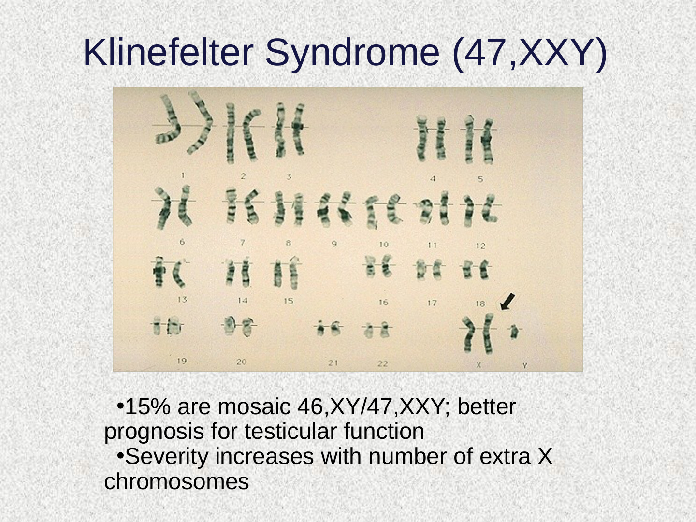</a>

Klinefelter syndrome phenotype illustration · [AN] Aneuploid syndrome phenotypes review.pptx, page/slide 25.

### Trisomy X — 47,XXX

* Course frequency: **~1/1,000 female births**.
* Usually maternal meiotic nondisjunction; maternal-age association.
* Physical phenotype may be subtle or apparently typical.
* Course estimates: ~75% fertile; 15–25% mild learning difficulties.
* Offspring usually have normal chromosome complements.
* Additional X chromosomes generally increase clinical effects.

### XYY syndrome — 47,XYY

* Course frequency: **~1/1,000 male births**.
* Paternal MII nondisjunction; postzygotic mosaic forms also occur.
* No clear paternal-age association in the slides.
* Often subtle phenotype; taller-than-average stature.
* Learning/language or behavioral difficulties may occur.
* Historical slides report IQ ~10–15 points below siblings on average.
* Individual cognition varies; this is not a prediction for every patient.

## Genomic disorders and deletion syndromes

### Contiguous gene syndromes and discovery

* Neighboring genes are deleted/duplicated together.
* Gene dosage across the region produces the combined phenotype.
* Common findings: DD/ID, dysmorphism, organ malformations.
* Mechanisms include de novo events and aberrant recombination.
* **Phenotype-first:** recognize syndrome, then identify chromosome cause.
* **Genotype-first/reverse dysmorphology:** identify CNV, then characterize clinical variability.
* CMA helped reveal variable and atypical presentations.
* Historical resources in slides: **ECARUCA** and **RareChromo/Unique**.

### 22q11.2 deletion syndrome

* Course frequency: **~1/4,000 live births**; common recurrent microdeletion syndrome.
* **Conotruncal heart defects**, palate abnormalities, thymic/parathyroid hypoplasia.
* Immune deficiency; hypocalcemia may cause seizures.
* Hearing loss, DD/learning difficulties, psychiatric risk including schizophrenia.
* Kidney, GI, skeletal, and characteristic facial findings.
* **LCR misalignment → NAHR → recurrent deletion/duplication**.
* Usually de novo; inherited deletion follows **autosomal dominant** transmission.
* Parent with deletion: **50% transmission per pregnancy**.
* Negative parental blood tests: low residual recurrence; germline mosaicism remains possible.
* Severity can differ greatly within a family.
* **Case:** 12 weeks, NT **4.2 mm** → broad differential, not a specific diagnosis.
* Differential: chromosome disorder, isolated heart defect, single-gene disorder, genomic syndrome.
* Case testing: **CVS + karyotype + prenatal array** → 22q11.2 deletion.
* Follow-up: parental deletion testing and genetic counseling.
* **18–22 weeks:** detailed ultrasound + fetal echocardiogram.
* Assess heart, palate/airway/GI, kidneys, skeleton, hernias, polyhydramnios.
* Imaging cannot predict all later learning, immune, or psychiatric effects.
* CMA detects the deletion; appropriate targeted FISH/MLPA can test a known familial deletion.

<a href="assets/review2/22q11-nahr.jpg">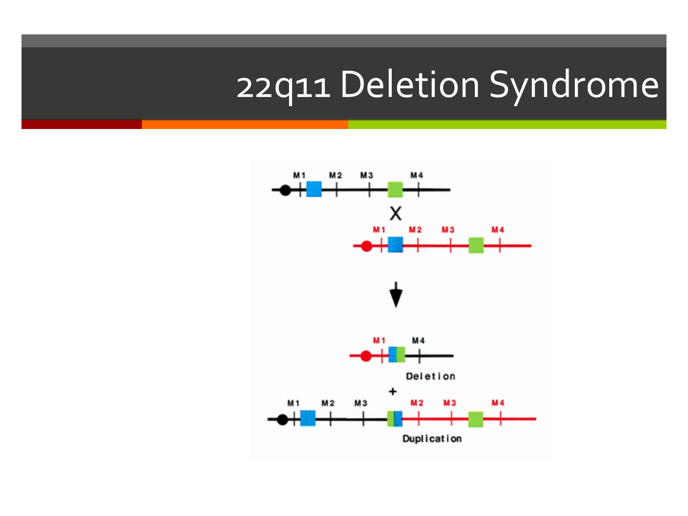</a>

Low-copy repeats and recurrent 22q11.2 rearrangements · [DE] Deletion syndromes.pdf, page/slide 11.

### 1p36 deletion syndrome

* Course frequency: **~1/5,000**; course estimate **~95% de novo**.
* Improved cytogenetics/FISH helped recognition in the 1990s.
* Hypotonia, microcephaly, growth delay, severe learning difficulties, epilepsy.
* Straight eyebrows, deep-set eyes, midface hypoplasia.
* CMA defines deletion extent; parental studies assess rearrangement/recurrence.

<a href="assets/review2/1p36-features.jpg">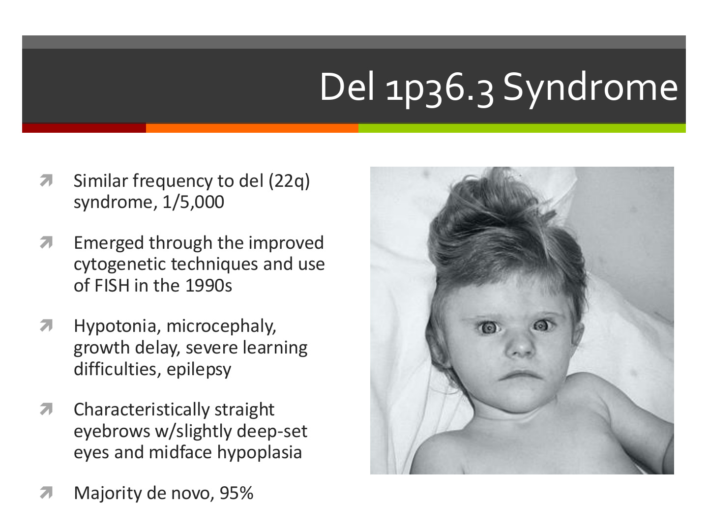</a>

1p36 deletion clinical clues · [DE] Deletion syndromes.pdf, page/slide 13.

### Williams syndrome — 7q11.23 deletion

* Deletion includes **ELN**, within the Williams–Beuren critical region.
* **Supravalvar aortic stenosis (SVAS)**; hypertension.
* Small upturned nose, long philtrum, wide mouth/prominent lips, small chin.
* Stellate/lacy iris; small widely spaced teeth; epicanthal folds.
* Growth/feeding difficulties, hypotonia, DD/ID, endocrine abnormalities.
* Socially engaging/talkative presentation; visuospatial difficulties may coexist.
* Historical “cocktail party manner” is a descriptive phrase, not a full cognitive assessment.
* **Case:** 3-year-old with feeding delay, stellate iris, and high BP → suspect Williams syndrome.
* Diagnostic deletion testing: CMA or appropriate targeted FISH/MLPA.
* Cardiac workup: ECG/EKG and **echocardiography** for structural disease.
* Care: early intervention, special education, vocational support.
* Speech, PT/OT, feeding, and sensory therapies as needed.
* Assess anxiety/attention difficulties; SVAS may require surgery.

<a href="assets/review2/williams-features.jpg">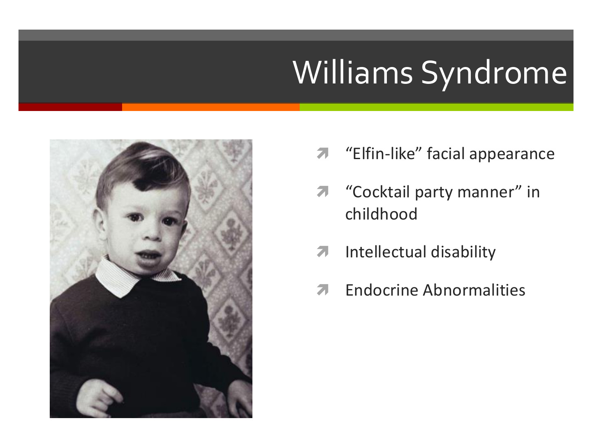</a>

Williams syndrome clinical clues · [DE] Deletion syndromes.pdf, page/slide 17.

### Cri-du-chat syndrome — 5p deletion

* First chromosome deletion syndrome described in **1963**.
* Deletions may be terminal/interstitial; course breakpoints **p13–p15.2**.
* **Cat-like cry**, microcephaly, moderate–severe ID, heart defects.
* Round face, hypertelorism, epicanthal folds, low-set ears, micrognathia.
* Usually de novo; course estimate **10–15% parental translocation**.
* CMA defines dosage loss; karyotype/parental studies assess structural mechanism.

<a href="assets/review2/cri-du-chat-features.jpg">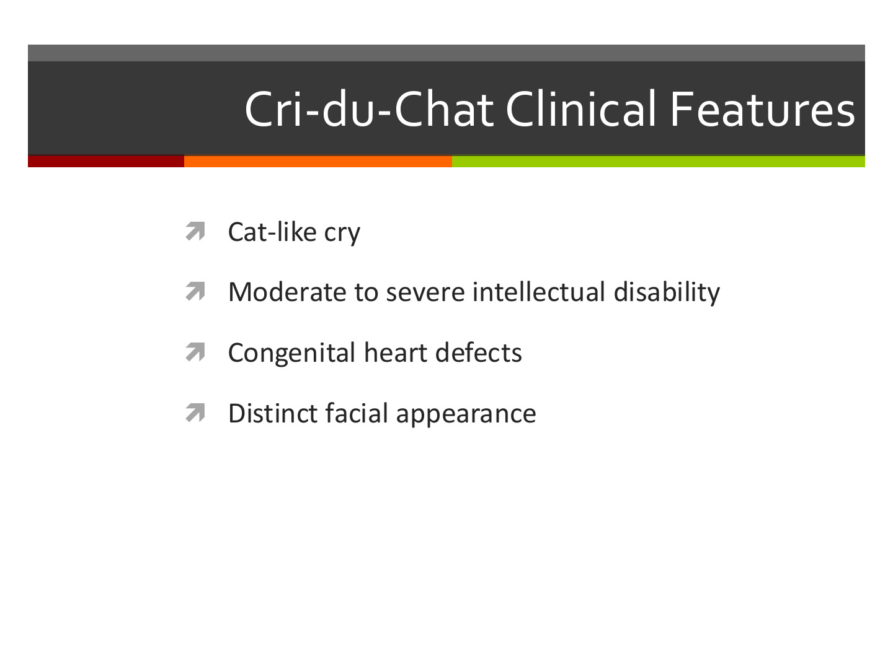</a>

Cri-du-chat syndrome clinical clues · [DE] Deletion syndromes.pdf, page/slide 20.

### Wolf–Hirschhorn syndrome — 4p deletion

* **4p−**; large deletions may be visible on karyotype.
* Subtle deletions require molecular testing/CMA.
* Prenatal/postnatal growth failure, microcephaly, DD/ID, seizures, hypotonia.
* **Greek warrior helmet:** broad nasal root continuing into forehead.
* Hypertelorism, high-arched eyebrows, broad nose, short philtrum.
* Downturned mouth, dysplastic ears/pits/tags, cleft lip/palate.
* Heart, renal, and skeletal abnormalities.
* Mottled/dry skin and dental problems.
* Deletion extent influences severity.
* De novo or unbalanced translocation; slides cite “almost half” for translocations in their cohort/context.
* Parental karyotypes matter when an unbalanced rearrangement is found.

<a href="assets/review2/whs-deletion.jpg">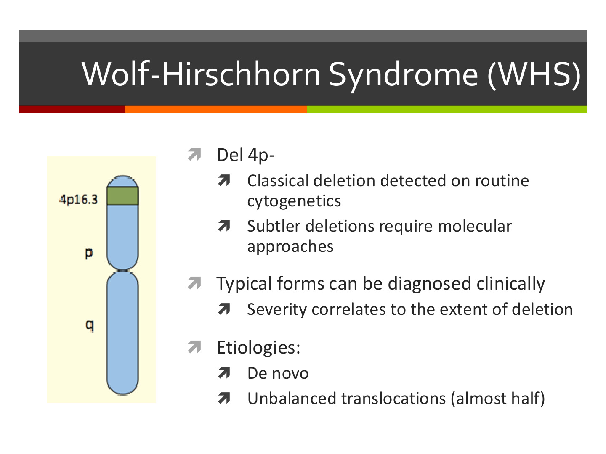</a>

Wolf–Hirschhorn deletion and chromosome mechanism · [DE] Deletion syndromes.pdf, page/slide 22.
<a href="assets/review2/whs-features.jpg">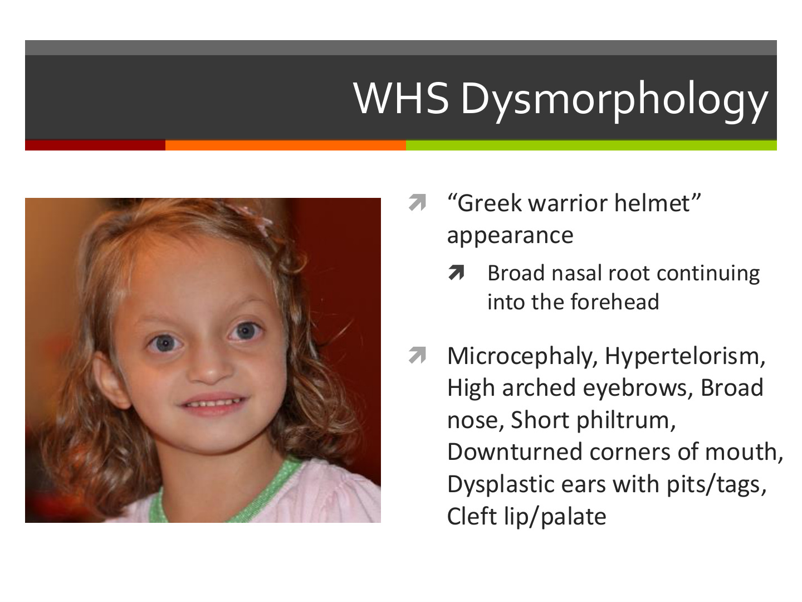</a>

Wolf–Hirschhorn facial findings · [DE] Deletion syndromes.pdf, page/slide 23.

## Structural chromosome rearrangements

### Deletions, duplications, and insertions

* **Deletion:** loss of a chromosome segment.
* **Terminal deletion:** distal segment lost after a breakpoint.
* **Interstitial deletion:** internal segment lost between two breakpoints.
* **Duplication:** extra copy of a segment.
* **Tandem duplication:** repeated segment adjacent in the same orientation.
* **Mirror/inverted duplication:** repeated segment has reversed orientation.
* **Insertion:** segment moves within one chromosome or into another chromosome.
* Insertion usually requires three breaks.
* Balanced rearrangement preserves dosage but may disrupt a gene/regulatory region.
* Unbalanced rearrangement changes dosage and may cause miscarriage or congenital anomalies.

<a href="assets/review2/terminal-deletion.jpg">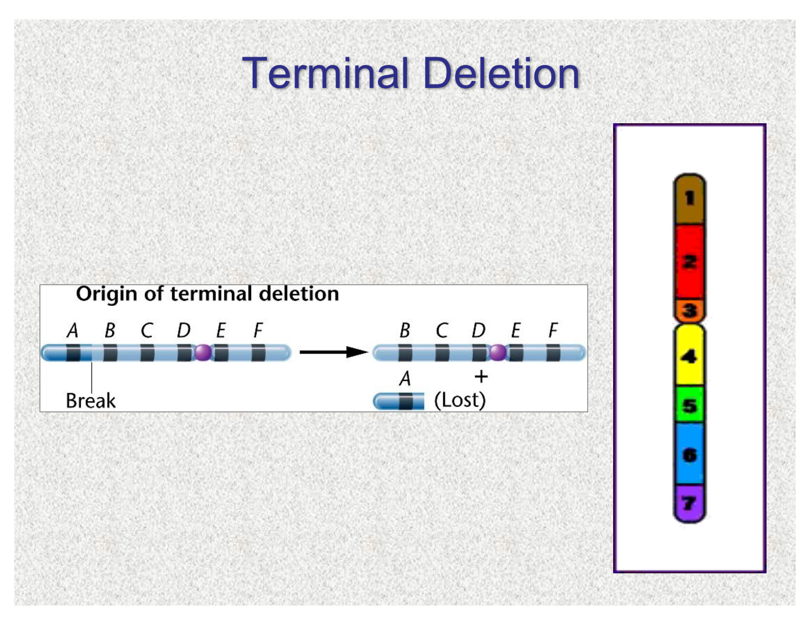</a>

Terminal deletion · [TR] AHG Translocations PPT (1).pdf, page/slide 5.
<a href="assets/review2/interstitial-deletion.jpg">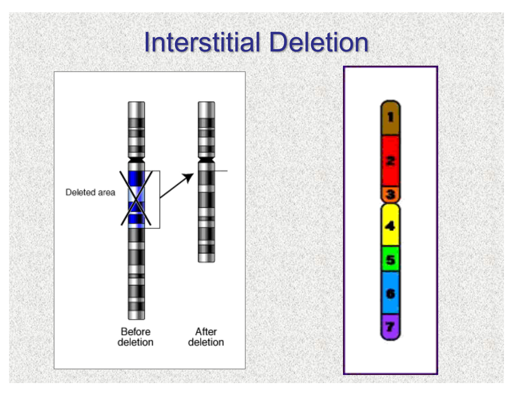</a>

Interstitial deletion · [TR] AHG Translocations PPT (1).pdf, page/slide 4.
<a href="assets/review2/tandem-duplication.jpg">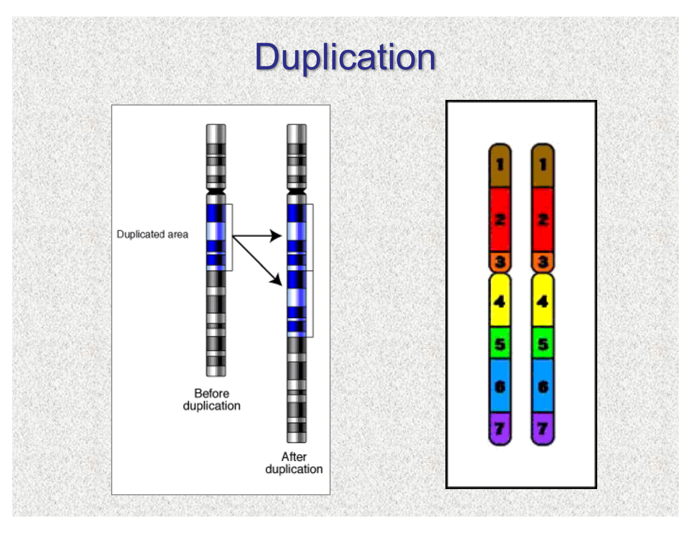</a>

Tandem duplication · [TR] AHG Translocations PPT (1).pdf, page/slide 2.
<a href="assets/review2/mirror-duplication.jpg">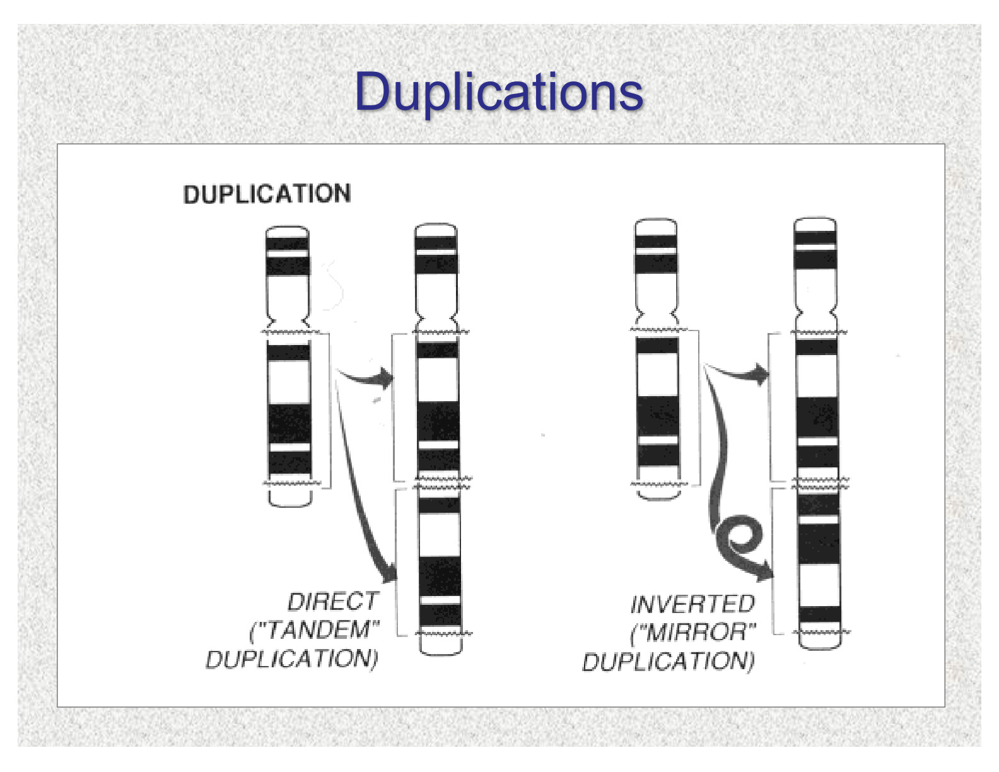</a>

Mirror duplication · [TR] AHG Translocations PPT (1).pdf, page/slide 3.
<a href="assets/review2/insertion.jpg">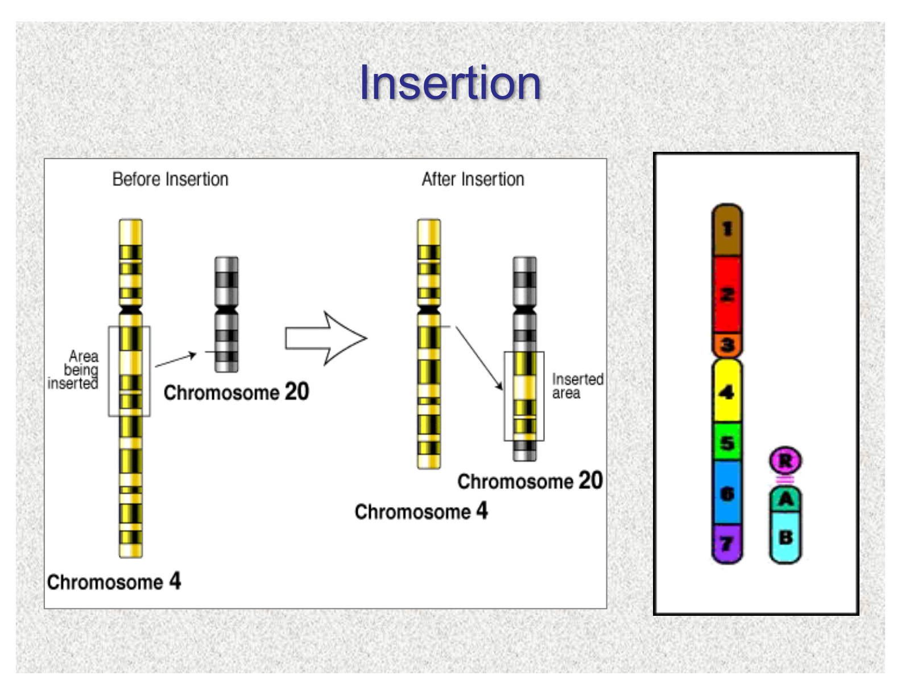</a>

Insertion rearrangement · [TR] AHG Translocations PPT (1).pdf, page/slide 6.

### Isochromosomes

* Two copies of one chromosome arm; the other arm is lost.
* Produces arm-level trisomy/monosomy when paired with a normal homolog.
* `i(21q)` contains two chromosome-21 long arms.
* i(21q) carrier gametes carry two 21q copies or none.
* Normal fertilization → trisomy 21 or nonviable monosomy 21.
* TBL highest Down-syndrome risk: **male i(21q) carrier**.

<a href="assets/review2/isochromosome.jpg">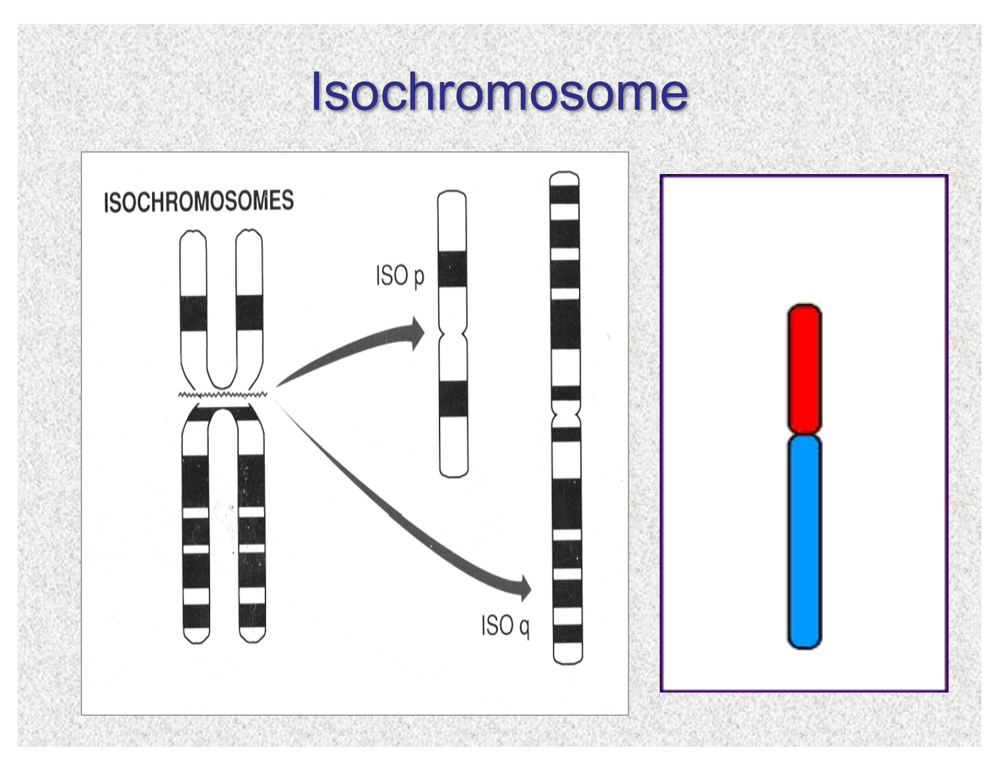</a>

Isochromosome formation · [TR] AHG Translocations PPT (1).pdf, page/slide 9.

## Reciprocal translocations

### Carrier status and derivative interpretation

* Reciprocal translocation = exchange between two nonhomologous chromosomes.
* Course carrier frequency: **~1/500**.
* Simple reciprocal translocation usually involves two chromosomes and two breakpoints.
* Balanced carrier: no apparent net loss/gain; often clinically unaffected.
* Breakpoint disruption/position effects can cause problems despite apparent balance.
* **Translocated segments:** exchanged distal material.
* **Centric segments:** material retained with each centromere.
* **Single-segment exchange, course usage:** one exchanged segment is very small/telomeric.
* **Double-segment exchange, course usage:** both exchanged segments are large.
* Inheriting one derivative without its complementary partner can cause duplication + deletion.
* `der(3)t(3;12)(q32;p13.2)`: centromere 3; distal 3q loss + distal 12p gain.
* `der(12)t(3;12)(q32;p13.2)`: centromere 12; distal 12p loss + distal 3q gain.
* `46,XX,der(2)t(2;10)(p12;p11)pat`: paternal derivative 2; distal 2p loss + distal 10p gain.
* An unbalanced derivative can still have **46 chromosomes**.

<a href="assets/review2/derivative-pair.jpg">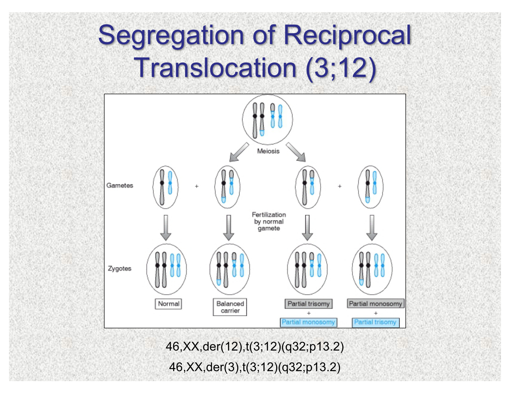</a>

Reciprocal translocation derivatives and imbalance · [TR] AHG Translocations PPT (1).pdf, page/slide 14.

### Quadrivalent and 2:2 segregation

* Normal A, normal B, der(A), der(B) align homologous DNA in **prophase I**.
* Four chromosomes form a cross-shaped **quadrivalent** at pachytene.
* Segregation describes chromosome movement to opposite poles.
* **Alternate:** normal A + normal B, or der(A) + der(B).
* Alternate produces normal or balanced gametes in the basic model.
* **Adjacent-1:** unlike/nonhomologous centromeres move together.
* Products: normal A + der(B), or der(A) + normal B.
* **Adjacent-2:** like/homologous centromeres move together.
* Products: normal A + der(A), or normal B + der(B).
* Adjacent products have reciprocal segmental duplication/deletion.
* Adjacent-1 is more common than adjacent-2.
* “Unlike/like centromeres” refers to chromosome identity, not chromosome length.

<a href="assets/review2/quadrivalent.jpg">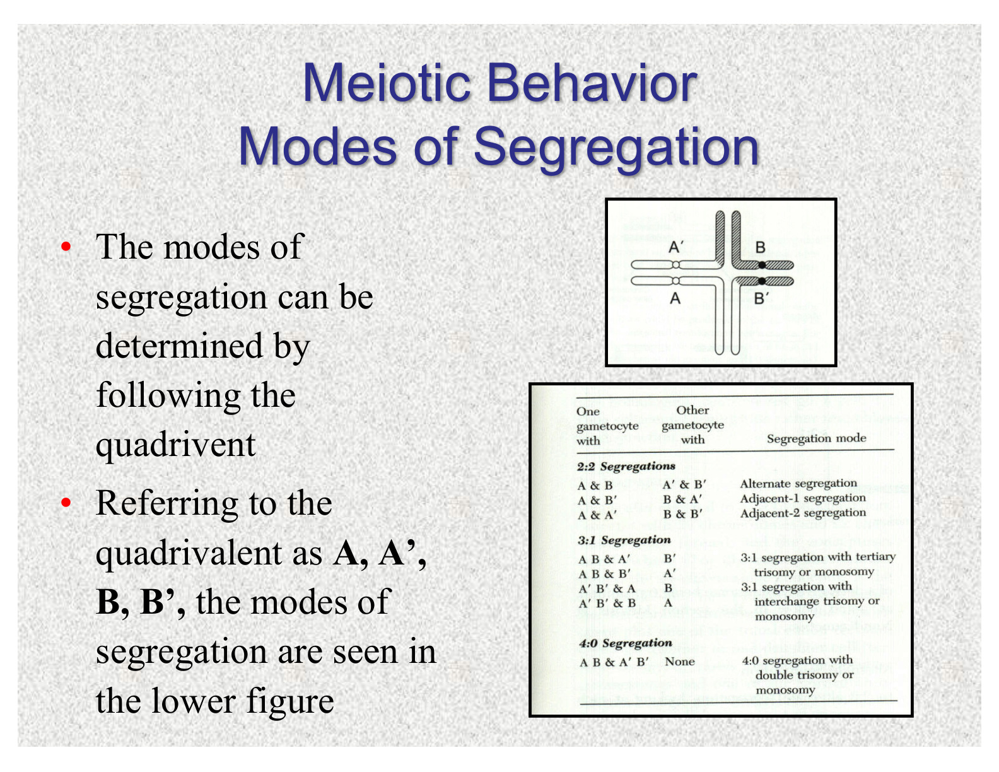</a>

Quadrivalent and segregation paths · [TR] AHG Translocations PPT (1).pdf, page/slide 17.
<a href="assets/review2/alternate.jpg">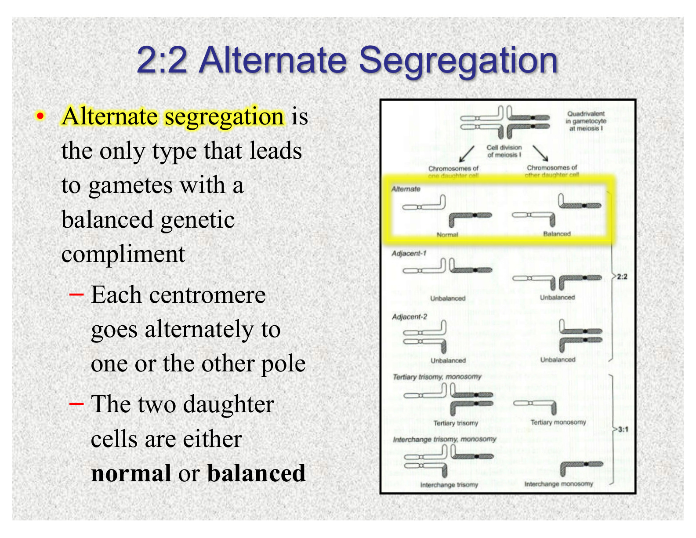</a>

Alternate segregation · [TR] AHG Translocations PPT (1).pdf, page/slide 18.
<a href="assets/review2/adjacent.jpg">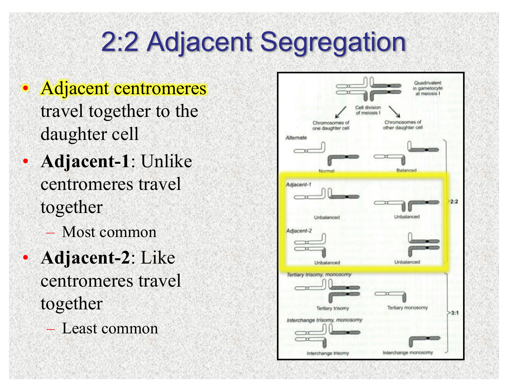</a>

Adjacent-1 versus adjacent-2 segregation · [TR] AHG Translocations PPT (1).pdf, page/slide 19.

### 3:1 segregation, tertiary, and interchange

* **3:1:** three chromosomes to one pole, one to the other.
* Basic autosomal model: gametes with **24 or 22 chromosomes**.
* **Tertiary trisomy gamete:** two normal chromosomes + one derivative.
* **Interchange trisomy gamete:** two derivatives + one normal chromosome.
* Corresponding one-chromosome products produce monosomic combinations after fertilization.
* **4:0:** all four to one pole; extreme imbalance, generally nonviable.
* **t(11;22)(q23;q11):** recurrent non-Robertsonian translocation; often shows 3:1 segregation.
* `47,XX,+der(22)t(11;22)(q23;q11)` → **tertiary trisomy/Emanuel syndrome**.
* Extra derivative contributes distal **11q23–qter** and proximal **22pter–q11** material.
* TBL extra der(22) answer: **3:1 tertiary**.

<a href="assets/review2/three-to-one.jpg">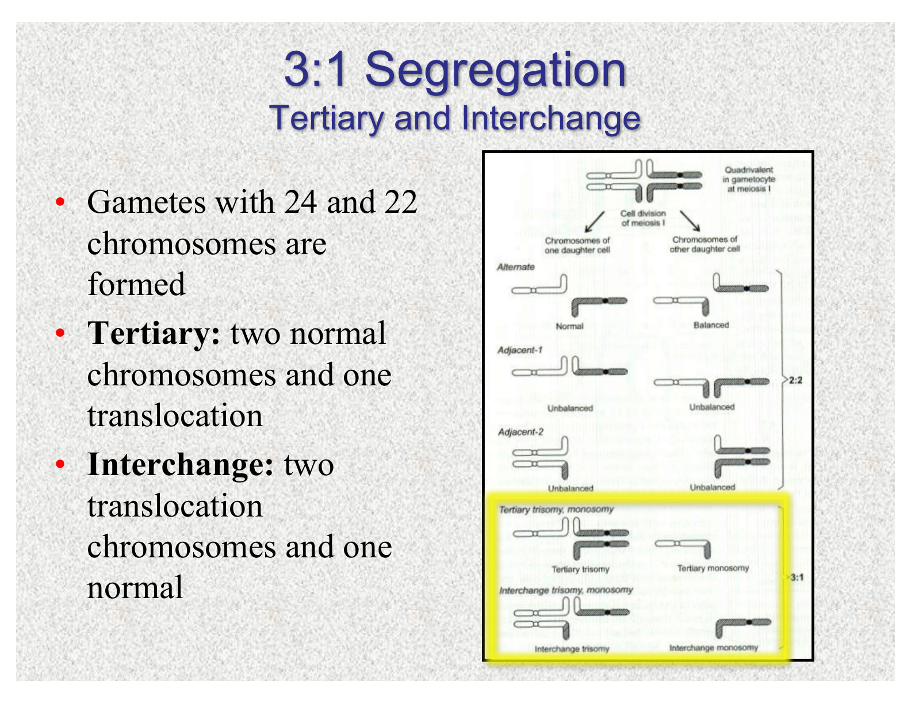</a>

Tertiary versus interchange 3:1 segregation · [TR] AHG Translocations PPT (1).pdf, page/slide 20.
<a href="assets/review2/emanuel.jpg">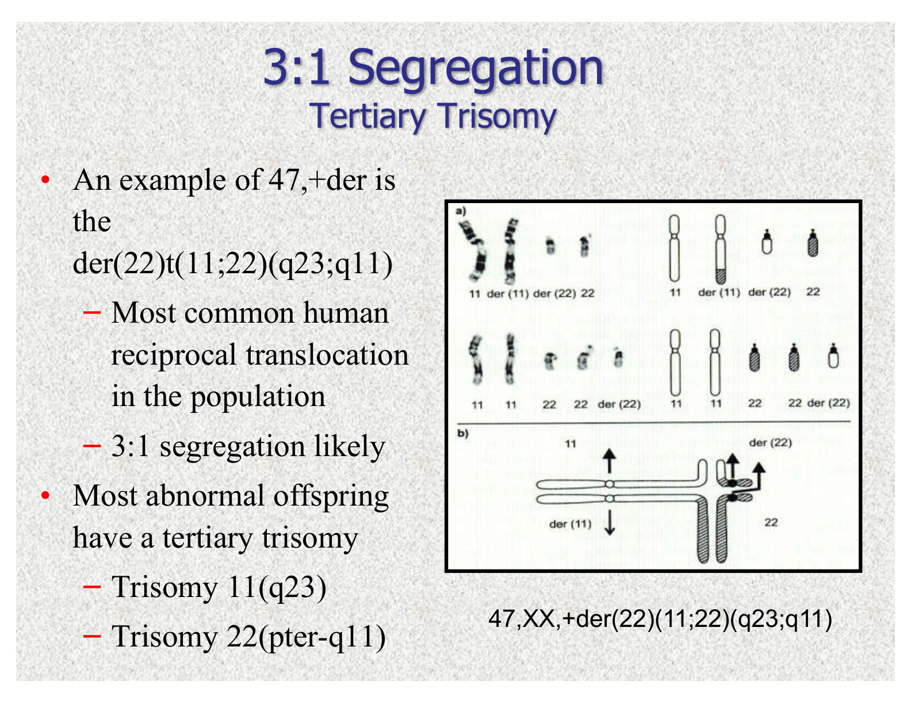</a>

Extra der(22) and tertiary trisomy · [TR] AHG Translocations PPT (1).pdf, page/slide 21.

### Predicting potentially viable segregation products

* Compare centric sizes, exchanged sizes, and overall quadrivalent shape.
* Small exchanged segments → adjacent-1 imbalance may be survivable.
* Small centric segments → adjacent-2 imbalance may be survivable.
* One small derivative/marked asymmetry → **3:1** may be favored.
* Mixed features can permit more than one viable malsegregation pattern.
* Large duplicated/deleted segments usually reduce survival.
* Subtelomeric rearrangements may pair as two bivalents and segregate independently.
* Least imbalance often has the greatest chance of survival.
* Gene content matters as well as physical size.
* These course rules predict viable products, not equal probabilities for every gamete.

<a href="assets/review2/segregation-rules.jpg">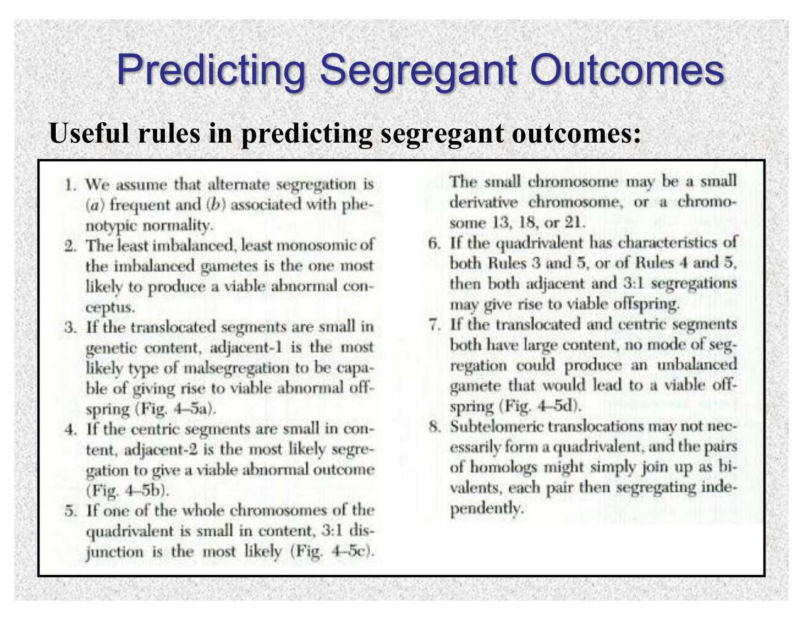</a>

Course rules for viable segregant outcomes · [TR] AHG Translocations PPT (1).pdf, page/slide 23.

### Reciprocal-translocation recurrence assessment

* **Ascertainment:** affected child, miscarriage, infertility, or incidental finding.
* An affected liveborn demonstrates viability of that particular imbalance.
* Miscarriages alone do not establish live-birth viability.
* Four risk factors: ascertainment, segregation pattern, transmitting-parent sex, imbalance.
* Course range: **0–30%**, depending on the specific rearrangement.
* Trace the actual chromosome content before assigning a recurrence estimate.
* Parent/family karyotypes establish whether the rearrangement is inherited.

### Worked t(4;10)(q33;q25.2) family

* Child: `46,XX,der(4)t(4;?)(q33;?)`.
* Mother: `46,XX`; father: `46,XY,t(4;10)(q33;q25.2)`.
* Daughter's der(4): **del(4q33–qter) + dup(10q25.2–qter)**.
* CMA defines loss/gain; metaphase FISH can locate selected added material.
* Small exchanged segments → course **single-segment** category; adjacent-1 is the key viable-imbalance pattern.
* Alternate gametes: **4 + 10**, or **der(4) + der(10)**.
* Adjacent-1 gametes: **4 + der(10)**, or **der(4) + 10**.
* Adjacent-2 gametes: **4 + der(4)**, or **10 + der(10)**.
* Adjacent-2: **dup proximal 4/del proximal 10**, or the reciprocal imbalance.
* Tertiary example: `47,XX,+der(10)t(4;10)(q33;q25.2)`.
* Interchange example: `47,XX,+4,t(4;10)(q33;q25.2)`.
* Draw all four chromosome types before following 3:1 centromere combinations.

Chromosome map for t(4;10)(q33;q25.2) · [TA] 2026AHG-TranslocationPPTwAnswers.pdf, page/slide 31.

t(4;10): tertiary and interchange gamete combinations · [TA] 2026AHG-TranslocationPPTwAnswers.pdf, page/slide 39.

t(4;10): tertiary and interchange notation · [TA] 2026AHG-TranslocationPPTwAnswers.pdf, page/slide 40.

### Extra translocation practice: 4;9 and 2;18

* `46,XX,t(4;9)(q13;q12)`: small centric segments → **adjacent-2**.
* Product: `46,XX,+der(4)t(4;9)(q13;q12),-9`.
* Reciprocal product: `46,XX,+der(9)t(4;9)(q13;q12),-4`.
* `46,XX,t(2;18)(q35;q12)`: asymmetric quadrivalent → **3:1**.
* Tertiary: `47,XX,+der(2)t(2;18)(q35;q12)`.
* Alternative tertiary: `47,XX,+der(18)t(2;18)(q35;q12)`.
* Interchange: `47,XX,+2,t(2;18)(q35;q12)`.
* Alternative interchange: `47,XX,+18,t(2;18)(q35;q12)`.
* These are the source key's shorthand forms; complete reports also specify origin when established.

## Robertsonian translocations

### Formation and balanced carriers

* Fusion of acrocentric long arms: **13, 14, 15, 21, 22**.
* Two long arms retained; short-arm material/NORs may be lost.
* Balanced carrier typically has **45 chromosomes**.
* Example: `45,XX,rob(14;21)(q10;q10)`.
* Course keys also use `der(14;21)(q10;q10)`.
* `p10;q10` in one lecture bullet conflicts with the standard q-arm fusion example.
* Course frequency: **~1/1,000**.
* **Heterologous:** two different acrocentrics; may transmit through generations.
* **Homologous:** two copies of the same chromosome; often de novo.
* Common overall: **rob(13;14)**, followed by **rob(14;21)**.
* Chromosome-21 Robertsonian rearrangements can cause translocation Down syndrome.
* Formation models: centric fusion, whole-arm exchange, or short-arm breakage/reunion.
* Short-arm breakage may produce structurally dicentric chromosomes.
* Lecture: rob(13;14) and rob(14;21) are often dicentric.
* Functional stability may involve centromere inactivation/coordinated activity.
* NOR redundancy usually permits phenotypically balanced carriers.
* Course model: 8 rather than 10 NOR sites; ~4–7 active sites suffice.

Mechanisms of Robertsonian chromosome formation · [TR] AHG Translocations PPT (1).pdf, page/slide 29.

### Trivalent pairing and Robertsonian gametes

* Derivative + two corresponding normal homologs form a **trivalent**.
* **Alternate 2:1:** derivative alone, or both normal homologs.
* Produces balanced-carrier or normal gametes.
* **Adjacent 2:1:** derivative + one normal homolog, or the remaining homolog alone.
* Six basic gamete types occur in the standard model.
* Fertilization can produce normal, balanced, trisomic, or monosomic outcomes.
* **3:0** segregation is rare and usually severely unbalanced.
* **rob(13;14)** gamete with 13 + 14 → normal offspring.
* Gamete with rob alone → balanced carrier.
* Gamete with rob + 13 → trisomy 13 after normal fertilization.
* Gamete with rob + 14 → trisomy 14 after normal fertilization.
* Gamete with 13 alone → monosomy 14.
* Gamete with 14 alone → monosomy 13.
* Complete unbalanced trisomies **13/21** can survive to birth.
* Complete trisomies 14/15/22 and corresponding monosomies usually miscarry.
* Balanced rob(14;15), rob(14;22), or rob(15;22) carriers can be healthy.
* “Lethal” in those slide examples refers to unbalanced conceptions, not balanced carriers.
* Alternate segregation is favored; carrier sex affects observed reproductive risks.

Robertsonian trivalent and gamete outcomes · [TR] AHG Translocations PPT (1).pdf, page/slide 33.

### Homologous Robertsonian outcomes

* Examples: **rob(21;21)** and **rob(13;13)**.
* **1:0 segregation:** fused chromosome enters a gamete, or does not.
* Gametes are disomic or nullisomic for that long arm.
* No normal/balanced gamete in the basic homologous-fusion model.
* Normal fertilization → trisomy or monosomy.
* 21;21: Down syndrome among surviving offspring; monosomy 21 is nonviable.
* 13;13: trisomy 13 among surviving offspring; monosomy 13 is nonviable.

Homologous Robertsonian segregation · [TR] AHG Translocations PPT (1).pdf, page/slide 36.

### Robertsonian trisomy rescue and imprinting

* Trisomic conception can lose an untranslocated homolog through mitotic rescue.
* Chromosome count may normalize while leaving **UPD**.
* **Chromosomes 14/15:** assess imprinting-related UPD risk.
* Course rule: evaluate UPD in a fetus with a balanced rob involving 14 or 15.
* No classic imprinting syndrome for UPD13/21/22 does not mean “never any effect.”
* Isodisomy can unmask recessive disease on other chromosomes.

Trisomy rescue and uniparental disomy · [TR] AHG Translocations PPT (1).pdf, page/slide 35.

### Robertsonian empirical risks and source differences

* **Risk endpoint matters:** amniocentesis finding ≠ affected live-birth risk.
* Homologous 13;13 and 21;21 “100%” means affected survivors.
* rob(13;14): lecture ~0.7–1%; TBL male live-birth risk **<1%**.
* Maternal rob(14;21): lecture ~15% at amnio, ~10% liveborn.
* Paternal rob(14;21): lecture ~1%; newer TBL table **<1%**.
* TBL maternal chromosome-21 rob estimates: **10–15%**.
* Historical phenotype deck: maternal 14;21 **10–12%**, paternal **1–5%**.
* rob(13;15): lecture ~1%; paternal TBL estimate <1%.
* rob(13;21): maternal ~10–15%; paternal ~1%/<1%, depending on source.
* rob(13;22): lecture <1%; some slide tables round maternal risk to 1%.
* rob(21;22): maternal liveborn ~10%; paternal ~1%/<1%, depending on source.
* **rob(15;21) conflict:** lecture text ~1%; lecture summary ~10% maternal/~1% paternal.
* Newer TBL summary groups maternal 15;21 at 10–15%.
* Use the question's assigned source and transmitting parent; do not merge conflicting percentages.
* The lecture's broad “~20% female risk” is not universal for all robs.

Lecture empirical Robertsonian risk table · [TR] AHG Translocations PPT (1).pdf, page/slide 40.

### Patau family and inherited-etiology clues

* Cleft lip + microcephaly + postaxial polydactyly + renal anomaly → suspect trisomy 13.
* Diagnosis plus recurrence mechanism → **karyotype**, not targeted FISH alone.
* Affected child: `46,XX,+13,der(13;14)(q10;q10)`.
* Balanced male carrier: `45,XY,der(13;14)(q10;q10)`.
* Known carrier with a pregnant sibling's partner → test the biologically related sibling promptly.
* TBL next test: **Ms. Lawrence's brother, karyotype**.
* Parental/grandparental studies can then trace the rearrangement through the family.
* Sister-in-law CMA does not establish her partner's balanced-carrier status.
* Maternal 14;21 Down risk > male 13;14 Patau live-birth risk.
* TBL: if father carries 14;21, both comparison risks are low; key says “no different.”
* Quiz pedigree **A** suggests inherited etiology: recurrent losses + affected relatives across generations.
* Apparently isolated Down syndrome does not prove a de novo mechanism; karyotype remains necessary.

Family with translocation trisomy 13 · [TA] 2026AHG-TranslocationPPTwAnswers.pdf, page/slide 15.

Pedigrees: inherited versus apparently sporadic Down syndrome · [TQ] TranslocationTBLQuizKey (1).docx, page/slide 2.

## Sex chromosome rearrangements

### X-inactivation, XIST, and mosaicism

* X aneuploidy is relatively tolerated compared with autosomal imbalance.
* **Lyonization:** early embryonic silencing of most genes on one X.
* Descendants generally preserve the same active/inactive-X choice.
* Dosage compensation is incomplete; some genes escape.
* Approximately 50:50 maternal/paternal active-X distribution is an expectation, not a requirement.
* Course estimate: 90% fall between **75:25 and 25:75**.
* **Skewed X-inactivation:** preferential silencing of one X.
* Examples: X-linked hypohidrotic ectodermal dysplasia and calico coat mosaicism.
* **XIC:** X-inactivation center; **XIST at Xq13.2**.
* XIST = **X-inactive specific transcript**, not “transport.”
* XIST is a cis-acting long noncoding RNA.
* RNA coats the chromosome from which it is transcribed.
* Chromatin changes/CpG methylation help maintain silencing.

### Pseudoautosomal regions and escape genes

* **PAR1:** shared Xp/Yp sequence; normal X–Y pairing/recombination.
* **SHOX in PAR1:** important for skeletal growth.
* Reduced SHOX dosage contributes to Turner short stature.
* Atypical X–Y recombination near PAR1 can transfer **SRY**.
* **46,XX with SRY:** may develop testes/male external phenotype.
* SRY loss can contribute to **46,XY gonadal dysgenesis**.
* PAR2 lies near Xq/Yq tips; gene behavior differs from PAR1.
* **PAR2 is not synonymous with all ovarian-function genes**.
* PAR1 genes generally escape X-inactivation; PAR2 has gene-specific exceptions.
* Course PAR count: ~29 genes; counts depend on annotation.
* Course non-PAR escape estimates vary: sex-translocation slides ~15%; phenotype slide ~20% total.
* Actual escape depends on gene, tissue, and individual.

Pseudoautosomal regions and escape from X-inactivation · [SX] Sex Chromosome Translocations PPT.pdf, page/slide 8.

### Measuring skewed X-inactivation

* AR/HUMARA-type testing uses the polymorphic **androgen-receptor CAG repeat**.
* Compare PCR before/after methylation-sensitive restriction digestion.
* Allelic amplification estimates preferential inactivation.
* Homozygosity at the tested marker can make the assay uninformative.
* Course thresholds: >**80–90%** supports skewing; lab cutoffs vary.
* Blood results may not reflect ovary, brain, or other tissues.
* A skewing result does not measure every gene's expression.

### Balanced X–autosome carriers

* Normal X is **usually preferentially inactivated**.
* Keeps derivative X/autosomal material active and avoids functional autosomal monosomy.
* Silencing der(X) could spread into attached autosomal material.
* X material on a derivative autosome may remain active.
* The derivative carrying **XIST/XIC** depends on the breakpoint.
* Do not assume XIC always remains on der(X).
* Structurally abnormal X chromosomes may be preferentially inactivated if the silencing machinery is retained.
* Breakpoints can disrupt ovarian-function regions or Mendelian disease genes.
* Course infertility figure: ~50% female carriers; male carriers described as infertile.
* Treat this as a course/cohort estimate, not an absolute prediction for every rearrangement.
* Assess dosage, breakpoints, gene disruption, XIC, and escape genes individually.
* TBL “sex translocations always have more consequences than autosomal translocations” → **False**.
* Greater tolerance can allow additional unbalanced conceptions to survive.

Balanced X–autosome translocation and preferred inactive X · [SX] Sex Chromosome Translocations PPT.pdf, page/slide 10.

### Unbalanced X–autosome products and functional dosage

* Preferential X-inactivation tends to favor the least harmful functional imbalance.
* Derivative X is often inactivated when it retains a functional XIC.
* Autosomal silencing may be incomplete; X-inactivation does not guarantee a normal phenotype.
* **Functional X disomy:** two active copies of an X segment.
* X material on an autosome may escape normal X-inactivation control.
* Normal maternal X + der(10) carrying Xp can produce functional Xp disomy.
* **Adjacent-1:** X disomy/deletion + autosomal duplication/deletion.
* **Adjacent-2:** X deletion/autosomal duplication, or X duplication/autosomal deletion.
* **3:1 tertiary trisomy:** X duplication, sometimes with autosomal duplication.
* **3:1 tertiary monosomy:** X deletion, sometimes with autosomal deletion.
* Inactivation belongs to resulting embryonic somatic cells, not mature gametes themselves.
* Fertile carrier outcomes range from mild sex-chromosome phenotypes to severe imbalance.

Unbalanced X–autosome translocation and X-inactivation · [SX] Sex Chromosome Translocations PPT.pdf, page/slide 11.

X material on an autosome and functional X disomy · [SX] Sex Chromosome Translocations PPT.pdf, page/slide 12.

### Worked t(7;X)(q32;q25) pregnancy

* Mother carries a balanced 7–X translocation; father `46,XY`.
* der(X): X centromere/proximal X + distal **7q32–qter**.
* der(7): chromosome-7 centromere/proximal 7 + distal **Xq25–qter**.
* XIC at Xq13.2 remains on **der(X)**.
* Balanced maternal somatic cells usually inactivate the **normal X**.
* Small translocated segments → course likely malsegregation **adjacent-1**.
* Alternate: **7 + X**, or **der(7) + der(X)**.
* Adjacent-1: **7 + der(X)**, or **der(7) + X**.
* `7 + der(X)` → **dup distal 7q + del distal Xq**.
* `der(7) + X` → **del distal 7q + dup distal Xq**.
* At 12 weeks: offer **CVS**, or later **amniocentesis**.
* Course answer: **high-resolution karyotype + microarray**.
* Karyotype identifies structure; microarray defines deleted/duplicated DNA.
* Targeted FISH can clarify a region but is not a complete substitute.
* Fetal `46,X,der(X)t(X;7)(q25;q32)` is equivalent in content to the course's notation.
* Expected CMA: **Xq25–qter deletion + 7q32–qter duplication**.
* Answer slide 31 says “Xq32–ter”; **q32 is a typo for q25**.
* Preferred somatic Xi: often der(X), retaining XIC.
* Spreading into attached 7q may reduce expression of duplicated material, variably.
* DNA copy-number imbalance remains detectable despite X-inactivation.
* Escape genes, incomplete spreading, and tissue differences limit phenotype prediction.
* Normal result: either normal X can become inactive.
* Balanced carrier fetus: normal X is usually preferentially inactive.

t(7;X)(q32;q25): carrier chromosomes and X-inactivation · [SA] 2026AHGSexChromesPPTwithAnswers.pdf, page/slide 19.

t(7;X): quadrivalent and likely adjacent-1 segregation · [SA] 2026AHGSexChromesPPTwithAnswers.pdf, page/slide 22.

t(7;X): balanced and unbalanced products · [SA] 2026AHGSexChromesPPTwithAnswers.pdf, page/slide 26.

Fetal der(X)t(7;X): preferred X-inactivation · [SA] 2026AHGSexChromesPPTwithAnswers.pdf, page/slide 34.

### Worked t(X;20)(q11.2;q11.2) infertility case

* Mother carries a balanced X–20 translocation; father `46,XY`.
* der(X): proximal X/X centromere + distal 20q.
* der(20): proximal 20/20 centromere + distal Xq.
* **XIC at Xq13.2 transfers to der(20)** in this case.
* Balanced carrier usually inactivates the normal X.
* Small centric segments + asymmetric quadrivalent → course **3:1** prediction.
* Alternate: **X + 20**, or **der(X) + der(20)**.
* Three-chromosome maternal products, after normal X-bearing fertilization:
  * **X + 20 + der(X):** dup proximal X/SHOX + dup distal 20q.
  * **X + 20 + der(20):** dup distal Xq + dup proximal 20.
  * **X + der(X) + der(20):** three X equivalents; course labels **Triple X**.
  * **20 + der(X) + der(20):** trisomy-20 dosage; generally nonviable.
* Complementary one-chromosome products:
  * **der(20) alone:** del proximal X + del distal 20q.
  * **der(X) alone:** del distal Xq + del proximal 20.
  * **20 alone:** **45,X**, course Turner outcome.
  * **X alone:** monosomy-20 dosage; generally nonviable.
* Slide shorthand “Xp/Xq” corresponds to segments defined by q11.2 breakpoints.
* Course emphasizes Triple-X/Turner-like products as the clearly survivable unbalanced examples.
* “Two of eight” theoretical products is not a 25% clinical pregnancy probability.
* Assign somatic Xi using the actual **XIC-bearing derivative**, not centromere name alone.
* Multiple X equivalents may require inactivation of more than one XIC-bearing chromosome.

t(X;20)(q11.2;q11.2): location of XIC · [SA] 2026AHGSexChromesPPTwithAnswers.pdf, page/slide 42.

t(X;20): lopsided quadrivalent · [SA] 2026AHGSexChromesPPTwithAnswers.pdf, page/slide 44.

t(X;20): 3:1 outcomes and preferred X-inactivation · [SA] 2026AHGSexChromesPPTwithAnswers.pdf, page/slide 48.

### SRY and amenorrhea quiz applications

* `46,X,t(X;10)(q22;q25)` + primary amenorrhea: quiz answer **C**.
* Key describes preferential normal-X inactivation and functional X effects.
* Balanced rearrangement does not itself prove a physical X deletion.
* Also consider Xq ovarian-region disruption and position effects.
* XX fetus with SRY: next test **FISH**; quiz answer **D**.
* FISH determines whether SRY lies on X or an autosome.
* Expected course phenotype: male with infertility; answer **E**.
* SRY transfer does not provide the full Y-linked spermatogenesis regions.
* Likely mechanism: atypical paternal X–Y recombination near the PAR boundary.
* Course recurrence: **~0.1%**, assuming an apparently de novo event.
* Fertility alone does not establish de novo status; parental studies can clarify origin.
* Microarray gives dosage/sequence presence, not a full banded karyotype.

### Y chromosome and Y–autosome translocations

* **SRY:** testis determination, Yp near PAR1.
* **AZFa, AZFb, AZFc:** Yq11 regions important for spermatogenesis.
* AZF labels describe regions containing multiple genes, not three single genes.
* Yq12 is largely repetitive heterochromatin; course approximation ~50% of Y.
* Lecture: loss of Y PAR2 often has no obvious phenotypic consequence.
* Course common type: ~70% involve an acrocentric autosome.
* Acrocentric break: **p11–p13**; Y break: **Yq12**.
* Usually no meaningful euchromatic imbalance; phenotype/fertility often preserved.
* About half of this common group involve **chromosome 15**.
* Other reciprocal Y–autosome exchanges may involve any autosome.
* Y breakpoint often **q11.2 or q12**; many are de novo.
* Infertility may prompt diagnosis despite an otherwise typical phenotype.
* Causes include AZF disruption/deletion or impaired meiotic pairing/segregation.
* A Yq12 breakpoint alone does not demonstrate AZF loss.

## Inversions

### Inversion types and notation

* **Inversion:** a chromosome segment reverses end-to-end.
* **Pericentric:** includes centromere; one p-arm and one q-arm breakpoint.
* **Paracentric:** both breakpoints within one arm; centromere excluded.
* Pericentric example: `46,XX,inv(3)(p25q21)`.
* Paracentric example: `46,XY,inv(18)(q13q24)`.
* Balanced carriers are often unaffected; breakpoint/cryptic imbalance exceptions exist.
* Inversion heterozygote: one normal homolog + one inverted homolog.

### Drawing an inversion loop

* Mark both breakpoints and the centromere on the normal chromosome.
* Reverse only the intervening segment in the inverted homolog.
* Pair identical loci in the same orientation by forming a loop.
* Replicate both homologs to show four chromatids.
* Place one crossover between **non-sister chromatids** inside the loop.
* Follow each chromatid continuously from one end to the other.
* Count centromeres and duplicated/deleted distal segments in each product.
* Four chromatid products do not imply equal clinical pregnancy probabilities.

Pericentric inversion loop and crossover · [IV] AHG-InversionPPT.pdf, page/slide 6.

### Pericentric recombinant products

* Two nonrecombinants: normal homolog (**aa′**) and balanced inverted homolog (**bb′**).
* Recombinant **cc′**: **dup distal p + del distal q**.
* Recombinant **dd′**: **dup distal q + del distal p**.
* Recombinants retain one centromere in the standard model.
* Small distal segments → smaller imbalance and potentially viable abnormal offspring.
* Large distal segments → larger imbalance and more pregnancy loss.
* Large inversion span often leaves smaller distal segments.
* Gene content and crossover frequency also affect risk.
* Child with del11p/dup11q: `46,XY,rec(11)dup(11q)inv(11)(p15.2q24.1)`.
* Inversion quiz notation answer: **D**; duplicated arm is **11q**.

Reciprocal dup(p)/del(q) and dup(q)/del(p) products · [IV] AHG-InversionPPT.pdf, page/slide 7.

### inv(8) worked examples

* TBL father: `46,XY,inv(8)(p22q24.1)`; mother `46,XX`.
* Balanced fetal inversion is expected to be phenotypically unaffected in the course example.
* Before risk estimation: parental karyotypes, family history, literature, imbalance assessment.
* Single crossover C–D: unbalanced sequences **ABCDEA** and **GFBCDEFG**; answer **B**.
* Compare end-segment dosage, rather than simply looking for reversed letter order.
* Father's sister has miscarriages but no known liveborn recombinant child.
* TBL liveborn recombinant risk: **~1%**, answer **C**.
* Separate handwritten example: `inv(8)(p23.1q24.1)`; do not substitute its p breakpoint.
* Handwritten recombinant boy: `46,XY,rec(8)dup(8p)inv(8)(p23.1q24.1)`.
* Reciprocal recombinant boy: `46,XY,rec(8)dup(8q)inv(8)(p23.1q24.1)`.

Worked inv(8)(p22q24.1) loop · [IA] 2026AHGInversionTBLwAnswers.pdf, page/slide 15.

Handwritten inv(8)(p23.1q24.1) solution · [IP] Inversion Problem Set ANSWERS.pdf, page/slide 1.

### Recombinant X and ovarian-function clues

* Female rec(X) imbalance may be mitigated by preferential abnormal-X inactivation.
* **del Xq/dup Xp:** normal/tall stature + ovarian dysgenesis in the course examples.
* **del Xp/dup Xq:** short stature; ovarian function may be relatively preserved.
* Exact breakpoints/escape genes determine the individual phenotype.
* Male rec(X) can have partial X nullisomy/disomy; usually severe/nonviable unless distal imbalance is small.
* Balanced inv(X) can transmit through males or females.
* Male non-PAR X lacks a homologous X partner for an inversion loop.
* X–Y recombination can still occur within PARs.
* An unaffected male carrier transmits his X to daughters, Y to sons.
* Gene/PAR disruption can affect phenotype/fertility; “all inv(X) males unaffected” is an oversimplification.
* **Tall + primary amenorrhea + rec(X)dup(Xp)** → maternal inversion recombination in the TBL.
* Mother's karyotype: **`46,X,inv(X)(p22q24)`**.
* Existing liveborn recombinant → course family recurrence **5–15%**.
* This is the carrier mother's recurrence category, not automatically the daughter's own reproductive risk.
* Handwritten short-stature sister example: **rec(X)dup(Xq)** from the same maternal inversion.
* Handwritten products: **ABCDE**, **ACBDE**, **ABCA**, **EDCBDE**.
* The short-stature patient receives the **dup(q)/del(p)** recombinant.

Handwritten recombinant X and inversion-loop solution · [IP] Inversion Problem Set ANSWERS.pdf, page/slide 1.

### Paracentric recombinant products and cases

* Normal and balanced inverted chromatids remain potentially viable.
* One crossover produces an **acentric fragment** and **dicentric chromatid**.
* Acentric material lacks a centromere; dicentric material forms an unstable bridge.
* Unbalanced products usually fail to yield viable offspring.
* Miscarriage risk and liveborn recombinant risk are different outcomes.
* Course liveborn risk: **0.1–0.5%**; TBL single-best answer **0.1%**.
* “Cannot produce unbalanced offspring” is a simplified model, not absolute zero risk.
* High-resolution banding may be needed to recognize a subtle paracentric inversion.
* `46,XX,inv(3)(q21q26)` quiz: viable gametes **ABCD and ACBD**; answer **B**.
* `46,XY,inv(3)(q25q27)` TBL: paracentric; unstable recombinant products explain losses.
* Handwritten `46,XX,inv(14)(q21.1q31.3)`: paracentric.
* inv(14) balanced products: **ABCDEF** and **ABCEDF**.
* inv(14) recombinants: `ABCDECBA` and `FEDE`, as traced in the source drawing.
* Inspect centromeres in the drawing; letter strings alone do not identify viability.
* Familial paracentric inv(X) may be silent; critical-region breakpoints can impair fertility.
* Historical inv(Y)(q11q21) family: unaffected older males; grandson had atypical genital development/Müllerian structures.
* A familial inversion does not exclude an additional cause of an atypical phenotype.

Worked paracentric inv(3)(q25q27) loop · [IA] 2026AHGInversionTBLwAnswers.pdf, page/slide 24.

Handwritten paracentric inv(14)(q21.1q31.3) solution · [IP] Inversion Problem Set ANSWERS.pdf, page/slide 2.

### Inversion recurrence, ascertainment, and prenatal diagnosis

* **No recombinant liveborn family history:** course estimate **~1%** for pericentric inversion.
* **Recombinant liveborn relative:** course estimate **5–15%**.
* Some texts use 5–10%; this uploaded course key uses **5–15%**.
* Existing affected survivor establishes viability of that recombinant imbalance.
* Miscarriages alone do not establish viability to birth.
* Highest-risk quiz option: **pericentric-inversion woman with a recombinant niece**, answer **C**.
* Small pericentric inversion with centromeric breakpoints → large distal imbalance → miscarriage more likely.
* Prenatal diagnosis: offer when the family has a recombinant child.
* Also assess listed high-risk inversions or larger comparable inversions.
* Course flags inversions involving **13, 18, 21** for prenatal discussion.
* Breakpoint near **15q11–q13:** assess for PWS/Angelman-region deletion.
* Individualize using breakpoints, genes, family outcomes, and published data.
* Paracentric-inversion TBL: offer prenatal options generally; not a high-risk indication by itself.
* Handwritten key says “not typically” for this indication; literature review can change the assessment.

Inversions listed for prenatal diagnosis in the lecture · [IV] AHG-InversionPPT.pdf, page/slide 10.

### Common inversion variants

* Course benign heterochromatic variants: **1, 9, 16, Y**.
* Examples: **inv(9)(p11q13)**, **inv(2)(p11q13)**, and selected Y heterochromatic inversions.
* Variant breakpoints matter; not every inversion on these chromosomes is benign.
* TBL lowest-risk listed inversion: **inv(9)(p11q13)**; answer **A**.
* “All autosomal inversions have phenotype/reproductive effects” → **False**.
* Course **inv(Y)(p11q13)** is treated as a benign variant.
* Historical Y-band labels vary; interpret the actual chromosome region/report.

## Source index

| ID | Uploaded file | Material merged |
|---|---|---|
| MI | AHG2022Mitosis&Meiosis.pptx | Chromosome structure, mitosis/meiosis, dosage, maternal-age effects, UPD |
| MH | AHG Meiosis and Mitosis Handout (1).pdf | Cell machinery, cell cycle, division stages, gametogenesis, nondisjunction |
| CH | AHG Cytogenetics Handout (1) (1).pdf | Banding, karyotype workflow, nomenclature, FISH, arrays, CNVs |
| CY | 2026AHG-CytoPPTwAnswers.pptx | Test selection, markers/linkage, RFLP cases, nondisjunction origin, mosaicism |
| MC | AHG-MolecularCytogeneticsPPT.pptx | FISH probes, array workflows/data, SNP interpretation, test capabilities |
| AN | Aneuploid syndrome phenotypes review.pptx | Seven aneuploid syndromes, features, mechanisms, care, recurrence |
| DE | Deletion syndromes.pdf | Contiguous gene syndromes, five deletion syndromes, prenatal/child cases |
| TR | AHG Translocations PPT (1).pdf | Structural rearrangements, reciprocal/Robertsonian segregation and risks |
| TA | 2026AHG-TranslocationPPTwAnswers.pdf | Patau pedigree, t(4;10) derivatives/gametes, tertiary/interchange notation |
| TQ | TranslocationTBLQuizKey (1).docx | Robertsonian notation, i(21q) risk, der(2), extra der(22), inherited pedigrees |
| TE | KEY AHG Extra Translocation Questions.docx | Adjacent-2 t(4;9) and 3:1 t(2;18) karyotype exercises |
| SX | Sex Chromosome Translocations PPT.pdf | XIST/XIC, PARs, functional X dosage, X–autosome/Y–autosome mechanisms |
| SA | 2026AHGSexChromesPPTwithAnswers.pdf | t(7;X) and t(X;20) cases, prenatal testing, dosage/X-inactivation diagrams |
| SQ | SexChromosomeTBLQuizKey.pdf | Amenorrhea key, SRY localization/phenotype/recurrence, true–false correction |
| IV | AHG-InversionPPT.pdf | Inversion loops/products, X inversions, variants, risks, prenatal criteria |
| IA | 2026AHGInversionTBLwAnswers.pdf | inv(8)/inv(3) worked cases, recombinant X, AR testing, answer explanations |
| IQ | AHGInversionTBLQuiz (1).pdf | Viable letter-sequence gametes, risk comparison, rec(11) notation, small inversion |
| IP | Inversion Problem Set ANSWERS.pdf | Handwritten inv(8), rec(X), inv(14) loop and gamete solutions |
| NQ | NondisjunctionTBLQuizKey.docx | Chromosome-6 markers, mosaic timing, painted homologs, trisomy-13 origin |

### References for corrections to simplified slide statements

* [GeneReviews: genetic testing, arrays, and UPD](https://www.ncbi.nlm.nih.gov/books/NBK279899/).
* [GeneReviews: imprinting errors and UPD](https://www.ncbi.nlm.nih.gov/books/NBK535150/).
* [X–autosome translocations and X-inactivation](https://pmc.ncbi.nlm.nih.gov/articles/PMC9969345/).
* [PAR2 gene expression and X-inactivation](https://pmc.ncbi.nlm.nih.gov/articles/PMC2034264/).
* [International Turner syndrome guidelines](https://pmc.ncbi.nlm.nih.gov/articles/PMC11759048/).
